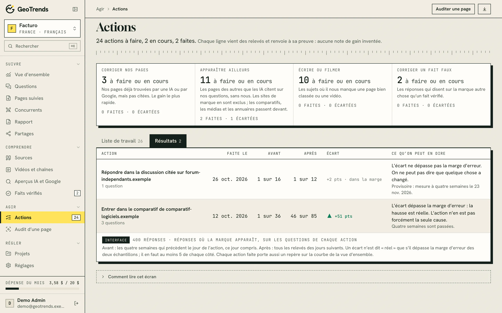

<!-- Page générée depuis la documentation du site (src/site/docs) par scripts/exporter-docs.ts : ne pas la modifier ici. -->

# Ma correction a-t-elle compté ?

> Marquer une action faite, lire la présence de la marque avant et après sur les questions concernées, et savoir ce qu’on peut en dire, et ce qu’on ne peut pas.

[← Sommaire de la documentation](../README.md) · [Read this page in English](../../en/use-cases/did-my-fix-work.md)

Il y a cinq semaines, après plusieurs échanges, comparatif-logiciels.exemple a ajouté Facturo à son comparatif. Depuis, la marque semble revenir plus souvent sur les questions où cette page est citée. L’équipe demande si l’effort a payé. La réponse honnête tient en deux temps : ce que les chiffres montrent, puis ce qu’ils ne prouvent pas.

## Ce qu’il vous faut

- Une action de la liste de travail passée à « fait », avec la bonne date.
- Des relevés d’interface dans les quatre semaines qui précèdent cette date, et après elle : au moins 5 réponses de chaque côté.
- Du temps : le résultat reste provisoire tant que quatre semaines ne sont pas passées.

## Étapes

1. **Marquer l’action faite, à la bonne date.** Sur **Actions**, passez la ligne à **Fait**. Dans sa fiche, le champ **Faite le** prend la date du jour ; corrigez-la si le changement a eu lieu un autre jour, par exemple le jour où le comparatif a été mis à jour. Notez ce qui a été fait dans **Note**.

2. **Lire l’avant et l’après.** La fiche de l’action affiche **Avant et après, sur** les questions concernées, en relevés d’interface : **Les quatre semaines d’avant** et **Depuis le …**, chacun en « k sur n » réponses où Facturo apparaît, puis l’écart et une phrase qui dit s’il dépasse la marge d’erreur. Avant quatre semaines, la fiche précise que le résultat est provisoire.

3. **Comparer toutes les actions faites.** L’onglet **Résultats** réunit les actions faites : **Faite le**, **Avant**, **Après**, **Écart** et **Ce qu’on peut en dire**. Une action sortie de la liste, parce que la page n’est plus citée sans vous, y garde sa fiche, sa note et son résultat.

   

4. **Chercher la trace dans les réponses.** Ouvrez les questions concernées et lisez les réponses d’après la date. La page où vous êtes entré est-elle citée dans les réponses qui nomment maintenant Facturo ? Sur l’écran **Réponses**, le filtre **Présence** sépare les réponses avec et sans la marque. C’est cette trace, plus que le chiffre, qui relie l’action à l’écart.

5. **Replacer l’action dans la courbe.** Sur **Vue d’ensemble**, un repère « Action faite » marque la courbe ce jour-là. Regardez les autres repères autour : un changement de modèle à la même période brouille la lecture. Si les relevés sont trop peu nombreux, une **Mesure approfondie** sur une question concernée ajoute des réponses du côté « après ».

   

## Ce que ça permet de décider

Continuer dans la même voie, par exemple viser d’autres comparatifs, attendre la mesure à quatre semaines, ou changer d’approche. Le résultat d’une action sert à orienter les suivantes, pas à attribuer un mérite.

> [!WARNING]
> **Avant d’agir**
>
> Un écart qui suit une action est une piste à vérifier, pas la preuve que l’action l’a causé. Pendant les mêmes semaines, un modèle a pu changer, un concurrent reculer, une autre page évoluer. L’outil compare les questions de l’action à elles-mêmes, sans groupe témoin. Même au-dessus de la marge, il écrit : « l’action n’en est pas forcément la seule cause ».

**Voir aussi**

- [Mesurer après une action](../agir/mesure-apres-action.md)
- [La liste de travail](../agir/liste-de-travail.md)
- [Méthode de mesure](../reference/methode.md)
- [Un chiffre a bougé : vraie évolution ou bruit ?](./evolution-ou-bruit.md)
- [Dans quelle page faut-il apparaître en premier ?](./pages-ou-apparaitre.md)

---

Mise à jour : 2026-11-18 · [Lire cette page sur le site](https://geotrends.io/cas-usage/effet-d-une-correction)
