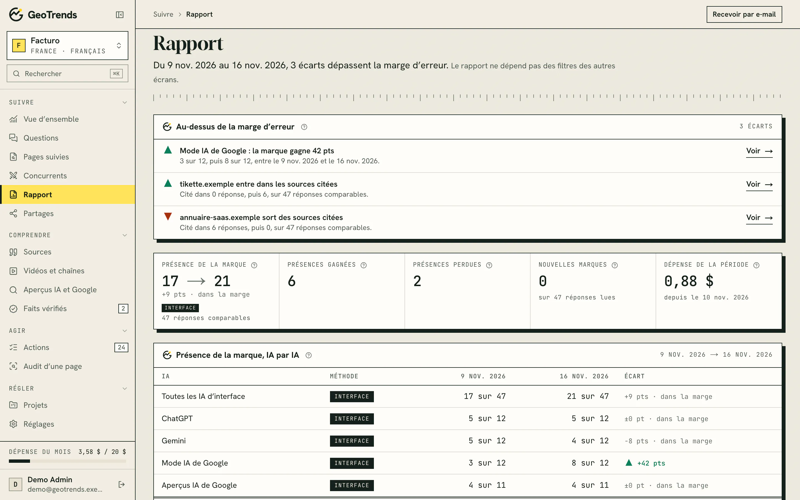
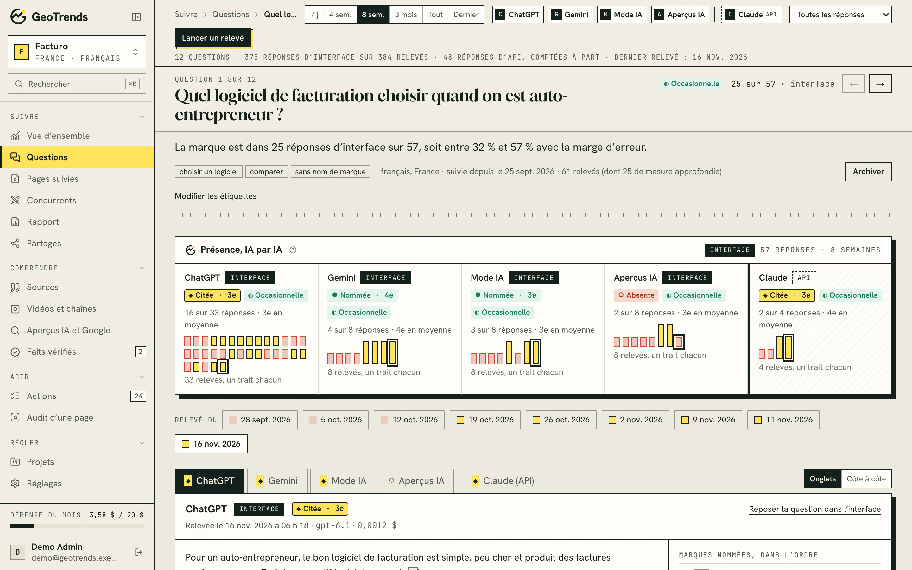

<!-- Page générée depuis la documentation du site (src/site/docs) par scripts/exporter-docs.ts : ne pas la modifier ici. -->

# Un chiffre a bougé : vraie évolution ou bruit ?

> Marge d’erreur, écarts colorés, repères sur la courbe et mesure approfondie : comment savoir si une hausse ou une baisse est réelle avant d’y réagir.

[← Sommaire de la documentation](../README.md) · [Read this page in English](../../en/use-cases/real-change-or-noise.md)

Lundi, la visibilité de Facturo a perdu quelques points. La semaine d’avant, elle en avait gagné. Une réponse d’IA est un tirage : posée deux fois, la même question ne reçoit pas la même réponse. Avant de chercher une cause, il faut savoir si l’écart dépasse ce que le hasard suffit à expliquer.

## Ce qu’il vous faut

- Au moins deux jours de relevé, pour avoir quelque chose à comparer.
- Assez de réponses de chaque côté : en dessous de 5, l’outil n’affiche pas de pourcentage et ne qualifie pas l’écart.

## Étapes

1. **Regarder la couleur de l’écart.** Sur **Vue d’ensemble**, chaque tuile compare la période choisie à celle d’avant. L’écart n’est coloré que s’il dépasse la marge d’erreur ; sinon il est marqué « dans la marge » ou « trop peu de relevés ». La bulle d’aide de **Visibilité** donne la marge : « entre … et … ». Changez la période dans la barre du haut pour comparer quatre semaines à quatre semaines, plutôt qu’un relevé à un autre.

2. **Lire la courbe avec sa bande.** Le graphique **Évolution, relevé après relevé** place un point par jour de relevé, relié par des segments droits, jamais lissés. Autour de la courbe principale, une bande grise trace la marge d’erreur : deux points dont les bandes se recouvrent ne se distinguent pas. L’option **Période précédente** ajoute la même mesure, en pointillé.

   

3. **Lire les repères.** Des repères marquent la courbe : un changement de modèle (« ChatGPT change de modèle : … devient … »), une action passée à « fait », une mesure approfondie. Un écart qui tombe le jour d’un changement de modèle peut venir de là, et pas de vous.

4. **Ne garder que ce qui dépasse la marge.** Ouvrez **Rapport**. Il compare les deux derniers jours de relevé, sur les seuls couples question et IA qui ont une réponse aux deux dates. Le bloc **Au-dessus de la marge d’erreur** ne liste que les écarts réels ; **Présence gagnée ou perdue, question par question** donne des indices, à confirmer. Les **Alertes** de la vue d’ensemble suivent la même règle.

   

5. **Trancher sur une question.** Une question seule a trop peu de réponses pour un verdict net. Sur sa page, le bloc **Mesure approfondie** la pose 5, 10 ou 25 fois de suite aux IA d’interface que vous cochez, avec le prix affiché avant l’envoi. Le verdict et la marge se recalculent ; ces relevés comptent pour cette question seulement, pas dans les chiffres d’ensemble.

   

## Ce que ça permet de décider

Réagir ou attendre. Un écart dans la marge ne demande rien, sinon le relevé suivant. Un écart au-dessus de la marge mérite une enquête : quelle IA, quelles questions, quel repère ce jour-là, quel concurrent est monté en même temps.

> [!WARNING]
> **Avant d’agir**
>
> Un écart « réel » dit que le chiffre a bougé, pas pourquoi : un nouveau modèle, un concurrent, une page modifiée ailleurs ou votre propre correction peuvent l’expliquer. La marge est calculée à 95 % : sur vingt écarts signalés, un peut encore venir du hasard. Le rapport et les alertes ignorent les filtres de la barre du haut ; les tuiles, elles, les suivent.

**Voir aussi**

- [Méthode de mesure](../reference/methode.md)
- [Mesure approfondie](../mesurer/mesure-approfondie.md)
- [Rapport et alertes](../piloter/rapport-et-alertes.md)
- [Vue d’ensemble](../mesurer/vue-d-ensemble.md)
- [Ma correction a-t-elle compté ?](./effet-d-une-correction.md)

---

Mise à jour : 2026-11-18 · [Lire cette page sur le site](https://geotrends.io/cas-usage/evolution-ou-bruit)
