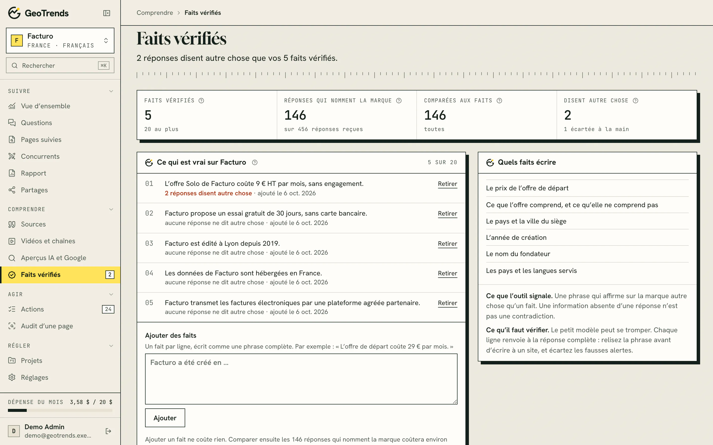

<!-- Page générée depuis la documentation du site (src/site/docs) par scripts/exporter-docs.ts : ne pas la modifier ici. -->

# Une IA répète une information fausse sur ma marque : que faire ?

> Écrire ce qui est vrai sur la marque, repérer les réponses qui disent autre chose, remonter à la page qui sert de source, puis corriger ou demander une correction.

[← Sommaire de la documentation](../README.md) · [Read this page in English](../../en/use-cases/wrong-information.md)

Un prospect vous écrit que Facturo « coûte plus cher que prévu ». Il a lu un prix dans une réponse d’IA, et ce prix n’est plus le vôtre depuis longtemps. Une erreur répétée par une IA se propage sans bruit : il faut la repérer, retrouver d’où elle vient, et la corriger à la source.

## Ce qu’il vous faut

- Des faits vérifiés sur la marque, écrits par vous : un prix, une offre, un pays, une date de création. Vingt au plus par projet ; les saisir est gratuit.
- Des réponses qui nomment Facturo. Les questions qui contiennent le nom de la marque en donnent le plus.
- Un premier clic payant pour comparer les réponses déjà relevées ; les suivantes sont comparées pendant leur lecture automatique, sans appel en plus.

## Étapes

1. **Écrire ce qui est vrai.** Ouvrez **Faits vérifiés**. Dans **Ce qui est vrai sur Facturo**, écrivez un fait par ligne, comme une phrase complète, précise et vérifiable : le prix de l’offre de départ, les pays servis, la date de création. Le bloc **Quels faits écrire** donne des exemples. Cinq à vingt faits suffisent.

2. **Comparer les réponses aux faits.** Le bouton **Vérifier les réponses** affiche son prix avant le clic. Un petit modèle relit chaque réponse qui nomme Facturo et relève les phrases qui contredisent un fait. Les réponses qui ne nomment pas la marque ne sont pas relues : elles ne peuvent pas la contredire.

3. **Lire les contradictions.** Le tableau **Réponses qui disent autre chose** donne, pour chaque phrase, le **Fait vérifié** contredit, **Ce que dit la réponse**, l’IA et sa méthode (interface ou API), la **Source citée à l’appui**, un lien vers la réponse complète et la **Suite à donner**. Une fausse alerte s’écarte avec **Écarter (fausse alerte)**.

   

4. **Remonter à la source.** Si la phrase s’appuie sur une page de facturo.exemple, corrigez votre page : une ancienne grille tarifaire oubliée suffit à tromper une IA. Si la page est celle d’un autre site, son auteur peut la corriger. Si aucune source n’est citée, vérifiez que vos propres pages disent ce fait clairement, à un endroit facile à trouver.

5. **Suivre la correction.** Chaque contradiction est aussi une ligne d’**Actions**, dans le groupe **Corriger un fait faux**. Notez-y la **Demande de correction** envoyée dans **Prises de contact**, puis passez la ligne à **Fait** quand la source est corrigée. Les relevés suivants diront si la phrase revient.

## Ce que ça permet de décider

Qui doit corriger quoi : votre équipe si la source est à vous, l’auteur d’une page tierce sinon, et une page plus claire de votre côté quand l’IA ne cite rien. Et quelles erreurs passent en premier : celles qui reviennent chez plusieurs IA, ou qui touchent au prix.

> [!WARNING]
> **Avant d’agir**
>
> Le petit modèle peut se tromper : relisez la phrase dans la réponse complète avant d’écrire à un site. Une information absente d’une réponse n’est pas une contradiction. Ici, interface et API sont comptées ensemble, parce qu’on relit des phrases au lieu de mesurer une part ; chaque ligne dit sa méthode. Une source corrigée peut mettre du temps à disparaître des réponses, et rien ne garantit qu’elle disparaîtra.

**Voir aussi**

- [Faits vérifiés](../comprendre/faits-verifies.md)
- [Suivre une action et ses prises de contact](../agir/prises-de-contact.md)
- [La liste de travail](../agir/liste-de-travail.md)
- [Avec ou sans nom de marque : comment répartir mes questions ?](./questions-avec-ou-sans-marque.md)
- [Ma correction a-t-elle compté ?](./effet-d-une-correction.md)

---

Mise à jour : 2026-11-18 · [Lire cette page sur le site](https://geotrends.io/cas-usage/information-fausse)
