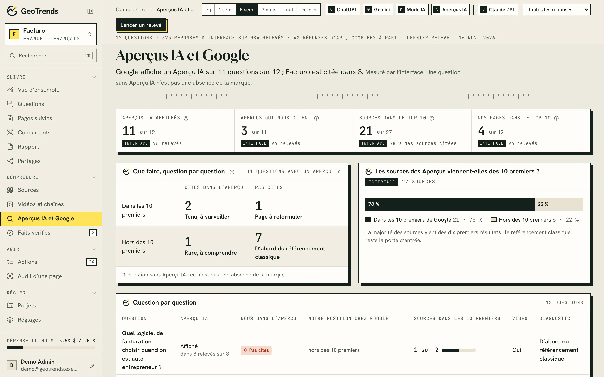
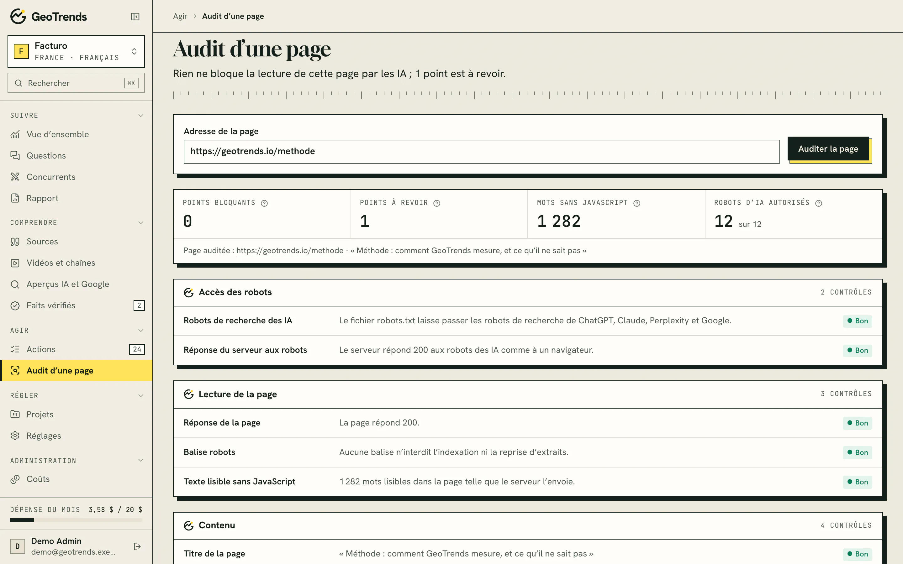

<!-- Page générée depuis la documentation du site (src/site/docs) par scripts/exporter-docs.ts : ne pas la modifier ici. -->

# Ma page est lue mais pas citée : que corriger ?

> Une IA ouvre votre page puis cite celle d’un autre, ou Google la classe sans la reprendre dans son Aperçu IA : comment le voir, comparer et reformuler.

[← Sommaire de la documentation](../README.md) · [Read this page in English](../../en/use-cases/page-read-not-cited.md)

ChatGPT ouvre la page « Facturer en auto-entrepreneur » de facturo.exemple, puis répond en citant un comparatif et la page d’un concurrent. Votre page a été trouvée : c’est le plus dur. Elle a été écartée : c’est ce qu’il faut corriger. C’est souvent le gain le plus rapide de la liste de travail.

## Ce qu’il vous faut

- Des relevés de ChatGPT ou de Claude : ce sont les seules IA qui disent quelles pages elles ont lues sans les citer.
- Pour le cas de Google : des relevés des Aperçus IA, qui rapportent aussi les dix premiers résultats classiques.
- Le site de la marque déclaré dans le projet.

## Étapes

1. **Trouver vos pages écartées.** Ouvrez **Sources**, onglet **Nos pages**. Pour chaque page de Facturo : le nombre de réponses où elle est **Citée**, le nombre de fois où elle a été **Lue sans être citée**, sa place **Chez Google** sur vos questions, et les **Pages citées à sa place**.

2. **Comparer avec les pages citées à sa place.** Ouvrez les pages citées à la place de la vôtre, puis la page de la question concernée. Le bloc **Les pages qui font gagner** liste les pages citées par deux IA ou plus. Regardez ce qu’elles ont et que la vôtre n’a pas : une réponse dès les premières lignes, un tableau, un prix, une date.

3. **Repérer le cas de Google.** Ouvrez **Aperçus IA et Google**. Le tableau **Que faire, question par question** croise deux questions : êtes-vous dans les dix premiers résultats, et l’Aperçu vous cite-t-il ? La case **Page à reformuler** compte les questions où votre page est bien classée mais absente de l’Aperçu. Un clic filtre le détail.

   

4. **Ouvrir la ligne de travail et auditer la page.** Sur **Actions**, le groupe **Corriger nos pages** contient « Reformuler une page lue par l’IA mais pas citée » et « Reformuler la page classée n° … sur Google, absente de l’Aperçu IA ». Le lien **Auditer cette page** lance **Audit d’une page** : d’abord les **Points bloquants**, puis les **Points à revoir** (titre principal, sous-titres, texte lisible sans JavaScript, données structurées, date).

   

5. **Reformuler, puis marquer l’action faite.** Réécrivez la page pour qu’elle réponde à la question en tête, nettement, avec ce que donnent les pages citées à sa place. Puis passez la ligne à **Fait**, à la date de mise en ligne : l’outil comparera la présence de Facturo sur ces questions avant et après.

## Ce que ça permet de décider

Quelle page réécrire en premier, et dans quel sens. Une page lue par plusieurs IA, ou classée dans les dix premiers sans être reprise, passe avant une page jamais trouvée : celle-là a d’abord un problème de référencement.

> [!WARNING]
> **Avant d’agir**
>
> Gemini et Google ne disent pas quelles pages ils ont lues : chez eux, une page écartée ne se voit pas. Une page lue une seule fois peut l’avoir été par hasard. L’audit dit ce qui empêche une IA de lire ou de reprendre la page, pas si elle sera citée. Et une hausse après la réécriture est un indice à vérifier, pas la preuve que la réécriture l’a causée.

**Voir aussi**

- [Sources citées](../comprendre/sources.md)
- [Aperçus IA et résultats de Google](../comprendre/google.md)
- [Audit d’une page](../agir/audit.md)
- [Les robots des IA peuvent-ils lire ma page ?](./robots-des-ia.md)
- [Ma correction a-t-elle compté ?](./effet-d-une-correction.md)

---

Mise à jour : 2026-11-18 · [Lire cette page sur le site](https://geotrends.io/cas-usage/page-lue-pas-citee)
