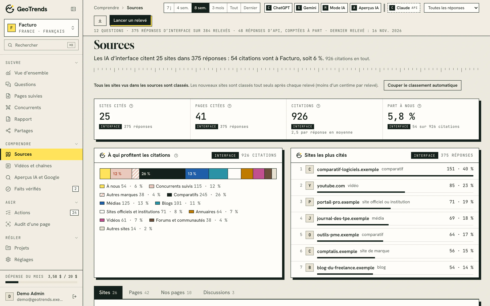
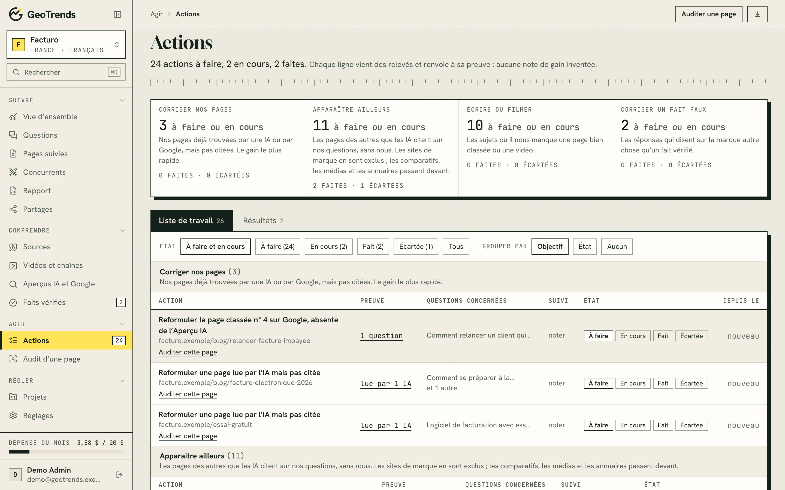

<!-- Page générée depuis la documentation du site (src/site/docs) par scripts/exporter-docs.ts : ne pas la modifier ici. -->

# Dans quelle page faut-il apparaître en premier ?

> Les pages que les IA citent sur vos questions sans vous, classées par type de site, et la façon de choisir celle où demander une place, puis de suivre la démarche.

[← Sommaire de la documentation](../README.md) · [Read this page in English](../../en/use-cases/pages-to-appear-on.md)

Sur vos questions, les IA citent des pages d’autres sites : un comparatif de logiciels, un article de média, un annuaire, un fil de forum. Facturo n’y figure pas. Vous ne pouvez pas écrire à tout le monde. Il faut choisir la page où une place compte le plus, et commencer par elle.

## Ce qu’il vous faut

- Des relevés d’interface avec leurs sources citées.
- Les sites classés par type. Le classement se lance une fois, d’un clic, pour quelques centimes ; les nouveaux sites sont ensuite classés tout seuls.
- Le site et les propriétés de Facturo déclarés, pour que l’outil sache quelles pages sont les vôtres.

## Étapes

1. **Classer les sites cités.** Ouvrez **Sources**. Si des sites ne sont pas encore classés, le bandeau propose **Classer les sites**, avec son prix. Chaque site reçoit un type (comparatif, média, blog, forum, annuaire, site de marque, site officiel, boutique) et un propriétaire : à nous, concurrent suivi, autre marque ou tiers. La barre **À qui profitent les citations** montre la répartition. Un type faux se corrige à la main, sur la fiche du site.

   

2. **Lister les pages citées sans vous.** Passez à l’onglet **Pages** et choisissez **Seulement les pages citées sans nous**. Chaque ligne donne la **Page**, son **Type**, **À qui** elle appartient, le nombre de **Réponses** qui la citent, la colonne **Dont sans nous** (celles où Facturo n’apparaît pas) et les **IA** qui la citent. Triez sur **Dont sans nous**.

3. **Ouvrir la fiche d’une page.** Un clic sur une ligne ouvre la fiche : les réponses qui citent la page, les marques nommées dans ces réponses, le type du site. Si la page n’est pas déjà dans la liste de travail, le bouton **Ajouter à la liste de travail** l’y met.

4. **Lire la liste de travail.** Ouvrez **Actions**. Le groupe **Apparaître ailleurs** réunit les pages des autres que les IA citent sans vous ; les sites de marque en sont exclus, les comparatifs, les médias et les annuaires passent devant. Chaque ligne dit quoi faire, par exemple « Entrer dans le comparatif de comparatif-logiciels.exemple », et la colonne **Preuve** compte les réponses et les IA concernées.

   

5. **Lancer la démarche et la noter.** Ouvrez la ligne retenue et passez-la **En cours**. Dans **Prises de contact**, notez chaque message : le type de démarche (**Demande d’ajout**, **Proposition de test**, **Réponse dans un fil**…), la date, la personne contactée, ce qui a été demandé, puis **Ajouter au journal**. Quand la réponse arrive, marquez-la : **Réponse favorable**, **Refus** ou **Sans réponse**.

## Ce que ça permet de décider

Par quelle page commencer : celle qui est citée sans vous dans le plus de réponses, par le plus d’IA, sur un site où une place se demande (un comparatif, un média, un annuaire). Pour un fil de forum, l’onglet **Discussions** liste les endroits où il est encore possible de répondre.

> [!WARNING]
> **Avant d’agir**
>
> Le contenu des pages citées n’est pas lu : les marques de la fiche sont celles des réponses, pas celles de la page. L’outil ne connaît pas le trafic d’une page, faute de lien avec Google Analytics ou la Search Console. Une page citée dans une seule réponse peut l’être par hasard. Et entrer dans un comparatif ne garantit pas d’être cité : la mesure suivante le dira.

**Voir aussi**

- [Sources citées](../comprendre/sources.md)
- [La liste de travail](../agir/liste-de-travail.md)
- [Suivre une action et ses prises de contact](../agir/prises-de-contact.md)
- [Qui est cité à ma place ?](./qui-est-cite-a-ma-place.md)
- [Ma correction a-t-elle compté ?](./effet-d-une-correction.md)

---

Mise à jour : 2026-11-18 · [Lire cette page sur le site](https://geotrends.io/cas-usage/pages-ou-apparaitre)
