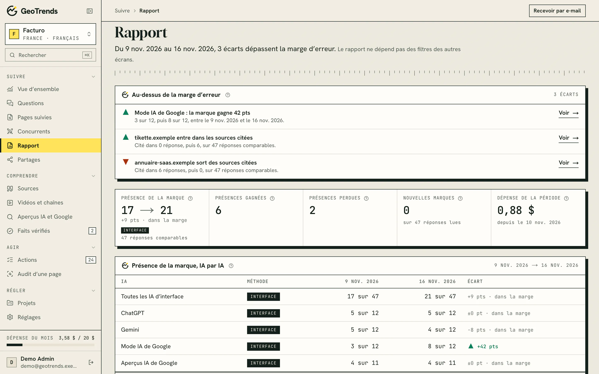
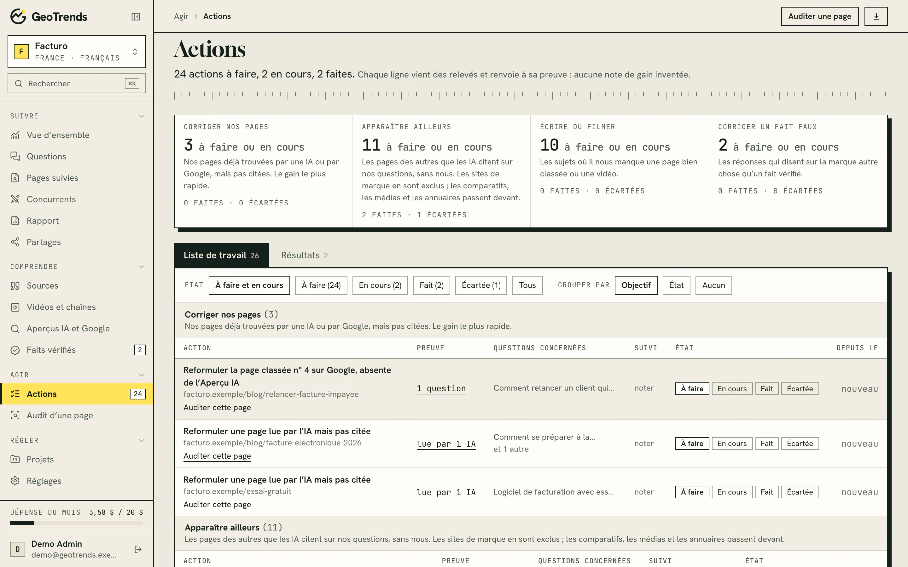

<!-- Page générée depuis la documentation du site (src/site/docs) par scripts/exporter-docs.ts : ne pas la modifier ici. -->

# Comment préparer le point du lundi avec l’équipe ?

> Le rapport compare les deux derniers relevés, la liste de travail dit quoi faire, les exports donnent les données : un ordre du jour en un quart d’heure, sans bruit.

[← Sommaire de la documentation](../README.md) · [Read this page in English](../../en/use-cases/monday-team-meeting.md)

Chaque lundi, l’équipe de Facturo passe un quart d’heure sur sa présence dans les IA. Sans préparation, la réunion commente le moindre point de visibilité gagné ou perdu. Avec le rapport, elle part de ce qui a vraiment changé, et finit sur qui fait quoi cette semaine.

## Ce qu’il vous faut

- Au moins deux jours de relevé : le rapport compare les deux derniers. Avec les relevés automatiques activés, ils arrivent chaque semaine sans y penser.
- Une liste de travail à jour : les états des actions, leurs notes et leurs prises de contact.

## Étapes

1. **Partir du rapport.** Ouvrez **Rapport**. Il compare les deux derniers jours de relevé du projet, sans tenir compte des filtres des autres écrans. En tête, **Au-dessus de la marge d’erreur** : les seuls changements qu’on peut tenir pour réels. Viennent ensuite les tuiles (**Présence de la marque**, **Présences gagnées**, **Présences perdues**, **Nouvelles marques**, **Dépense de la période**) et **Présence de la marque, IA par IA**.

   

2. **Lire les indices, sans s’y arrêter.** **Présence gagnée ou perdue, question par question**, **Marques nommées pour la première fois** et **Sources gagnées et perdues** donnent des pistes. Avec une seule réponse par question et par IA à chaque date, ce sont des indices : notez ceux qui reviennent d’une semaine à l’autre, ou lancez une mesure approfondie sur la question.

3. **Fixer les actions de la semaine.** Le bloc **Les trois actions les plus utiles** reprend la tête de la liste de travail. Sur **Actions**, passez en revue les lignes **En cours**, leurs **Prises de contact** et les réponses reçues ; décidez qui reprend quoi, et passez à **Fait** ce qui l’est. L’onglet **Résultats** montre l’avant et l’après des actions déjà faites.

   

4. **Exporter ce qu’il faut garder.** Le bouton **Exporter** de la barre du haut télécharge les données de l’écran en CSV : une ligne par réponse relevée depuis **Vue d’ensemble** ou **Questions**, les sources depuis **Sources**, la liste de travail depuis **Actions**. Chaque graphique a aussi son propre téléchargement. Les comptes administrateurs exportent tous les appels payants depuis **Coûts**.

5. **Voir l’e-mail du lundi.** En bas du rapport, **Recevoir ce rapport par e-mail** montre la version courte prévue pour l’équipe, avec **Voir l’e-mail tel qu’il sera envoyé**. Aujourd’hui, l’e-mail ne part pas : la clé du service d’envoi n’est pas installée, et l’écran le dit. Le rapport se lit sur l’écran, ou se partage par ses exports.

## Ce que ça permet de décider

L’ordre du jour : ce qui a changé au-delà de la marge, et pourquoi on le pense ; les trois actions de la semaine et leurs responsables ; les démarches à relancer. Le reste attend le relevé suivant.

> [!WARNING]
> **Avant d’agir**
>
> Le rapport compare deux dates, pas deux périodes : pour une tendance, lisez **Vue d’ensemble** sur quatre ou huit semaines. Les mesures approfondies n’entrent pas dans sa comparaison. Il n’existe ni export PDF ni lien de partage public : les exports sont des fichiers CSV, et l’outil reste réservé aux comptes de l’équipe.

**Voir aussi**

- [Rapport et alertes](../piloter/rapport-et-alertes.md)
- [Exports CSV](../piloter/exports.md)
- [La liste de travail](../agir/liste-de-travail.md)
- [Un chiffre a bougé : vraie évolution ou bruit ?](./evolution-ou-bruit.md)
- [Ma correction a-t-elle compté ?](./effet-d-une-correction.md)

---

Mise à jour : 2026-11-18 · [Lire cette page sur le site](https://geotrends.io/cas-usage/point-du-lundi)
