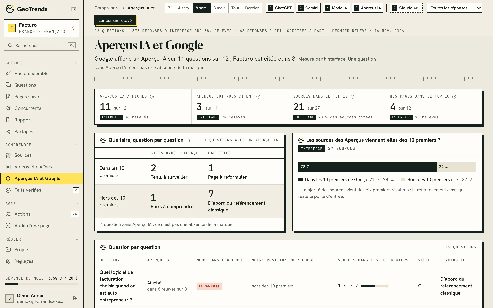
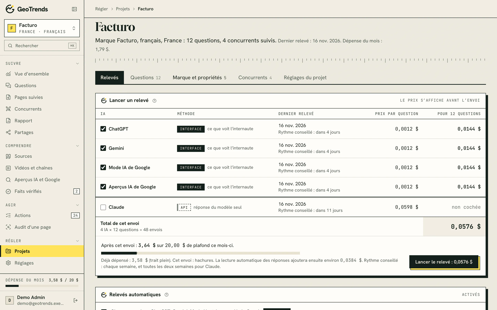

<!-- Page générée depuis la documentation du site (src/site/docs) par scripts/exporter-docs.ts : ne pas la modifier ici. -->

# Quelles IA regarder en premier, et pourquoi Claude est-il à part ?

> Quatre IA relevées par l’interface, une par son API : comment les comparer, par laquelle commencer, et pourquoi le chiffre de Claude ne s’additionne jamais.

[← Sommaire de la documentation](../README.md) · [Read this page in English](../../en/use-cases/which-ai-engines-first.md)

GeoTrends relève cinq IA. Quatre par leur interface, comme un internaute les voit : ChatGPT, Gemini, le Mode IA et les Aperçus IA de Google. La cinquième, Claude, par son API : c’est la réponse du modèle seul. Avec quelques heures par semaine pour Facturo, il faut choisir où regarder d’abord.

## Ce qu’il vous faut

- Au moins un relevé des quatre IA d’interface sur les questions du projet.
- Pour le repère de Claude : des relevés de Claude, cochés au moment de lancer un relevé ou activés toutes les deux semaines.

## Étapes

1. **Comparer les IA d’interface.** Ouvrez **Vue d’ensemble**. Les tuiles du haut portent sur les quatre IA d’interface réunies. Plus bas, le tableau **Présence, IA par IA** donne une ligne par IA, sans jamais les additionner : **Relevés**, **Visibilité**, **Écart**, **Site cité**, **Vidéo citée**, **Nom seul**, **Lu, non cité**. Les étiquettes « la plus forte » et « la plus faible » n’apparaissent que si au moins deux IA ont assez de réponses pour être comparées. Sous chaque nom, le modèle qui a répondu.

   

2. **Regarder Google à part.** Ouvrez **Aperçus IA et Google**. La tuile **Aperçus IA affichés** dit sur combien de questions Google affiche un Aperçu IA. Une question sans Aperçu sort du calcul : ce n’est pas une absence de Facturo, et ce n’est pas une question à travailler pour Google. Le bloc **Que faire, question par question** croise les dix premiers résultats de Google et les sources de l’Aperçu.

   

3. **Lire une IA seule.** Dans la barre du haut, le filtre **IA** masque ou affiche chaque IA. Une IA masquée sort des chiffres de tous les écrans, sans que rien ne soit effacé : pratique pour lire ChatGPT seul, puis Gemini seul.

4. **Lire Claude à part.** Sur **Vue d’ensemble**, la tuile **Claude (API)** et le bloc **Claude, mesuré par son API** ont leur propre chiffre et leur propre courbe, en pointillé. Dans les tableaux, la colonne de Claude est séparée des autres par un double filet. Son chiffre dit si le modèle connaît Facturo et la recommande ; il ne dit pas ce qu’affiche l’application Claude.

5. **Choisir le rythme et le prix.** Ouvrez la fiche du projet, onglet **Relevés**. Le prix par question de chaque IA s’affiche avant tout envoi : 0,0012 $ par l’interface, environ 0,06 $ pour Claude. Le bloc **Relevés automatiques** propose chaque semaine pour les quatre IA d’interface, toutes les deux semaines pour Claude.

   

## Ce que ça permet de décider

Par quelle IA commencer le travail : en général celle d’interface où Facturo est la plus faible, en gardant ChatGPT près des yeux parce qu’il dit aussi les pages lues sans être citées et les recherches lancées. Pour Google, ne travailler que les questions où un Aperçu IA s’affiche. Et s’il faut payer Claude : utile comme repère sur le modèle, pas comme mesure de ce que voient vos clients.

> [!WARNING]
> **Avant d’agir**
>
> Perplexity et Copilot ne sont pas suivis. Claude est interrogé par son API, recherche web activée : un écart entre Claude et ChatGPT peut venir de la méthode autant que du modèle. Gemini et Google ne donnent ni les pages lues sans être citées, ni les recherches lancées. Tous les relevés partent d’une session neutre, sans historique : une personne connectée peut recevoir une autre réponse.

**Voir aussi**

- [Les IA suivies](../reference/ia-suivies.md)
- [Méthode de mesure](../reference/methode.md)
- [Vue d’ensemble](../mesurer/vue-d-ensemble.md)
- [Relevés automatiques](../projet/releves-automatiques.md)
- [ChatGPT cite-t-il ma marque, et sur quelles questions ?](./chatgpt-cite-t-il-ma-marque.md)

---

Mise à jour : 2026-11-18 · [Lire cette page sur le site](https://geotrends.io/cas-usage/quelles-ia-regarder)
