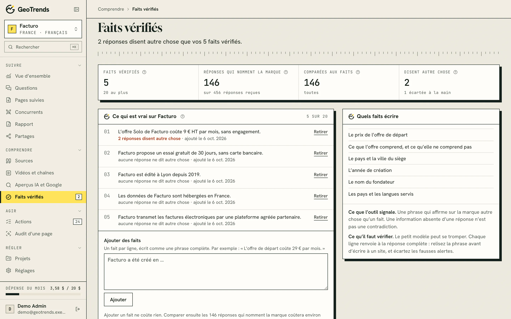

<!-- Page générée depuis la documentation du site (src/site/docs) par scripts/exporter-docs.ts : ne pas la modifier ici. -->

# Avec ou sans nom de marque : comment répartir mes questions ?

> Une question qui contient le nom de la marque ne mesure pas la même chose qu’une autre. Comment les repérer, les lire à part et les répartir dans un projet.

[← Sommaire de la documentation](../README.md) · [Read this page in English](../../en/use-cases/branded-or-unbranded-prompts.md)

« Facturo est-il adapté aux auto-entrepreneurs ? » : l’IA parle presque forcément de Facturo, et ce qui compte est ce qu’elle en dit. « Quel logiciel de facturation choisir pour un auto-entrepreneur ? » : c’est là qu’un client qui ne vous connaît pas encore vous découvre, ou découvre Comptalis. Les deux sortes de questions sont utiles, mais elles ne répondent pas à la même question.

## Ce qu’il vous faut

- Des questions des deux sortes dans le projet. L’outil les classe tout seul, sans appel payant : une question est « avec le nom de la marque » si son texte contient ce nom, « sans » dans le cas contraire.
- Quelques relevés sur chaque question, pour que les verdicts sortent du « trop tôt pour dire ».
- Pour les questions avec le nom : quelques faits vérifiés sur la marque, saisis sur l’écran **Faits vérifiés**.

## Étapes

1. **Voir la répartition.** Ouvrez **Questions**, puis **Filtrer et grouper**. Le filtre **Nom de la marque** propose **Sans** et **Avec**, chacun avec son nombre de questions. Dans le tableau, une question qui contient le nom porte l’étiquette « avec le nom de la marque ».

   

2. **Lire votre place sur les questions sans le nom.** Choisissez **Sans**. Le tableau ne garde que ces questions : comptez les verdicts solide, occasionnelle et absente, et regardez la colonne **Premier nommé**. C’est votre place réelle face à Comptalis, Devizo ou Tikette, chez des clients qui ne cherchaient pas Facturo.

3. **Lire ce que les IA disent de vous sur les questions avec le nom.** Choisissez **Avec**, puis ouvrez une question. Le texte de chaque réponse est affiché tel que l’IA l’a écrit, la marque surlignée. Sur **Vue d’ensemble**, le bloc **Le ton employé pour Facturo** répartit les mentions entre positif, neutre et négatif.

4. **Vérifier les faits.** Les questions avec le nom sont celles où l’IA en dit le plus sur la marque : prix, offres, public visé. L’écran **Faits vérifiés** compare les réponses qui nomment la marque aux faits que vous avez écrits, et liste celles qui disent autre chose.

   

5. **Ajuster la liste.** Gardez quelques questions avec le nom, celles qu’un client pose avant d’acheter : le prix, les avis, la comparaison avec un concurrent. Mettez l’essentiel de l’effort sur les questions sans le nom, en puisant dans **Idées de questions à suivre** sur l’écran **Aperçus IA et Google**.

## Ce que ça permet de décider

Sur quelles questions juger les progrès : les questions sans le nom pour savoir si de nouveaux clients vous rencontrent, les questions avec le nom pour savoir si ce que les IA disent de vous est juste. L’outil n’impose aucune proportion ; une liste faite surtout de questions sans le nom donne une visibilité plus basse, mais plus honnête.

> [!WARNING]
> **Avant d’agir**
>
> Le filtre **Nom de la marque** n’existe que sur l’écran **Questions** : la vue d’ensemble, les concurrents et la carte des thèmes comptent les deux sortes ensemble, et une question avec le nom tire la visibilité vers le haut. Le classement ne cherche que le nom principal : une question qui n’emploie qu’une autre écriture du nom, ou seulement le nom d’un concurrent, est rangée « sans ».

**Voir aussi**

- [L’écran Questions](../mesurer/questions.md)
- [Faits vérifiés](../comprendre/faits-verifies.md)
- [Méthode de mesure](../reference/methode.md)
- [Suis-je en train de suivre les bonnes questions ?](./suivre-les-bonnes-questions.md)
- [Une IA répète une information fausse sur ma marque : que faire ?](./information-fausse.md)

---

Mise à jour : 2026-11-18 · [Lire cette page sur le site](https://geotrends.io/cas-usage/questions-avec-ou-sans-marque)
