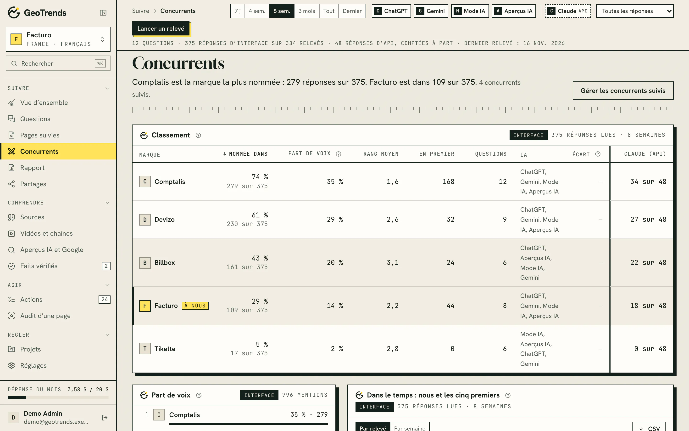

<!-- Page générée depuis la documentation du site (src/site/docs) par scripts/exporter-docs.ts : ne pas la modifier ici. -->

# Qui est cité à ma place ?

> Les marques que les IA nomment sur vos questions, celles à suivre comme concurrents, leur rang, leur part de voix, et les pages qui les font citer à votre place.

[← Sommaire de la documentation](../README.md) · [Read this page in English](../../en/use-cases/who-is-cited-instead-of-me.md)

Sur « Quel logiciel de facturation choisir pour un auto-entrepreneur ? », Facturo n’apparaît pas. Quelqu’un apparaît forcément à sa place. Vous pensiez à Comptalis et à Devizo ; les IA en nomment peut-être d’autres. Il faut savoir qui, sur quelles questions, et grâce à quelles pages.

## Ce qu’il vous faut

- Des réponses dont les marques sont lues. ChatGPT les donne avec sa réponse ; pour les autres IA, la lecture automatique les relève après chaque relevé.
- Au moins un concurrent suivi pour que la part de voix se calcule. Suivre une marque est gratuit et ne lance aucun relevé.

## Étapes

1. **Voir qui est nommé à votre place.** Sur **Vue d’ensemble**, le bloc **Nommés à notre place** liste les autres marques nommées par les IA d’interface, avec leur nombre de réponses, le nombre de fois où elles sont nommées en premier et leur rang moyen. Le bouton **Suivre** en fait un concurrent du projet.

2. **Choisir les concurrents à suivre.** Ouvrez **Concurrents**. Le bloc **Marques repérées, pas encore suivies** propose, pour chaque marque nommée, **Suivre** ou **Ignorer**. Ignorer retire la marque de la liste sans rien changer aux chiffres. Suivez Comptalis, Devizo, Tikette, Billbox, et toute marque que vous découvrez ici.

   

3. **Lire le classement.** Le tableau **Classement** met Facturo et les concurrents suivis côte à côte : **Nommée dans**, **Part de voix**, **Rang moyen**, **En premier**, **Questions**, **IA**, **Écart**. Le tableau **Face-à-face**, plus bas, reprend chaque mesure en ligne, une marque par colonne, et marque d’un trait vert la meilleure case de chaque ligne.

4. **Voir qui gagne chaque question.** Sur **Questions**, la colonne **Premier nommé** donne, pour chaque question, la marque le plus souvent nommée en premier. Sur **Concurrents**, la grille **Question par question, IA par IA**, réglée sur **Premier nommé**, le montre IA par IA.

5. **Trouver les pages qui les font citer.** Ouvrez **Sources**, onglet **Pages**, et choisissez **Seulement les pages citées sans nous**. La colonne **Dont sans nous** compte les réponses qui citent la page sans nommer ni citer Facturo. Un clic sur une ligne ouvre sa fiche : les réponses qui la citent et les marques nommées avec elle.

## Ce que ça permet de décider

Quelles marques suivre comme concurrents, et lesquelles écarter. Sur quelles questions chacune prend votre place, chez quelles IA. Et quelles pages, souvent des comparatifs, il faudrait obtenir ou écrire pour entrer dans ces réponses.

> [!WARNING]
> **Avant d’agir**
>
> Une réponse dont les marques ne sont pas encore lues est écartée des classements : la lecture automatique peut se tromper sur une écriture ou un nom proche, ouvrez quelques réponses pour vérifier. Les marques d’une page citée sont celles de la réponse : le contenu de la page n’est pas lu. Claude, mesuré par son API, a sa propre colonne et n’entre dans aucun total.

**Voir aussi**

- [Concurrents et part de voix](../comprendre/concurrents.md)
- [Choisir ses concurrents](../projet/concurrents.md)
- [Sources citées](../comprendre/sources.md)
- [Quel concurrent s’installe sur mes sujets ?](./concurrent-qui-s-installe.md)
- [Dans quelle page faut-il apparaître en premier ?](./pages-ou-apparaitre.md)

---

Mise à jour : 2026-11-18 · [Lire cette page sur le site](https://geotrends.io/cas-usage/qui-est-cite-a-ma-place)
