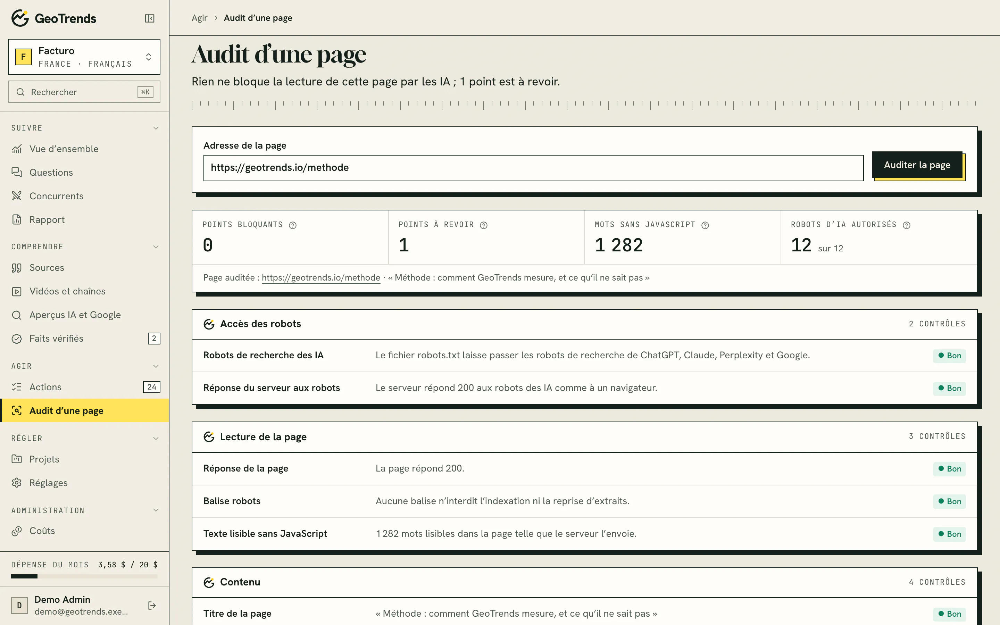

<!-- Page générée depuis la documentation du site (src/site/docs) par scripts/exporter-docs.ts : ne pas la modifier ici. -->

# Les robots des IA peuvent-ils lire ma page ?

> Un audit gratuit d’une page : ce que le robots.txt autorise, ce que le serveur répond aux robots des IA, le texte lisible sans JavaScript et ce qui gêne la citation.

[← Sommaire de la documentation](../README.md) · [Read this page in English](../../en/use-cases/can-ai-crawlers-read-my-page.md)

La page tarifs de facturo.exemple n’est jamais citée, ni même lue, alors qu’elle répond exactement à « Combien coûte un logiciel de facturation ? ». Avant de la réécrire, il faut écarter une cause plus bête : les robots des IA n’y ont peut-être pas accès, ou n’y trouvent rien à lire.

## Ce qu’il vous faut

- L’adresse complète d’une page publique. L’audit la lit directement : aucun appel payant, rien à installer.
- Si la page est à vous, un accès au site ou à son hébergeur pour corriger ce que l’audit trouve.

## Étapes

1. **Lancer l’audit.** Ouvrez **Audit d’une page**, collez l’adresse dans **Adresse de la page**, puis **Auditer la page**. Depuis **Actions**, le lien **Auditer cette page** et, sur **Sources**, onglet **Nos pages**, le lien **Auditer** remplissent l’adresse pour vous.

2. **Lire le résumé.** Quatre chiffres en tête : **Robots d’IA autorisés** (sur les douze robots vérifiés), **Mots sans JavaScript**, **Points bloquants** et **Points à revoir**. Une phrase dit si quelque chose empêche les IA de lire la page.

   

3. **Vérifier robot par robot.** Le tableau **Robot par robot** donne, pour chaque robot, à quoi il sert, la **Règle du site** tirée du robots.txt (autorisé ou bloqué) et la **Réponse du serveur**. Cette réponse est testée pour les robots de recherche de ChatGPT, de Claude, de Perplexity et de Google, en se présentant sous leur nom. Un serveur qui répond 200 à un navigateur mais refuse ces robots signale un pare-feu ou un hébergeur qui les bloque, même si le robots.txt les autorise.

4. **Corriger les points bloquants.** Les **Points bloquants** empêchent une IA de lire ou de reprendre la page : robots de recherche interdits par le robots.txt ou refusés par le serveur, page qui ne répond pas 200, balise qui interdit l’indexation ou les extraits, texte presque absent sans JavaScript. Ils se corrigent en premier.

5. **Revoir le reste.** Les **Points à revoir** ne bloquent pas la lecture, mais rendent la page moins facile à citer : pas de titre principal ou plusieurs, peu de sous-titres, peu de texte sans JavaScript, pas de données structurées, une date absente ou ancienne, une adresse de référence qui pointe ailleurs. D’autres lignes sont données pour information : listes et tableaux, auteur, robots d’entraînement, fichier llms.txt (rien ne prouve que les IA s’en servent).

## Ce que ça permet de décider

Si le problème est technique, à confier à la personne qui gère le site, ou éditorial, à traiter en réécrivant la page. Bloquer les robots d’entraînement (GPTBot, ClaudeBot, Google-Extended) est un choix possible : cela n’empêche pas d’être cité. Bloquer les robots de recherche, si.

> [!WARNING]
> **Avant d’agir**
>
> L’audit dit ce qui empêche une page d’être lue, pas si elle sera citée. Il lit une seule page à la fois, sans parcourir le site. Le test de la réponse du serveur part de notre serveur, sous le nom de chaque robot : un pare-feu qui vérifie aussi l’adresse d’origine peut traiter le vrai robot autrement. Les robots d’entraînement ne sont vérifiés que dans le robots.txt.

**Voir aussi**

- [Audit d’une page](../agir/audit.md)
- [Les IA suivies](../reference/ia-suivies.md)
- [Ma page est lue mais pas citée : que corriger ?](./page-lue-pas-citee.md)
- [Ma marque est-elle citée, nommée ou absente ?](./citee-nommee-ou-absente.md)

---

Mise à jour : 2026-11-18 · [Lire cette page sur le site](https://geotrends.io/cas-usage/robots-des-ia)
