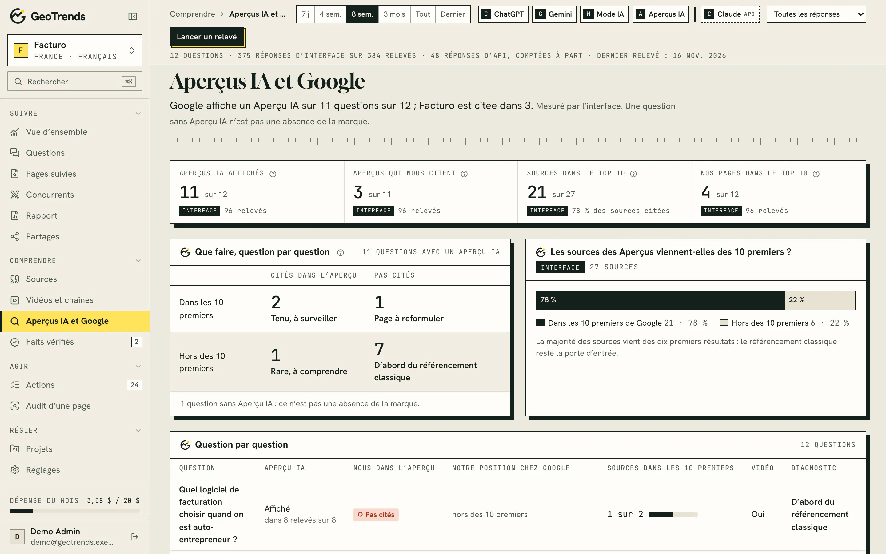
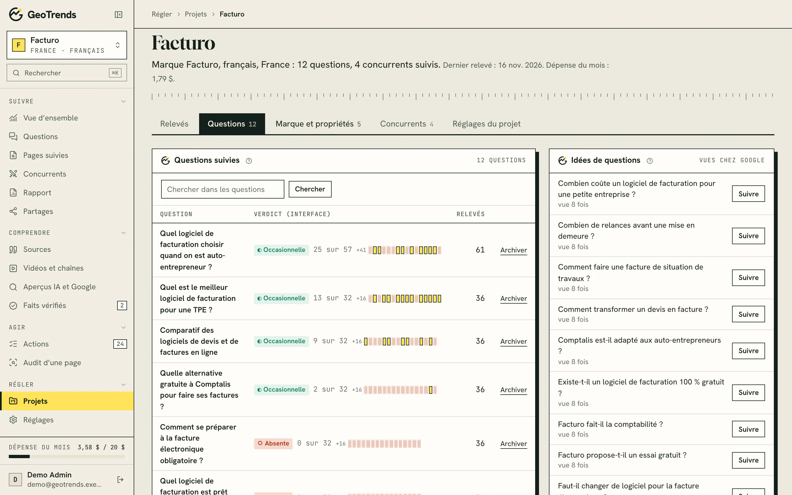

<!-- Page générée depuis la documentation du site (src/site/docs) par scripts/exporter-docs.ts : ne pas la modifier ici. -->

# Suis-je en train de suivre les bonnes questions ?

> Vérifier que vos questions sont celles de vos clients : verdicts, premier nommé, idées tirées de Google et des IA, questions à ajouter ou à archiver.

[← Sommaire de la documentation](../README.md) · [Read this page in English](../../en/use-cases/tracking-the-right-prompts.md)

Vous avez écrit une première liste de questions en créant le projet Facturo. Quelques relevés plus tard, le doute vient : ces questions ressemblent-elles à ce que vos clients demandent vraiment aux IA, ou à ce que vous aimeriez qu’ils demandent ? Tous les chiffres de l’outil reposent sur cette liste. Elle mérite une relecture.

## Ce qu’il vous faut

- Un projet avec ses questions, et deux ou trois relevés au moins. Avant, chaque question porte le verdict « trop tôt pour dire ».
- Un relevé des Aperçus IA de Google : c’est lui qui rapporte les « autres questions posées » par les internautes.
- Des relevés de ChatGPT ou de Claude, pour connaître les recherches que l’IA lance elle-même avant de répondre.

## Étapes

1. **Relire les verdicts, question par question.** Ouvrez **Questions**. Chaque ligne donne le dernier état chez chaque IA, puis le **Verdict** sur la période (solide, occasionnelle, absente) et la marque **Premier nommé**. Une question où Facturo est absente n’est pas une mauvaise question : c’est souvent celle qu’il faut gagner. Regardez plutôt qui est nommé en premier : si ce ne sont jamais des logiciels de facturation, la question ne dit peut-être pas ce que vous croyez.

   

2. **Regarder ce que demandent les internautes.** Ouvrez **Aperçus IA et Google**, bloc **Idées de questions à suivre**. Vous y trouvez les « autres questions posées » que Google affiche sous vos questions, et les recherches que ChatGPT ou Claude ont tapées avant de répondre, les plus fréquentes d’abord. Ce sont de vraies formulations, pas les vôtres.

   

3. **Ajouter les questions retenues.** Le bouton **Ajouter au projet** reprend une idée telle quelle. Pour écrire vos propres questions, ouvrez la fiche du projet, onglet **Questions** : une question par ligne, comme un client la poserait à une IA. Ajouter une question ne coûte rien ; la dépense commence au prochain relevé.

   

4. **Archiver ce qui ne sert plus.** Dans **Questions**, cochez les questions devenues inutiles, puis **Archiver les questions cochées**. Elles ne sont plus relevées et ne comptent plus dans les chiffres ; leur historique reste, et elles se reprennent à tout moment. Une question déjà relevée ne se modifie pas : pour la reformuler, archivez-la et écrivez-en une nouvelle.

5. **Vérifier l’équilibre de la liste.** Ouvrez **Filtrer et grouper** au-dessus du tableau. Les filtres **Intention** (s’informer, comparer, acheter), **Thème** et **Nom de la marque** montrent comment la liste se répartit. Une liste faite seulement de questions « acheter », ou de questions qui contiennent déjà le mot Facturo, ne dira pas grand-chose de votre place chez les clients qui ne vous connaissent pas encore.

## Ce que ça permet de décider

Quelles questions garder, lesquelles ajouter, lesquelles archiver. Et donc sur quelle base se calculeront la visibilité, la part de voix et la liste de travail des semaines suivantes.

> [!WARNING]
> **Avant d’agir**
>
> L’outil n’affiche aucun volume de recherche : aucune IA ne publie ce qu’on lui demande, et les « autres questions posées » de Google sont de vraies questions sans fréquence connue. Changer la liste change aussi la base des chiffres : pour comparer deux périodes, comparez des périodes où la liste est la même, ou lisez les questions une à une.

**Voir aussi**

- [Écrire les questions à suivre](../projet/questions.md)
- [L’écran Questions](../mesurer/questions.md)
- [Aperçus IA et résultats de Google](../comprendre/google.md)
- [Avec ou sans nom de marque : comment répartir mes questions ?](./questions-avec-ou-sans-marque.md)

---

Mise à jour : 2026-11-18 · [Lire cette page sur le site](https://geotrends.io/cas-usage/suivre-les-bonnes-questions)
