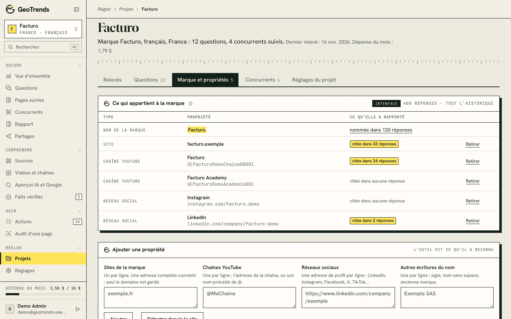
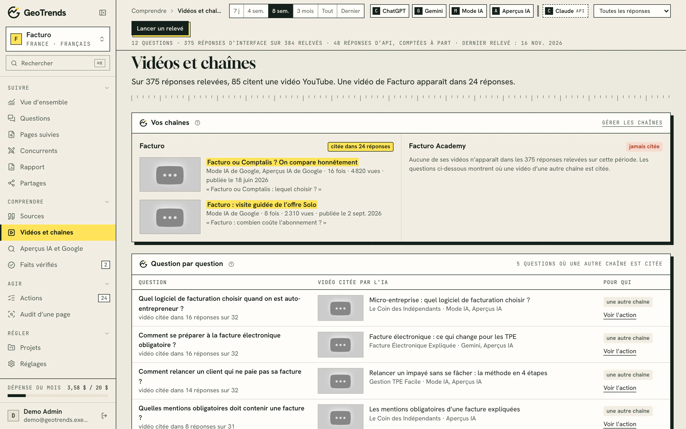

<!-- Page générée depuis la documentation du site (src/site/docs) par scripts/exporter-docs.ts : ne pas la modifier ici. -->

# Quelles vidéos YouTube tourner ?

> Les questions où les IA citent une vidéo YouTube qui n’est pas la vôtre, les chaînes qui prennent la place, et comment en tirer une liste de vidéos à tourner.

[← Sommaire de la documentation](../README.md) · [Read this page in English](../../en/use-cases/videos-to-make.md)

Facturo a deux chaînes, « Facturo » et « Facturo Academy », et une liste d’idées de vidéos plus longue que le temps de tournage. Certaines IA, Google en tête, citent des vidéos YouTube dans leurs réponses. Celles qu’elles citent sur vos questions disent quels sujets filmer en premier.

## Ce qu’il vous faut

- Les chaînes YouTube de la marque déclarées dans le projet. Une vidéo citée compte pour la chaîne qui l’a publiée : sans déclaration, une vidéo de Facturo Academy compterait pour « youtube.com ».
- Des relevés dont les réponses citent des vidéos. Le titre, la chaîne, la date et les vues de chaque vidéo citée sont lus gratuitement.

## Étapes

1. **Déclarer les chaînes.** Ouvrez la fiche du projet, onglet **Marque et propriétés**, rubrique **Chaînes YouTube** : une chaîne par ligne, son adresse ou son nom précédé de @. Le bouton **Détecter depuis le site** propose aussi les chaînes liées depuis la page d’accueil.

   

2. **Voir si vos chaînes sont citées.** Ouvrez **Vidéos et chaînes**. Le bloc **Vos chaînes** donne une carte par chaîne déclarée, même jamais citée : le nombre de réponses qui citent une de ses vidéos, et la vidéo la plus citée.

   

3. **Repérer les questions où une autre vidéo est citée.** Le bloc **Question par question** liste les questions pour lesquelles une IA cite au moins une vidéo YouTube, avec la miniature, la chaîne, les vues et, quand l’adresse le précise, le passage cité. La colonne **Pour qui** dit si la vidéo est la vôtre. En haut, les questions où la vidéo citée appartient à une autre chaîne.

4. **Connaître les chaînes concurrentes.** Le bloc **Les autres chaînes citées** réunit les chaînes d’autres créateurs ou marques dont une vidéo est citée. Celles qui reviennent souvent sont vos concurrentes sur YouTube pour ces questions, même si ce ne sont pas des éditeurs de logiciels.

5. **Passer par la liste de travail.** Sur **Actions**, le groupe **Écrire ou filmer** contient une ligne « Tourner une vidéo sur … » pour chaque question où les IA citent des vidéos et aucune des vôtres. La ligne rappelle les vidéos citées, leur chaîne et leurs vues. Le lien **Voir l’action**, sur l’écran des vidéos, y mène aussi.

## Ce que ça permet de décider

Quels sujets filmer en premier : les questions où les IA citent déjà des vidéos, aucune de Facturo. Et sous quel angle : celui des vidéos citées, leur durée, le passage qui sert de réponse. Une question où aucune IA ne cite de vidéo ne se gagne probablement pas par YouTube.

> [!WARNING]
> **Avant d’agir**
>
> Toutes les IA ne citent pas des vidéos : sur certaines périodes, seul Google le fait, et l’écran le dit. Les vidéos citées se comptent souvent sur les doigts d’une main : l’écran compte en réponses relevées, sans pourcentage. Une vidéo publiée ne sera pas forcément citée ; la mesure suivante le dira, sans prouver que la vidéo en est la cause.

**Voir aussi**

- [Vidéos et chaînes](../comprendre/videos.md)
- [Sites, chaînes YouTube et réseaux sociaux](../projet/sites-chaines-reseaux.md)
- [La liste de travail](../agir/liste-de-travail.md)
- [Ma marque est-elle citée, nommée ou absente ?](./citee-nommee-ou-absente.md)
- [Ma correction a-t-elle compté ?](./effet-d-une-correction.md)

---

Mise à jour : 2026-11-18 · [Lire cette page sur le site](https://geotrends.io/cas-usage/videos-a-tourner)
