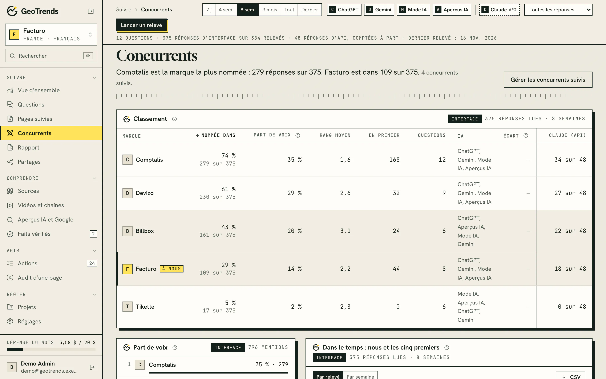

<!-- Page générée depuis la documentation du site (src/site/docs) par scripts/exporter-docs.ts : ne pas la modifier ici. -->

# Concurrents et part de voix

> Quelles marques les IA nomment sur vos questions, à quel rang et dans quelle part des réponses : classement, part de voix, face-à-face, question par question.

[← Sommaire de la documentation](../README.md) · [Read this page in English](../../en/understand/competitors.md)

L’écran Concurrents répond à une question : quand un client pose vos questions, quelles marques les IA lui recommandent, et où se place la vôtre ? Il sert à choisir contre qui travailler, et sur quelles questions.

On y arrive aussi depuis la vue d’ensemble, par **Tout le classement** ou **Tous les concurrents**. En haut à droite, **Gérer les concurrents suivis** ouvre l’onglet Concurrents de la fiche du projet, où l’on déclare aussi le site de chacun.

*L’écran Concurrents du projet Facturo : le classement de Facturo face à Comptalis, Devizo, Tikette et Billbox, puis la part de voix et son évolution.*

## Sur quoi tout est compté

Tous les chiffres de l’écran se comptent sur les **réponses lues** : les réponses d’interface dont on connaît les marques nommées, dans l’ordre. ChatGPT renvoie lui-même ses marques ; pour les autres IA, elles sont tirées du texte par la lecture automatique. Tant que des réponses ne sont pas lues, un bandeau propose **Lire les réponses**, avec son prix. Claude, mesuré par son API, a sa propre colonne et n’entre dans aucun total.

Une mention qui contient le nom d’un concurrent suivi compte pour lui : « Comptalis Facturation » compte pour Comptalis. La comparaison ignore les majuscules, les accents et la ponctuation, et le nom du concurrent doit faire au moins trois lettres.

## Le classement

Le bloc **Classement** range votre marque et les concurrents suivis, du plus nommé au moins nommé. Sans concurrent suivi, l’écran propose d’abord **Suivez vos premiers concurrents**, avec la liste des marques repérées.

| Colonne | Définition |
| --- | --- |
| **Marque** | Un clic ouvre les réponses qui la nomment. |
| **Nommée dans** | Part des réponses lues qui nomment la marque, avec le compte (« 9 sur 30 », par exemple). |
| **Part de voix** | Mentions de la marque rapportées à celles de votre marque et des concurrents suivis. |
| **Rang moyen** | Place moyenne de la marque dans la liste des marques nommées, quand elle est nommée. |
| **En premier** | Nombre de réponses où elle est la première marque nommée. |
| **Questions** | Nombre de questions où elle est nommée au moins une fois. |
| **IA** | Les IA d’interface qui la nomment. |
| **Écart** | Écart avec la période d’avant, coloré seulement au-delà de la marge d’erreur. |
| **Claude (API)** | Réponses de Claude qui la nomment, sur les réponses de Claude lues. Compté à part. |

## Part de voix et évolution

Le bloc **Part de voix** rapporte vos mentions à celles des concurrents suivis : elle n’existe qu’avec au moins un concurrent suivi, et change dès que vous en ajoutez un. À côté, **Dans le temps : nous et les cinq premiers** trace, relevé après relevé, la part des réponses lues qui nomment chaque marque : la vôtre et cinq autres au plus (les concurrents suivis d’abord, sinon les marques les plus nommées). Le bouton **CSV** exporte les données de la courbe.

**À quel rang chaque marque est nommée** compte, pour votre marque et ces cinq autres, les réponses où elle est nommée en 1er, 2e, 3e, ou 4e et plus. La dernière colonne, **Jamais nommée**, donne les réponses lues où elle n’apparaît pas. Plus la case est foncée, plus le nombre est grand.

## Question par question, IA par IA

Une ligne par question, une colonne par IA, avec le dernier relevé de chaque IA. Le choix **Voir** change ce que dit chaque case :

| Vue | Ce que montre la case |
| --- | --- |
| **Notre rang** | Le rang de votre marque (1er, 2e…), « présente » si elle est nommée sans rang connu, « absente » sinon. Un clic ouvre la réponse. |
| **Premier nommé** | La marque nommée en premier dans la réponse. |
| **Face à un concurrent** | Le choix **Face à** désigne le concurrent. La case dit « Nous devant », « Comptalis devant » (avec les deux rangs), « Nous seuls », « Comptalis seul » ou « Aucun des deux ». |

Un point signifie qu’il n’y a pas de réponse à lire : question pas encore relevée, ou pas d’Aperçu IA. « pas lu » : les marques de cette réponse ne sont pas encore connues. La colonne **Couverture** compte les IA d’interface où votre marque apparaît, sur celles qui ont répondu.

## Le face-à-face

Le bloc **Face-à-face** met les mesures en lignes et les marques en colonnes : votre marque et quatre concurrents au plus. La meilleure case de chaque ligne est marquée d’un trait vert.

- **Nommée dans (part des réponses lues)**, **Nommée en premier**, **Rang moyen quand nommée** (le plus petit l’emporte).
- **Questions où elle apparaît** et **IA d’interface qui la nomment**, sur le total de questions et d’IA.
- **Mentions positives**, quand le ton a été lu : les réponses qui recommandent la marque, sur celles dont le ton est connu.
- Une dernière ligne, séparée : **Claude (API) : réponses qui la nomment**.

## Les marques repérées

Le bloc **Marques repérées, pas encore suivies** liste les autres marques que les IA nomment sur vos questions, avec leurs **Réponses**, **En premier**, **Rang moyen**, **Questions** et **Claude (API)**. Un clic sur une ligne ouvre sa fiche : la description relevée dans les réponses, les questions où elle est nommée, et **Voir les réponses qui la nomment**.

- **Suivre** en fait un concurrent du projet : elle entre dans le classement, la part de voix et le face-à-face. C’est gratuit et ne lance aucun relevé.
- **Ignorer** la retire de cette liste, sans rien changer aux chiffres : utile pour un nom générique ou un outil qui n’est pas un concurrent.
- **Voir les marques écartées** affiche celles que vous avez ignorées ; **Remettre** les fait revenir.

## Savoir contre qui travailler

1. **Lire la phrase du haut.** Elle dit quelle marque est la plus nommée, sur combien de réponses lues, et où en est la vôtre.

2. **Suivre trois à cinq concurrents.** Dans **Marques repérées, pas encore suivies**, cliquez **Suivre** sur celles qui reviennent le plus souvent et qui sont de vrais concurrents. Le classement et la part de voix se remplissent aussitôt, sans nouveau relevé.

3. **Comparer la part de voix et son écart.** Un écart coloré est réel ; gris, il reste dans la marge d’erreur.

4. **Trouver les questions où un concurrent mène.** Dans la grille, choisissez **Face à un concurrent**, puis le concurrent. Les cases « Comptalis devant » ou « Comptalis seul » sont les questions à reprendre.

5. **Comprendre grâce à quoi il est nommé.** Ouvrez la réponse depuis la grille, puis l’écran Sources : les pages citées à côté du concurrent disent où il faut apparaître.

## Limites

> [!WARNING]
> Les marques, leur rang et le ton sont lus dans le texte par un petit modèle, sauf pour ChatGPT : sur une réponse ambiguë, il peut se tromper, et chaque case renvoie au texte d’origine. La part de voix ne compte que les concurrents suivis : elle change quand la liste change. Avec une réponse par question et par IA à chaque date, les écarts restent souvent dans la marge d’erreur. Pour ne regarder que les réponses qui nomment un concurrent, utilisez le filtre **Face à** de la barre du haut.

**Voir aussi**

- [Choisir ses concurrents](../projet/concurrents.md)
- [Sources citées](./sources.md)
- [Qui est cité à ma place ?](../cas-usage/qui-est-cite-a-ma-place.md)
- [Quel concurrent s’installe sur mes sujets ?](../cas-usage/concurrent-qui-s-installe.md)

---

Mise à jour : 2026-11-18 · [Lire cette page sur le site](https://geotrends.io/documentation/comprendre/concurrents)
