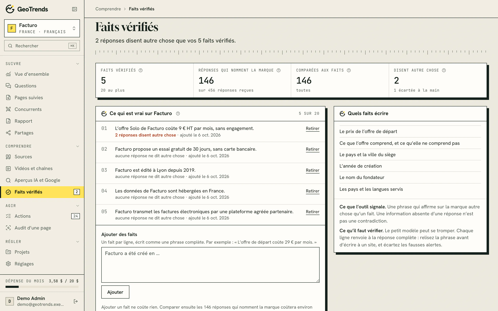
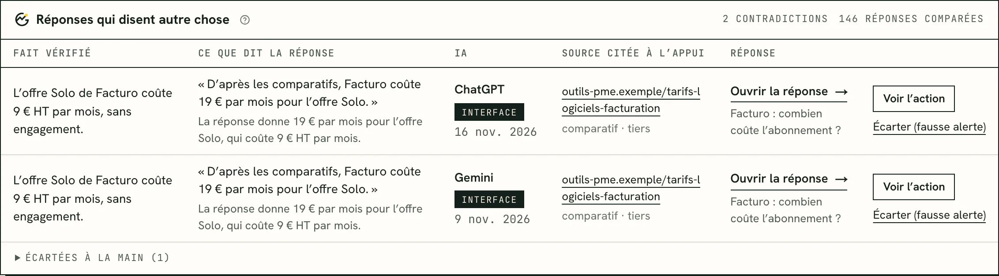

<!-- Page générée depuis la documentation du site (src/site/docs) par scripts/exporter-docs.ts : ne pas la modifier ici. -->

# Faits vérifiés

> Vous écrivez ce qui est vrai sur la marque : prix, offre, pays, dates. L’outil signale les réponses des IA qui disent autre chose, et la source en cause.

[← Sommaire de la documentation](../README.md) · [Read this page in English](../../en/understand/fact-checks.md)

Une IA peut citer la marque et se tromper sur elle : un ancien prix, une offre qui n’existe plus, un mauvais pays. L’écran Faits vérifiés compare les réponses à ce que vous tenez pour vrai, et dit lesquelles disent autre chose. Il sert à décider quelle page corriger chez vous, ou quel site prévenir.

Dans le menu, un nombre à côté de **Faits vérifiés** compte les réponses qui contredisent un fait, hors fausses alertes écartées. Chaque contradiction est aussi une ligne de la liste de travail, « Corriger un fait faux ».

*L’écran Faits vérifiés du projet Facturo : les faits saisis, puis les réponses qui disent autre chose, avec la phrase en cause et la source citée à l’appui.*

## Les chiffres clés

| Tuile | Ce qu’elle compte |
| --- | --- |
| **Faits vérifiés** | Ce que vous avez écrit comme vrai sur la marque. 20 au plus par projet. |
| **Réponses qui nomment la marque** | Les réponses reçues où la marque est nommée, sur toutes les réponses reçues. Seules celles-là peuvent la contredire. |
| **Comparées aux faits** | Réponses déjà relues par le petit modèle pour y chercher une contradiction, ou le nombre qui reste à comparer. |
| **Disent autre chose** | Réponses où une phrase affirme sur la marque autre chose qu’un fait vérifié, avec le nombre de fausses alertes écartées à la main. |

> [!NOTE]
> **Interface et API comptées ensemble, ici seulement**
>
> Partout ailleurs, les deux méthodes restent séparées. Ici, aucune part n’est mesurée : on relit des phrases. Une erreur écrite par Claude, interrogé par son API, est donc signalée aussi, et chaque ligne porte le tampon de sa méthode. Les réponses des questions archivées sont relues elles aussi, quelle que soit la période choisie.

## Écrire les faits

Le bloc **Ce qui est vrai sur Facturo** liste les faits saisis. Pour en ajouter, remplissez **Ajouter des faits** : un fait par ligne, écrit comme une phrase complète, par exemple « L’offre de départ coûte 29 € par mois. » Une ligne de moins de huit signes ou déjà saisie est ignorée. Ajouter un fait ne coûte rien. **Retirer** supprime un fait, et les contradictions relevées contre lui partent avec.

Une phrase par fait, précise et vérifiable : cinq à vingt faits suffisent. Le bloc **Quels faits écrire** propose six sujets :

- Le prix de l’offre de départ
- Ce que l’offre comprend, et ce qu’elle ne comprend pas
- Le pays et la ville du siège
- L’année de création
- Le nom du fondateur
- Les pays et les langues servis

## Comparer les réponses aux faits

Quand des réponses qui nomment la marque n’ont pas encore été comparées, un bandeau propose **Vérifier les réponses**, avec son prix (environ 0,0006 $ par réponse). Le petit modèle relit chacune et relève les phrases qui contredisent un fait. C’est un appel payant, inscrit au journal des coûts, qui ne part que sur votre clic.

- Les réponses qui ne nomment pas la marque ne sont pas relues : elles ne peuvent pas la contredire.
- Après l’ajout d’un fait, les réponses déjà comparées le sont de nouveau, pour tenir compte du nouveau fait : le bandeau revient.
- Les réponses à venir sont comparées aux faits pendant leur lecture automatique, sans appel en plus.

## Les réponses qui disent autre chose

| Colonne | Ce qu’elle montre |
| --- | --- |
| **Fait vérifié** | Le fait contredit. |
| **Ce que dit la réponse** | La phrase de la réponse, copiée mot pour mot, et une explication courte : ce que dit la réponse, et ce qui est vrai. |
| **IA** | L’IA, le tampon de sa méthode (interface ou API) et la date du relevé. |
| **Source citée à l’appui** | La page sur laquelle s’appuie la phrase, avec son type et à qui elle appartient, ou « aucune source citée à l’appui ». |
| **Réponse** | **Ouvrir la réponse** affiche le texte complet, à la bonne date et sur la bonne IA. |

Au bout de chaque ligne, **Voir l’action** ouvre la ligne de la liste de travail, et **Écarter (fausse alerte)** retire la contradiction : elle sort de la liste de travail et ne revient pas à la lecture suivante. Les lignes écartées restent visibles, repliées, sous **Écartées à la main** ; **Remettre dans la liste** les fait revenir.

*Les réponses qui disent autre chose qu’un fait vérifié : la phrase relevée, l’IA, la source citée à l’appui et le lien vers la réponse.*

## Faire corriger une information fausse

1. **Écrire cinq à dix faits.** Commencez par ce qui change souvent et coûte cher quand c’est faux : le prix, l’offre, les pays servis.

2. **Vérifier les réponses.** Cliquez **Vérifier les réponses** : le prix est écrit sur le bouton. Les réponses reviennent comparées en quelques instants.

3. **Relire chaque phrase.** **Ouvrir la réponse** montre la phrase dans son contexte. Si le petit modèle s’est trompé, **Écarter (fausse alerte)**.

4. **Remonter à la source.** Si une source est citée à l’appui, c’est elle qu’il faut faire corriger : votre page si elle est à vous, sinon le site qui la publie.

5. **Noter la démarche.** **Voir l’action** ouvre la fiche de la ligne : notez-y la demande de correction envoyée, puis passez la ligne à « Fait » quand la page est corrigée.

## Limites

> [!WARNING]
> Le petit modèle peut se tromper, dans les deux sens : signaler une phrase juste, ou manquer une erreur. Chaque ligne renvoie à la réponse complète : relisez avant d’écrire à un site. Une information absente d’une réponse n’est pas une contradiction, et une phrase qui dit la même chose avec d’autres mots non plus. Faire corriger la source ne garantit pas que l’IA change sa réponse : la mesure suivante le dira.

**Voir aussi**

- [La liste de travail](../agir/liste-de-travail.md)
- [Suivre une action et ses prises de contact](../agir/prises-de-contact.md)
- [Une IA répète une information fausse sur ma marque : que faire ?](../cas-usage/information-fausse.md)

---

Mise à jour : 2026-11-18 · [Lire cette page sur le site](https://geotrends.io/documentation/comprendre/faits-verifies)
