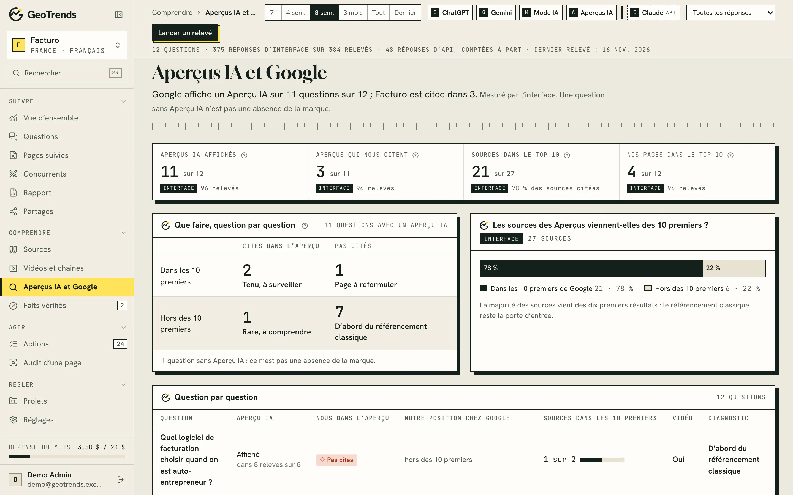

<!-- Page générée depuis la documentation du site (src/site/docs) par scripts/exporter-docs.ts : ne pas la modifier ici. -->

# Aperçus IA et résultats de Google

> Les Aperçus IA de Google face aux dix premiers résultats de la recherche : une consigne par question, la part des sources classées, des idées de questions.

[← Sommaire de la documentation](../README.md) · [Read this page in English](../../en/understand/google.md)

Quand Google affiche un Aperçu IA, il le pose au-dessus de ses résultats classiques. Le relevé d’un Aperçu IA garde les deux : le texte de l’aperçu avec ses sources, et les dix premiers résultats de la même recherche. L’écran les compare pour répondre à une question : si la marque manque à l’aperçu, est-ce un problème de référencement classique, ou un problème de page ?

On y arrive aussi par la tuile **Aperçus IA** de la vue d’ensemble. Le bloc des idées de questions, en bas, est ouvert par **Voir des idées de questions** sur l’écran Questions et par **Toutes les idées, et les recherches des IA** dans la fiche du projet.

*L’écran Aperçus IA et Google du projet Facturo : les chiffres clés, le tableau « Que faire, question par question » et la part des sources qui viennent des dix premiers résultats.*

> [!NOTE]
> **Une question sans aperçu n’est pas une absence**
>
> Google n’affiche pas d’Aperçu IA sur toutes les recherches. Une question pour laquelle il n’y en a pas revient « Pas d’aperçu » : elle n’est jamais comptée comme une absence de la marque, et le tableau la range à part.

## Les chiffres clés

| Tuile | Ce qu’elle compte |
| --- | --- |
| **Aperçus IA affichés** | Nombre de questions pour lesquelles Google affiche un Aperçu IA, sur les questions relevées. |
| **Aperçus qui nous citent** | Nombre de questions dont l’Aperçu IA cite une page ou une vidéo de la marque, sur celles qui ont un aperçu. |
| **Sources dans le top 10** | Parmi les sources citées par les Aperçus IA, celles qui figurent aussi dans les dix premiers résultats de Google, avec leur part. |
| **Nos pages dans le top 10** | Nombre de questions pour lesquelles une page de la marque est dans les dix premiers résultats de Google. |

Tout est mesuré par l’interface, sur les relevés des Aperçus IA de la période ; chaque tuile dit sur combien de relevés elle repose.

## Que faire, question par question

Deux questions suffisent : la marque est-elle dans les dix premiers résultats de Google, et l’Aperçu la cite-t-il ? Le croisement donne quatre cases, chacune avec le nombre de questions et sa consigne. Un clic sur une case filtre le tableau du dessous. Sous le tableau, une ligne compte les questions sans Aperçu IA.

|  | Cités dans l’Aperçu | Pas cités |
| --- | --- | --- |
| **Dans les 10 premiers** | **Tenu, à surveiller** | **Page à reformuler** : la page est trouvée, il lui manque une réponse nette. |
| **Hors des 10 premiers** | **Rare, à comprendre** : cité sans être bien classé. | **D’abord du référencement classique** |

Le bloc **Les sources des Aperçus viennent-elles des 10 premiers ?** découpe toutes les sources des aperçus en deux : dans les dix premiers de Google, ou hors des dix premiers. Si la majorité vient des dix premiers, l’écran conclut que le référencement classique reste la porte d’entrée ; sinon, qu’être bien classé ne suffit pas.

## Le tableau, question par question

| Colonne | Ce qu’elle montre |
| --- | --- |
| **Aperçu IA** | « Affiché » dans tant de relevés sur tant, « Pas d’aperçu », ou « pas relevé ». |
| **Nous dans l’Aperçu** | « Cités » (avec le compte s’il y a plusieurs relevés) ou « Pas cités ». |
| **Notre position chez Google** | Le rang de la page de la marque dans les résultats classiques, avec son adresse, ou « hors des 10 premiers ». |
| **Sources dans les 10 premiers** | Combien des sources de l’aperçu sont aussi dans les dix premiers résultats. |
| **Vidéo** | L’aperçu cite-t-il une vidéo ? |
| **Diagnostic** | La consigne pour cette question, tirée du dernier relevé de l’aperçu (voir ci-dessous). |

| Diagnostic | Quand |
| --- | --- |
| **Tenu, à surveiller** | Dans les 10 premiers et cité par l’Aperçu. |
| **Page à reformuler** | Dans les 10 premiers, mais pas cité : la page est trouvée, il lui manque une réponse nette. |
| **Rare, à comprendre** | Cité par l’Aperçu sans être dans les 10 premiers. |
| **D’abord du référencement classique** | Ni dans les 10 premiers, ni cité. |
| **Pas d’Aperçu : à ne pas travailler pour Google** | Google n’affiche pas d’Aperçu IA sur cette question. |
| **Pas encore relevé** | Les Aperçus IA n’ont pas été relevés pour cette question. |

## Idées de questions à suivre

Le dernier bloc propose des questions que vous ne suivez pas encore, tirées des relevés. Deux listes, au choix :

- **Autres questions posées** : les questions que Google affiche sous vos questions. Ce sont de vraies questions d’internautes. La colonne **Sous la question** dit sous laquelle des vôtres elle est apparue.
- **Recherches des IA** : ce que l’IA tape elle-même dans un moteur de recherche avant de répondre. C’est connu pour ChatGPT et Claude. Ce sont des sujets pour lesquels écrire.

La colonne **Vue** compte combien de fois l’idée est revenue. **Ajouter au projet** en fait une question suivie : c’est gratuit, et chaque relevé suivant coûtera un peu plus (le prix par question est écrit dans la bulle d’aide). Les questions déjà suivies ou archivées ne sont pas reproposées.

## Lire l’écran en quatre étapes

1. **Relever les Aperçus IA.** Au moment de lancer un relevé, laissez cochée la ligne **Aperçus IA de Google**. Le relevé des aperçus rapporte aussi les dix premiers résultats.

2. **Commencer par « Page à reformuler ».** Ce sont les questions où votre page est déjà bien classée sans être reprise. Chacune devient une ligne de la liste de travail, avec le rang de la page ; l’audit de la page dit si quelque chose bloque sa lecture.

3. **Traiter « D’abord du référencement classique ».** Tant que la page n’est pas mieux classée, l’aperçu a peu de chances de la reprendre. La liste de travail propose une ligne « Travailler le référencement » pour chacune.

4. **Suivre les bonnes questions.** Parcourez les **Autres questions posées** et ajoutez au projet celles que vos clients posent vraiment.

## Limites

> [!WARNING]
> Le diagnostic d’une question vient de son dernier relevé d’aperçu : une seule page de résultats, à une date. Google n’affiche pas toujours un aperçu sur la même recherche d’un jour à l’autre. Les dix premiers résultats sont ceux de cette page, depuis le pays et dans la langue du projet. Être bien classé ou bien écrit ne garantit pas d’être cité : l’écran dit où se situe le frein, pas comment obtenir la citation.

**Voir aussi**

- [La liste de travail](../agir/liste-de-travail.md)
- [Audit d’une page](../agir/audit.md)
- [Écrire les questions à suivre](../projet/questions.md)
- [Suis-je en train de suivre les bonnes questions ?](../cas-usage/suivre-les-bonnes-questions.md)

---

Mise à jour : 2026-11-18 · [Lire cette page sur le site](https://geotrends.io/documentation/comprendre/google)
