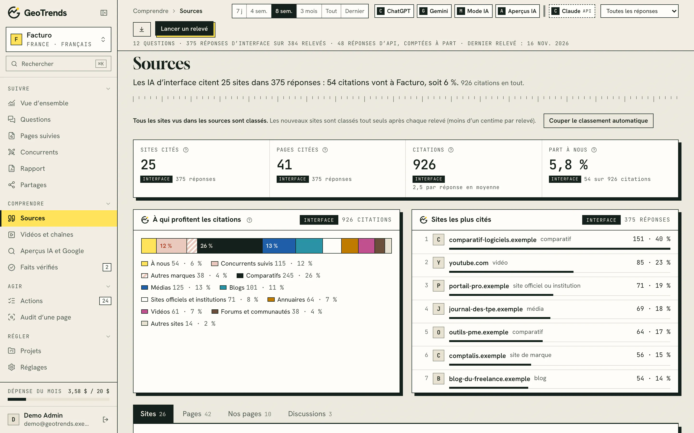

<!-- Page générée depuis la documentation du site (src/site/docs) par scripts/exporter-docs.ts : ne pas la modifier ici. -->

# Sources citées

> Les sites et les pages que les IA citent pour répondre à vos questions : leur type, à qui ils appartiennent, vos pages, et ce qui a bougé au dernier relevé.

[← Sommaire de la documentation](../README.md) · [Read this page in English](../../en/understand/sources.md)

Une IA qui répond s’appuie sur des pages, qu’elle affiche comme sources. L’écran Sources réunit ces pages, question par question et IA par IA, pour répondre à une question : quels sites écrivent la réponse, et où la marque doit-elle apparaître ? Tout vient des relevés déjà en base.

On y arrive aussi depuis la vue d’ensemble : **Toutes les sources**, un clic sur une part de **À qui profitent les citations** (l’écran s’ouvre filtré), ou la tuile **Sources à nous** (l’onglet Nos pages). La recherche rapide trouve un site et ouvre directement sa fiche.

*L’écran Sources du projet Facturo : les chiffres clés, la répartition des citations par bénéficiaire et par type de site, puis le tableau des sites cités.*

## Les chiffres clés

| Tuile | Ce qu’elle compte |
| --- | --- |
| **Sites cités** | Nombre de sites différents cités comme sources par les IA d’interface, sur tant de réponses. |
| **Pages citées** | Nombre de pages différentes citées comme sources. |
| **Citations** | Nombre total de sources citées, toutes réponses d’interface confondues, avec la moyenne par réponse. |
| **Part à nous** | Part des citations qui vont à une page du site, à une publication d’un profil déclaré ou à une vidéo de la marque. Un clic ouvre ces pages. |

Tous ces chiffres sont mesurés par l’interface. Les sources citées par Claude, interrogé par son API, sont comptées à part : la ligne de méthode au pied des tableaux le rappelle.

## Le type de chaque site, et à qui il appartient

Chaque site cité porte un type. Il se décide dans cet ordre : une correction faite à la main ; le classement gardé en base, fait une fois par un petit modèle à partir du nom du site et des titres de ses pages ; les plateformes connues de tous (YouTube ou Vimeo pour la vidéo, LinkedIn ou Instagram pour les réseaux sociaux, Reddit, Quora ou Trustpilot pour les forums, les sites en .gouv pour les sites officiels) ; un site dont le nom est celui d’une marque nommée dans les réponses, rangé « site de marque ». Tout le reste s’affiche **à classer** : rien n’est deviné.

| Type | Exemples |
| --- | --- |
| **comparatif** | Un classement ou un comparatif de logiciels, comme comparatif-logiciels.exemple. |
| **média** | Un journal, un magazine, un site d’actualité. |
| **annuaire** | Une liste de fournisseurs, une place de marché de logiciels. |
| **blog** | Un blog d’expert ou d’indépendant. |
| **forum ou communauté** | Un fil de discussion, une plateforme d’avis. |
| **vidéo** | Une vidéo, qui compte pour la chaîne qui l’a publiée. |
| **réseau social** | Une publication LinkedIn, Instagram, X… |
| **site officiel ou institution** | Une administration, un organisme public. |
| **boutique** | Un site marchand. |
| **site de marque** | Le site d’une marque : la vôtre, un concurrent ou une autre. |
| **autre** | Ce qui n’entre nulle part ailleurs. |

Chaque citation profite aussi à quelqu’un : **À nous** (une page du site, d’un profil déclaré, ou une vidéo d’une de vos chaînes), **Concurrent suivi** (son site déclaré, ou un domaine à son nom), **Autre marque**, ou **Tiers**. Le type d’un site est gardé une fois pour tous les projets ; à qui il appartient se décide projet par projet.

> [!NOTE]
> **Classer les sites**
>
> Tant que des sites ne sont pas classés, un bandeau propose **Classer les sites**, avec son prix (environ 0,00005 $ par site). C’est un appel payant, inscrit au journal des coûts, qui ne part que sur votre clic. Après ce premier clic, les nouveaux sites sont classés tout seuls après chaque relevé ; **Couper le classement automatique** l’arrête, au même endroit.

## À qui profitent les citations

La barre découpée répartit toutes les citations : à vous, aux concurrents suivis, aux autres marques, puis aux tiers, rangés par type de site. Un clic sur une part filtre les tableaux du dessous ; **Tout afficher** retire le filtre. À côté, **Sites les plus cités** classe les sept sites qui reviennent le plus, avec leur part des réponses.

## Les quatre tableaux

### Sites

Un site par ligne, avec un filtre **Type de site** et une recherche. Les colonnes : **Site**, **Type**, **À qui**, **Réponses** (réponses d’interface qui citent le site, et leur part), **IA qui le citent**, **Questions**, **Pages** et **Évolution** : les réponses comparables qui citent le site au dernier relevé par rapport au précédent (« nouveau », « perdu », +2…), colorées seulement au-delà de la marge d’erreur.

### Pages

Une page par ligne : **Page**, **Type**, **À qui**, **Réponses**, **Dont sans nous** (réponses qui citent la page sans nommer ni citer la marque : là où il faut entrer), **IA**, **Questions** et **Publiée le** (pour une vidéo). Le bouton **Seulement les pages citées sans nous** ne garde que les pages des autres où la marque manque.

### Nos pages

Les pages et vidéos de la marque : **Citée** (nombre de réponses qui la citent), **Lue sans être citée** (l’IA l’a ouverte sans la retenir), **Chez Google** (son rang dans les dix premiers résultats, sur quelle question), **Pages citées à sa place** (ce que l’IA a cité dans la même réponse) et le bouton **Auditer**, qui ouvre l’audit de la page. **Suivre** ouvre [Pages suivies](../mesurer/pages-suivies.md) avec son adresse : l’outil propose les questions auxquelles elle répond. Pour une vidéo, l’adresse peut porter le passage cité.

### Discussions

Les fils de forum et les publications de réseaux sociaux cités : **Fil ou publication**, **Plateforme**, **Réponses**, **IA**, **Questions**. Ce sont des endroits où l’on peut répondre.

## La fiche d’un site ou d’une page

Un clic sur une ligne ouvre sa fiche, sur le côté :

- **Réponses qui la citent** : chaque réponse, avec son IA et sa date, ouvre le texte complet.
- **Marques nommées dans ces réponses** : ce sont les marques des réponses, pas celles de la page, dont le contenu n’est pas lu.
- **Citations par jour de relevé**, et pour un site, le lien vers **ses pages citées**.
- **Type de** ce site : un choix de type et, pour un site de marque, la **Marque propriétaire**. **Corriger le type** l’emporte sur le petit modèle, pour tous les projets.
- Pour une page qui n’est pas à vous : **Ajouter à la liste de travail**, gratuit. La page y reste, même si elle n’est citée qu’une fois. Si elle y est déjà, la fiche le dit.

## Sources qui montent et qui descendent

Ce bloc compare le dernier jour de relevé au précédent, sur les seuls couples question et IA qui ont une réponse aux deux dates : sinon une source paraîtrait perdue parce qu’une question n’a pas été reposée. Le choix **Comparer** passe des sites aux pages. Quatre listes : **Nouvelles**, **En hausse**, **En baisse**, **Perdues**. Chaque nombre est un nombre de réponses qui citent la source ; il n’est coloré que si l’écart dépasse la marge d’erreur. Avec un seul jour de relevé, le bloc l’écrit et attend le deuxième.

## Trouver où apparaître

1. **Classer les sites une fois.** Cliquez **Classer les sites** si le bandeau est là. Le prix est écrit sur le bouton.

2. **Lire la part des tiers.** Dans **À qui profitent les citations**, cliquez la part des comparatifs, des médias ou des annuaires : ce sont les endroits où une place se demande.

3. **Ne garder que les pages sans vous.** Ouvrez l’onglet **Pages**, puis **Seulement les pages citées sans nous**. Triez sur **Dont sans nous**.

4. **Ouvrir la fiche et l’ajouter au travail.** Vérifiez les réponses qui la citent, corrigez le type s’il est faux, puis **Ajouter à la liste de travail**.

5. **Regarder vos propres pages.** Dans **Nos pages**, une page **Lue sans être citée** est déjà trouvée : **Auditer** dit si quelque chose l’empêche d’être reprise.

## Limites

> [!WARNING]
> Seules les sources citées par les IA d’interface entrent dans les chiffres ; Claude (API) est compté à part. Les pages lues sans être citées ne sont connues que pour les IA qui les donnent (ChatGPT et Claude). Le contenu des pages citées n’est pas lu : l’outil sait qu’une page est citée, pas ce qu’elle dit. Le type d’un site vient d’un petit modèle qui peut se tromper : une correction à la main l’emporte. Une seule réponse par question et par IA à chaque date fait des petits échantillons : un mouvement non coloré est un indice, pas une tendance.

**Voir aussi**

- [La liste de travail](../agir/liste-de-travail.md)
- [Audit d’une page](../agir/audit.md)
- [Dans quelle page faut-il apparaître en premier ?](../cas-usage/pages-ou-apparaitre.md)
- [Ma page est lue mais pas citée : que corriger ?](../cas-usage/page-lue-pas-citee.md)

---

Mise à jour : 2026-11-20 · [Lire cette page sur le site](https://geotrends.io/documentation/comprendre/sources)
