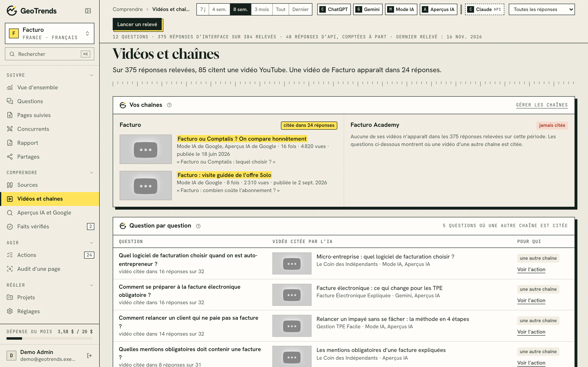

<!-- Page générée depuis la documentation du site (src/site/docs) par scripts/exporter-docs.ts : ne pas la modifier ici. -->

# Vidéos et chaînes

> Vos chaînes YouTube sont-elles citées par les IA, sur quelles questions une vidéo d’une autre chaîne prend la place, et quelles autres chaînes reviennent ?

[← Sommaire de la documentation](../README.md) · [Read this page in English](../../en/understand/videos.md)

Les IA citent aussi des vidéos YouTube. Une vidéo citée compte pour la chaîne qui l’a publiée, pas pour youtube.com : si la chaîne est celle de la marque, la citation compte pour la marque. L’écran Vidéos et chaînes répond à trois questions : vos chaînes sont-elles citées ? Sur quelles questions une autre vidéo prend-elle la place ? Quelles chaînes sont citées à votre place ?

Le lien **Gérer les chaînes** ouvre l’onglet Marque et propriétés de la fiche du projet, où les chaînes se déclarent. Depuis la liste de travail, une ligne « Tourner une vidéo » renvoie aux mêmes questions.

*L’écran Vidéos et chaînes du projet Facturo : la carte de chaque chaîne déclarée (Facturo, Facturo Academy), puis les questions où une vidéo est citée.*

## Une seule unité : la réponse relevée

Tout l’écran compte en réponses : combien de réponses relevées citent une vidéo, et laquelle. Seuls les relevés d’interface comptent : une vidéo citée par Claude, interrogé par son API, n’est pas ce que voit un internaute. La phrase du haut donne le compte : sur tant de réponses relevées, tant citent une vidéo YouTube, et une vidéo de la marque apparaît dans tant de réponses. Quand seul Google cite des vidéos (Mode IA ou Aperçus IA), la phrase le précise.

Chaque vidéo citée est rattachée à sa chaîne, avec son titre, son nombre de vues et sa date de publication, par l’API publique de YouTube (gratuite). Les miniatures viennent de l’adresse publique de YouTube, sans appel en plus.

## Vos chaînes

Une carte par chaîne déclarée, même si elle n’est jamais citée. La carte dit « citée dans tant de réponses » ou « jamais citée ». Pour chaque vidéo citée : sa miniature, son titre, les IA qui la citent, le nombre de citations, ses vues, sa date de publication, et le **Passage cité** quand l’adresse retenue par l’IA pointe un moment précis de la vidéo.

Sans chaîne déclarée, l’écran affiche « Aucune chaîne YouTube n’est déclarée pour la marque. » et le bouton **Déclarer une chaîne**. Les vidéos citées restent listées dessous.

## Question par question

Les questions pour lesquelles une IA cite au moins une vidéo. En haut, celles où la vidéo citée n’est pas la vôtre : une vidéo sur le même sujet a des chances d’y entrer.

| Colonne | Ce qu’elle montre |
| --- | --- |
| **Question** | Le texte de la question, et « vidéo citée dans tant de réponses sur tant ». |
| **Vidéo citée par l’IA** | Trois vidéos au plus, avec leur miniature, leur chaîne et les IA qui les citent. Un clic sur une IA ouvre la réponse. |
| **Pour qui** | « vous » si une de vos vidéos est citée, sinon « une autre chaîne ». **Voir l’action** ouvre la ligne correspondante de la liste de travail. |

## Les autres chaînes citées

Les chaînes d’autres créateurs ou marques dont une vidéo est citée, avec leurs **Réponses**, **Vidéos**, **Questions**, les IA qui les citent (**Citée par**) et leur **Vidéo la plus citée**. Celles qui reviennent souvent sont vos concurrents sur YouTube pour ces questions.

## Choisir la prochaine vidéo

1. **Déclarer vos chaînes.** Dans la fiche du projet, onglet **Marque et propriétés**, ajoutez chaque chaîne (Facturo, Facturo Academy) par son adresse ou son nom précédé de @. Sans cela, une de vos vidéos compterait pour quelqu’un d’autre.

2. **Lire vos cartes.** Une chaîne « jamais citée » n’est pas forcément absente des réponses : la marque peut y être par son site ou son nom.

3. **Repérer les questions prises par une autre chaîne.** Dans **Question par question**, les lignes « une autre chaîne » sont en haut. Regardez le sujet, la durée et le passage cité de la vidéo retenue.

4. **Passer à l’action.** **Voir l’action** ouvre la ligne « Tourner une vidéo sur … » de la liste de travail. Marquez-la « En cours », puis « Fait » quand la vidéo est en ligne : l’outil comparera avant et après.

## Limites

> [!WARNING]
> Les nombres sont souvent petits : peu de réponses citent une vidéo, et souvent seulement chez Google. Les vues sont celles du jour où la vidéo a été rattachée, pas celles d’aujourd’hui. Une vidéo ne compte pour la marque que si sa chaîne est déclarée. Publier une vidéo sur un sujet ne garantit pas qu’une IA la cite : l’écran dit où la place est prise, pas comment l’obtenir à coup sûr.

**Voir aussi**

- [Sites, chaînes YouTube et réseaux sociaux](../projet/sites-chaines-reseaux.md)
- [La liste de travail](../agir/liste-de-travail.md)
- [Quelles vidéos YouTube tourner ?](../cas-usage/videos-a-tourner.md)

---

Mise à jour : 2026-11-18 · [Lire cette page sur le site](https://geotrends.io/documentation/comprendre/videos)
