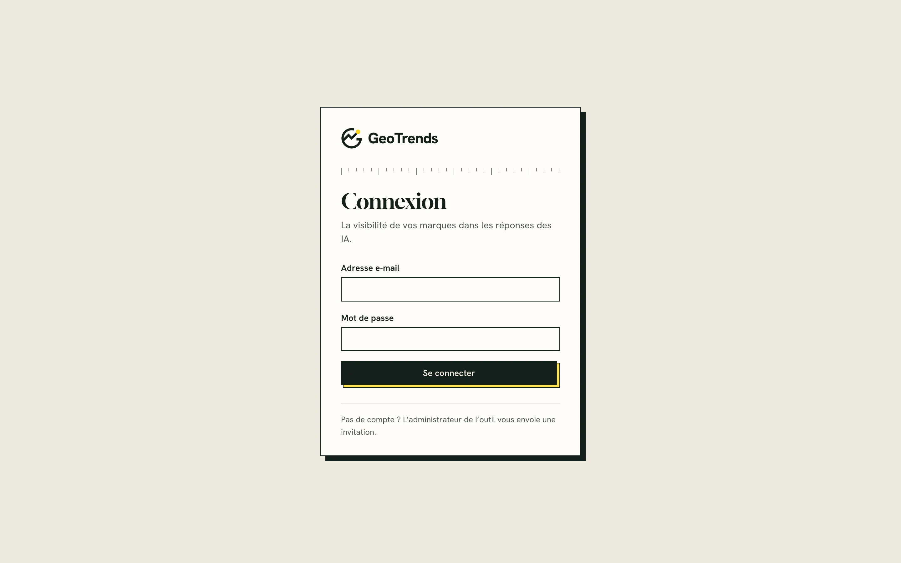
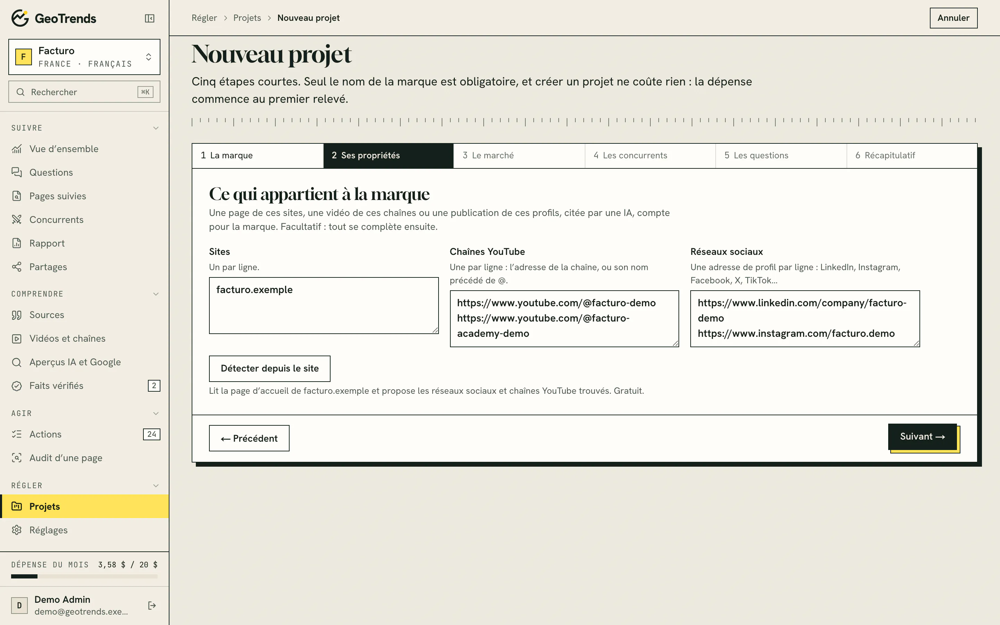
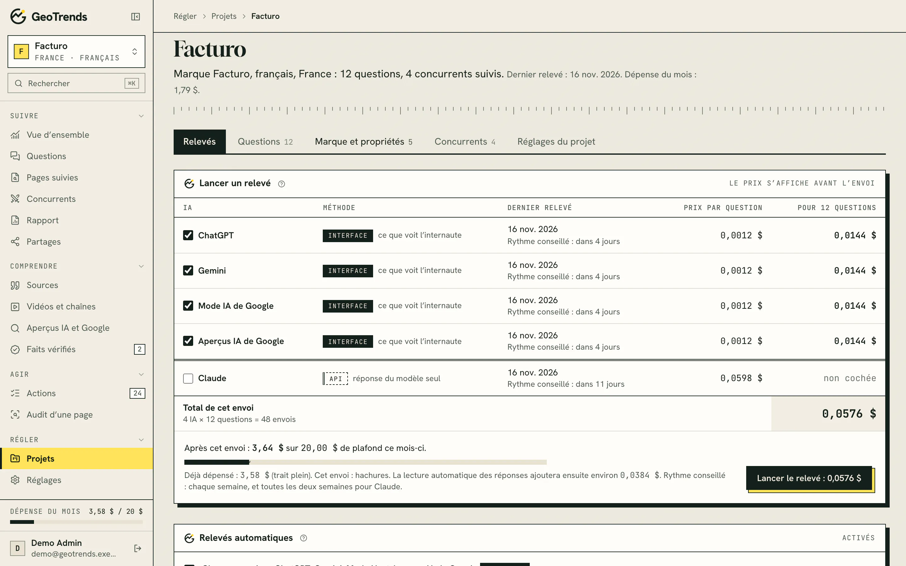

<!-- Page générée depuis la documentation du site (src/site/docs) par scripts/exporter-docs.ts : ne pas la modifier ici. -->

# Prise en main

> Du premier projet aux premiers résultats en six étapes : créer la marque, déclarer ce qui lui appartient, écrire ses questions, lancer un relevé, puis lire.

[← Sommaire de la documentation](../README.md) · [Read this page in English](../../en/get-started/quick-start.md)

Cette page suit le chemin le plus court, de la connexion aux premiers résultats. Comptez une demi-heure, dont quelques minutes d’attente pendant que les réponses reviennent. Rien n’est payant avant l’étape 5, et le prix s’affiche toujours avant l’envoi.

## Avant de commencer

- L’outil installé et un compte. Le premier compte se crée au premier lancement ; les suivants, par invitation de l’administrateur. Voir [Installer GeoTrends](./installer.md) et [Comptes et connexion](../piloter/comptes.md).
- Le nom de la marque tel que les IA l’écrivent, son site, sa chaîne YouTube et ses profils sociaux s’il y en a.
- Une dizaine de questions qu’un client poserait à une IA, avec ses mots. Gardez-en une bonne part sans le nom de la marque : ce sont elles qui amènent de nouveaux clients.

## Les six étapes

1. **Se connecter.** Ouvrez la page de connexion (bouton **Se connecter** en haut du site), puis saisissez votre adresse e-mail et votre mot de passe. L’outil s’ouvre sur la vue d’ensemble du dernier projet affiché.

   

2. **Créer le projet.** Menu **Régler › Projets**, puis **Nouveau projet**. La création tient en cinq étapes courtes et un récapitulatif : la marque, ses propriétés, le marché (pays et langue), les concurrents, les questions. Seul le nom de la marque est obligatoire, et créer un projet ne coûte rien. Détail : [Créer un projet](../projet/creer-un-projet.md).

   

3. **Déclarer ce qui appartient à la marque.** Sites, chaînes YouTube, réseaux sociaux, autres écritures du nom. Une page de ces sites ou une vidéo de ces chaînes, citée par une IA, compte alors pour la marque. Le bouton **Détecter depuis le site** lit la page d’accueil et propose les profils trouvés, gratuitement ; relisez avant d’ajouter. Détail : [Sites, chaînes YouTube et réseaux sociaux](../projet/sites-chaines-reseaux.md).

4. **Écrire les questions.** Une question par ligne, comme un client la poserait. Dix suffisent pour commencer. Une question déjà relevée ne se modifie plus : on l’archive, son historique reste. Conseils d’écriture : [Écrire les questions à suivre](../projet/questions.md).

5. **Lancer le premier relevé.** Sur la fiche du projet, onglet **Relevés**, le tableau donne le prix par question de chaque IA et le total. ChatGPT, Gemini, le Mode IA et les Aperçus IA de Google sont cochés ; Claude, plus cher, ne l’est pas. Cliquez sur **Lancer le relevé** : son prix est écrit sur le bouton. Les réponses reviennent en quelques minutes, 45 au plus, et la page se met à jour toute seule. Détail : [Lancer un relevé](../projet/lancer-un-releve.md).

   

6. **Lire les premiers résultats.** Ouvrez **Suivre › Vue d’ensemble**. Si un bandeau dit que des réponses n’ont pas encore été lues, **Lire les réponses** relève les marques nommées, leur rang et le ton (appel payant, son prix est affiché). Puis suivez l’ordre de lecture de [Lire ses premiers résultats](./premiers-resultats.md).

   

> [!NOTE]
> **Ce que coûte ce premier relevé**
>
> Une réponse relevée dans l’interface coûte 0,0012 $. Dix questions posées à quatre IA font 40 relevés, soit environ 0,05 $, plus environ 0,0008 $ par réponse pour la lecture automatique. Chaque appel est inscrit au journal des coûts. Voir [Ce que coûte un relevé](./couts.md).

## Ensuite

- **Suivre des concurrents.** Après le premier relevé, l’écran Concurrents propose les marques que les IA nomment le plus sur vos questions. **Suivre** en fait un concurrent : gratuit, cela ne lance aucun relevé. Voir [Choisir ses concurrents](../projet/concurrents.md).
- **Activer les relevés automatiques.** Sur l’onglet Relevés du projet : chaque semaine pour les IA relevées par l’interface, toutes les deux semaines pour Claude. Ils s’arrêtent d’eux-mêmes si le plafond du mois est atteint. Voir [Relevés automatiques](../projet/releves-automatiques.md).
- **Classer les sites et étiqueter les questions.** Deux clics, à quelques centimes au plus pour un projet, le prix écrit sur chaque bouton : le type de chaque site cité (sur Sources) et le thème de chaque question (sur Questions). La suite se fait toute seule.
- **Ouvrir la liste de travail.** L’écran Actions réunit ce qu’il faut faire, tiré des relevés. Voir [La liste de travail](../agir/liste-de-travail.md).

> [!WARNING]
> Un premier relevé est un échantillon : une réponse par question et par IA. Il dit où la marque apparaît aujourd’hui, pas une tendance. Les courbes et les écarts prennent leur sens à partir du deuxième ou du troisième relevé.

**Voir aussi**

- [Notions clés](./notions-cles.md)
- [Lire ses premiers résultats](./premiers-resultats.md)
- [Créer un projet](../projet/creer-un-projet.md)
- [Suis-je en train de suivre les bonnes questions ?](../cas-usage/suivre-les-bonnes-questions.md)

---

Mise à jour : 2026-11-25 · [Lire cette page sur le site](https://geotrends.io/documentation/demarrer/prise-en-main)
