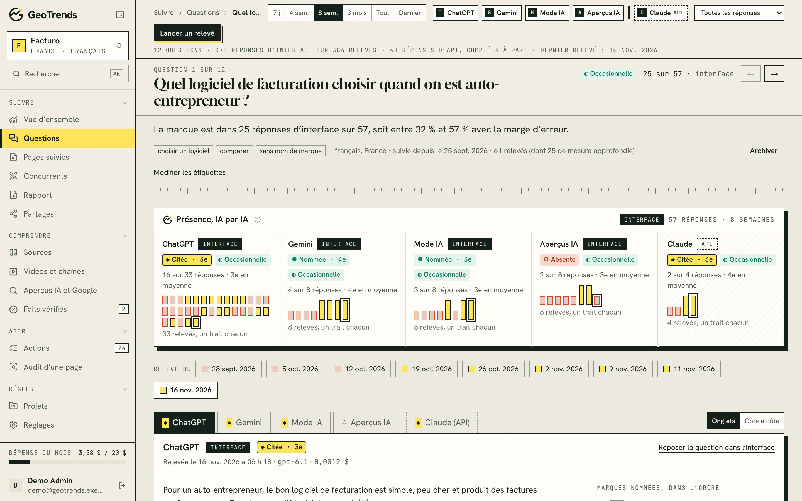
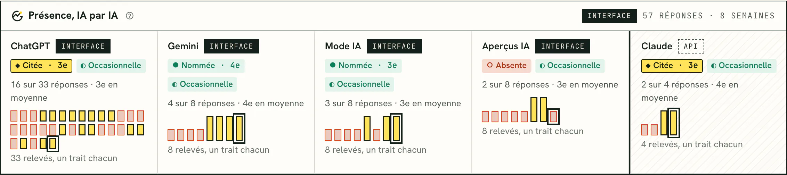
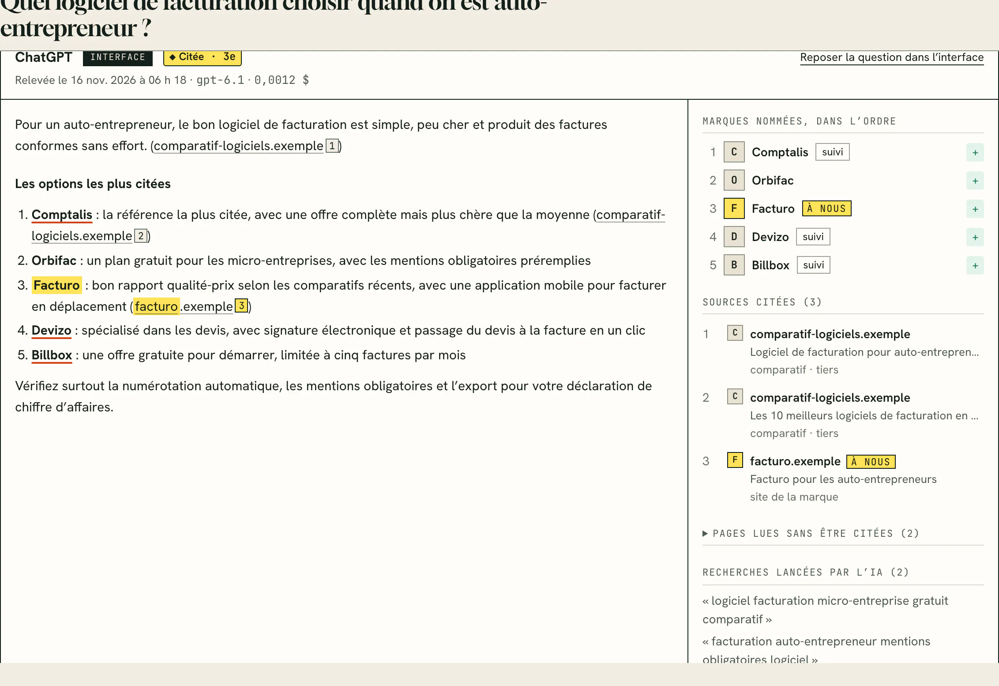

<!-- Page générée depuis la documentation du site (src/site/docs) par scripts/exporter-docs.ts : ne pas la modifier ici. -->

# La page d’une question

> Tout sur une question : le verdict et sa marge d’erreur, l’état chez chaque IA, chaque réponse entière avec ses sources, qui gagne et grâce à quelles pages.

[← Sommaire de la documentation](../README.md) · [Read this page in English](../../en/measure/prompt-page.md)

La page d’une question sert à comprendre pourquoi la marque gagne ou perd sur cette question précise, et ce qu’il faut corriger. On y lit le verdict, puis les réponses elles-mêmes, IA par IA, avec leurs sources : c’est la preuve derrière chaque chiffre de l’outil.

Pour y aller : un clic sur une question, partout dans l’outil (le tableau de l’écran Questions, la grille de couverture de la vue d’ensemble, la preuve d’une action, une alerte). Un clic sur un état ou un carreau ouvre directement la réponse de cette IA. Les flèches ← et → de l’en-tête passent à la question précédente ou suivante du projet.

*La page d’une question du projet Facturo : le verdict, la présence IA par IA avec un trait par relevé, puis les réponses en onglets.*

## L’en-tête et le verdict

En haut, restent visibles quand on fait défiler : le rang de la question dans le projet (« Question 3 sur 10 », ou « Question archivée »), son texte, son verdict et le compte des réponses d’interface. Dessous, une phrase dit le résultat avec sa marge d’erreur : la marque est dans tant de réponses d’interface sur tant, soit entre deux pourcentages, à partir de 5 réponses. Avec moins de 3 réponses, la phrase dit qu’il est trop tôt ; avec moins de 20, que la marge reste large et qu’une mesure approfondie la resserre.

Viennent ensuite les étiquettes : le thème (un clic ouvre les questions de ce thème), l’intention, et « avec » ou « sans nom de marque ». Puis le marché, la date depuis laquelle la question est suivie, et son nombre de relevés, dont ceux de mesure approfondie. **Archiver** la retire du suivi (son historique reste) ; une question archivée affiche **Reprendre le suivi**.

**Modifier les étiquettes** ouvre deux champs : le **Thème**, en un à trois mots, avec les thèmes déjà employés dans le projet, et l’**Intention** (s’informer, comparer, acheter, ou non classée). **Enregistrer** est gratuit, et une étiquette posée à la main n’est plus changée par le modèle.

## Présence, IA par IA

Une case par IA, Claude à part. Chacune donne l’état du relevé affiché (ou « Pas relevée ce jour-là »), le verdict de l’IA à partir de 3 réponses, le compte des réponses avec la marque et le rang moyen quand il est connu. Dessous, une frise : un trait par relevé, surligné quand la marque est là. Un clic sur un trait ouvre la réponse de ce jour-là. Avec un seul relevé, la case le rappelle : c’est un échantillon.

La ligne **Relevé du** choisit le jour affiché, chaque jour marqué d’un carreau jaune si la marque y apparaît chez au moins une IA. Par défaut, c’est le dernier jour de relevé.

*Présence, IA par IA, sur une question : l’état du relevé affiché, le verdict, et une frise avec un trait par relevé, surligné quand la marque est là.*

## Les réponses

Les réponses du jour choisi s’affichent en **Onglets** (une IA à la fois, sur toute la largeur) ou **Côte à côte** (une colonne par IA). Le choix est retenu ; sur téléphone, ce sont toujours des onglets. Chaque onglet porte un signe : la marque présente, absente, ou pas de réponse.

En tête de chaque réponse : l’IA, sa méthode, l’état, la date et l’heure du relevé, le modèle qui a répondu et le coût du relevé. Le lien **Reposer la question dans l’interface** ouvre l’IA sur cette question, pour voir par vous-même. Quand la question a été posée plusieurs fois ce jour-là (mesure approfondie), « Réponse 2 sur 10 ce jour-là » et les liens précédente et suivante passent de l’une à l’autre.

Le texte est celui que l’IA a écrit : il n’est jamais traduit ni corrigé. La marque y est surlignée, un concurrent suivi est souligné, et chaque source citée porte son numéro. À côté, ce que l’outil tire de la réponse :

| Bloc | Ce qu’il contient |
| --- | --- |
| **Marques nommées, dans l’ordre** | Le rang de chaque marque, la vôtre surlignée, la mention « suivi » pour un concurrent suivi, un + ou un − quand le ton est positif (recommandée) ou négatif (déconseillée). Si la marque manque, la liste se termine par « Facturo : absente ». |
| **Sources citées** | Les sources numérotées comme dans le texte : le site ou la chaîne YouTube, « à nous » pour une page de la marque, le titre, le type du site et à qui il appartient. |
| **Pages lues sans être citées** | Les pages que l’IA a ouvertes sans les citer, repliées. Données par ChatGPT et Claude seulement. |
| **Recherches lancées par l’IA** | Ce que l’IA a tapé dans un moteur avant de répondre. ChatGPT et Claude seulement. |
| **Questions associées** | Les questions que Google affiche avec ses résultats. |
| **Les 10 premiers résultats de Google** | Pour les Aperçus IA : les dix premiers résultats classiques, votre site surligné, chacun marqué « cité par l’Aperçu » ou « pas cité ». |

Une réponse en attente propose **Récupérer les réponses**. Un échec donne sa raison. Un Aperçu IA absent le dit : Google n’a pas affiché d’aperçu ce jour-là, ce n’est pas une absence de la marque.

*Les réponses côte à côte : le texte de chaque IA, la marque surlignée, et à droite les marques nommées et les sources citées.*

## Sur cette question

Ce bloc reprend toutes les réponses d’interface de la période, pas seulement celles du jour choisi.

- **Qui gagne** : les marques les plus nommées, avec leur compte sur les réponses lues, la vôtre comprise.
- **Les pages qui font gagner** : les pages citées par au moins deux IA différentes, hors pages de la marque. Un clic ouvre leur fiche dans l’écran Sources.
- **Nos pages** : les pages et vidéos de la marque citées, ou lues sans être citées, sur cette question.
- **Actions liées** : les lignes de la liste de travail dont cette question est la preuve, avec **Voir dans la liste de travail**.

## Évolution et historique

**Évolution de la question** trace la présence de la marque jour de relevé après jour de relevé : une courbe par IA d’interface et une pour toutes, avec la bande grise de la marge d’erreur. Sur une seule question, l’échantillon est petit et la bande large. Claude a son propre graphique, en pointillé. Plus bas, le bloc **Mesure approfondie** pose la question plusieurs fois de suite (voir [Mesure approfondie](./mesure-approfondie.md)), puis **Historique des relevés** donne une ligne par jour, la plus récente en haut, avec l’état chez chaque IA. Un clic sur un jour ou un état ouvre la réponse correspondante.

## Comprendre une question perdue

1. **Lire le verdict et sa marge.** « Absente » sur 12 réponses n’a pas le même poids qu’« absente » sur 2. La phrase sous l’en-tête donne le compte.

2. **Ouvrir la réponse la plus récente.** Onglet par onglet, lisez qui est nommé à la place de Facturo, et à quel rang.

3. **Regarder les sources.** Les pages citées sont celles sur lesquelles l’IA s’appuie. Un comparatif de logiciels de facturation sur un site .exemple revient chez trois IA ? C’est là qu’il faut apparaître.

4. **Vérifier vos pages.** Dans **Nos pages**, une page lue mais pas citée a été trouvée : il lui manque une réponse nette à la question. Pour les Aperçus IA, regardez si votre site est dans les dix premiers résultats de Google.

5. **Passer à l’action.** **Actions liées** reprend ce que la liste de travail propose pour cette question.

## Limites

> [!WARNING]
> Sur une seule question, quelques réponses par IA ne font pas une tendance : la marge d’erreur le montre. Les marques nommées, leur rang et le ton sont lus par un petit modèle, sauf pour ChatGPT ; tant que la lecture n’est pas faite, le bloc le dit. Reposer la question vous-même donnera sans doute une autre réponse : l’IA ne répond jamais deux fois pareil, et votre historique de navigation peut jouer. Les pages lues et les recherches ne sont connues que pour ChatGPT et Claude.

**Voir aussi**

- [Mesure approfondie](./mesure-approfondie.md)
- [Toutes les réponses](./reponses.md)
- [ChatGPT cite-t-il ma marque, et sur quelles questions ?](../cas-usage/chatgpt-cite-t-il-ma-marque.md)
- [Ma page est lue mais pas citée : que corriger ?](../cas-usage/page-lue-pas-citee.md)

---

Mise à jour : 2026-11-18 · [Lire cette page sur le site](https://geotrends.io/documentation/mesurer/fiche-question)
