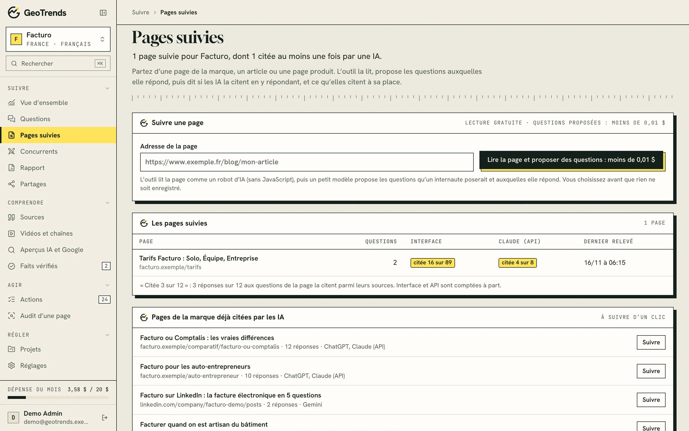
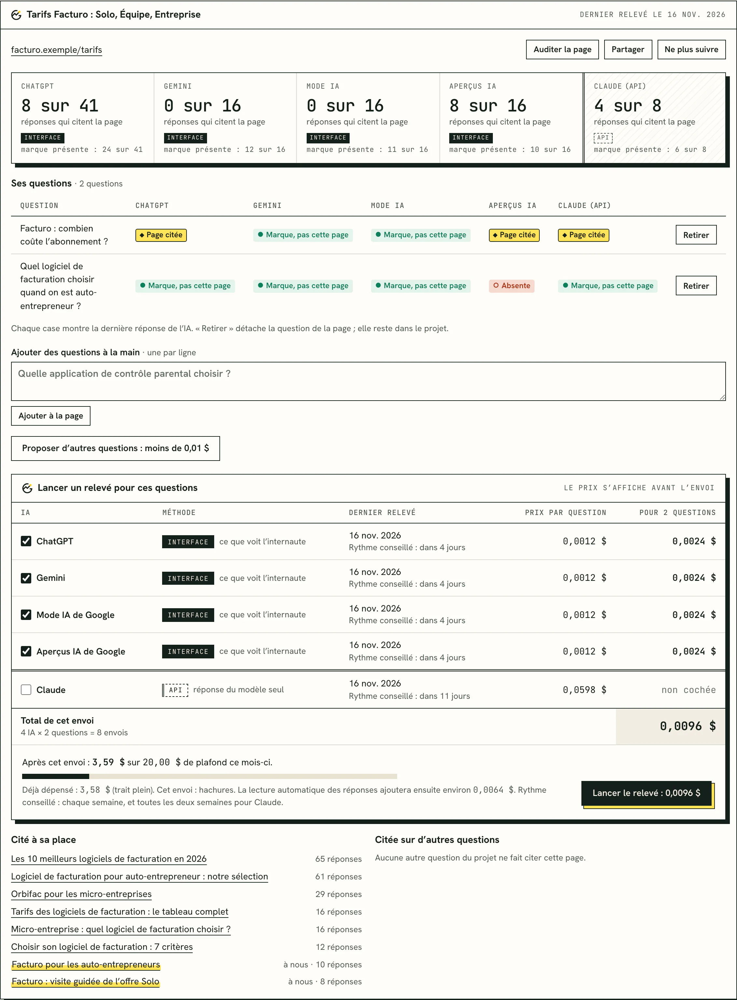

<!-- Page générée depuis la documentation du site (src/site/docs) par scripts/exporter-docs.ts : ne pas la modifier ici. -->

# Pages suivies

> Partir d’une page de la marque : l’outil la lit, propose les questions auxquelles elle répond, puis dit si les IA la citent et ce qu’elles citent à sa place.

[← Sommaire de la documentation](../README.md) · [Read this page in English](../../en/measure/tracked-pages.md)

On pense souvent par page : un article sponsorisé, une page produit, un comparatif. L’outil, lui, part des questions : il les pose aux IA et note les pages qu’elles citent. L’écran **Pages suivies** (menu **Suivre**) fait le lien entre les deux. Vous collez l’adresse d’une page de la marque ; l’outil la lit, propose les questions qu’un internaute poserait et auxquelles elle répond, puis montre, IA par IA, si les réponses à ces questions la citent.

*L’écran Pages suivies : coller l’adresse d’une page, la liste des pages suivies avec leur bilan, et les pages de la marque déjà citées, à suivre d’un clic.*

## Suivre une page

1. **Coller l’adresse.** Dans **Suivre une page**, l’adresse complète (https://…), puis **Lire la page et proposer des questions**. Autres chemins : **Partir d’une page** sur l’écran Questions, ou **Suivre** sur une page de l’onglet **Nos pages** de Sources.

2. **Relire les questions proposées.** L’outil lit la page comme un robot d’IA, sans JavaScript (gratuit). Un petit modèle propose jusqu’à six questions, la plupart sans le nom de la marque (moins d’un centime, inscrit au journal des coûts). Décochez celles qui ne conviennent pas, retouchez le texte, **Retirer** en supprime une, et le champ du dessous en **Ajoute** à la main.

3. **Suivre la page.** **Suivre la page avec … questions** (gratuit). Les questions rejoignent le projet : elles comptent ensuite dans ses chiffres et ses relevés automatiques. Vous pouvez aussi **rattacher des questions déjà suivies**.

4. **Lancer le relevé.** Sur la fiche de la page, **Lancer un relevé pour ces questions**, au prix affiché (0,0012 $ par question et par IA d’interface). Les réponses arrivent en quelques minutes.

> [!NOTE]
> **Pourquoi des questions sans le nom de la marque**
>
> Une question qui nomme la marque fait presque toujours citer son site. Ce qui compte, c’est de savoir si l’IA cite la page quand l’internaute ne la connaît pas encore : « Quelle application de contrôle parental choisir ? » plutôt que « Que vaut l’application X ? ».

## La fiche d’une page

*La fiche d’une page suivie : IA par IA, les réponses qui la citent ; puis chaque question avec la dernière réponse de chaque IA, et ce qui est cité à sa place.*

- **IA par IA** : « 3 sur 12 réponses qui citent la page », et en dessous la présence de la marque (nommée ou autre page citée). Claude, mesuré par son API, a sa tuile à part.
- **Ses questions** : une ligne par question, une colonne par IA, avec la dernière réponse : **Page citée**, **Marque, pas cette page**, **Lue, pas citée**, **Absente** ou **Sans réponse**. Un clic ouvre la réponse.
- **Retirer** détache une question de la page ; elle reste dans le projet. **Ajouter des questions à la main** (une par ligne) et **Proposer d’autres questions** complètent la liste.
- **Cité à sa place** : les pages citées dans les réponses qui ne citent pas la sienne. C’est là qu’il faut regarder pour comprendre ce que l’IA préfère.
- **Citée sur d’autres questions** : les réponses à d’autres questions du projet qui la citent aussi.
- En haut : **Auditer la page** (lisible par les robots des IA ?), **Partager** (une page privée pour un client, sur ces questions) et **Ne plus suivre** (ses questions restent dans le projet).

## Retrouver une page

La recherche rapide (⌘ K sur Mac, Ctrl K ailleurs) trouve aussi les pages : celles que vous suivez mènent à leur fiche, les autres pages citées à leur fiche dans Sources. Tapez un bout de l’adresse ou du titre.

## Limites

> [!WARNING]
> Une page n’est mesurée que sur ses questions : si une IA la cite pour une question que vous ne suivez pas, l’outil ne le voit pas. Les questions proposées sont un point de départ, à relire. Une page dont le texte ne s’affiche qu’avec JavaScript ne peut pas être lue : l’audit de la page le dit.

**Voir aussi**

- [L’écran Questions](./questions.md)
- [Sources citées](../comprendre/sources.md)
- [Audit d’une page](../agir/audit.md)
- [Partager avec un client](../piloter/partager-avec-un-client.md)

---

Mise à jour : 2026-11-20 · [Lire cette page sur le site](https://geotrends.io/documentation/mesurer/pages-suivies)
