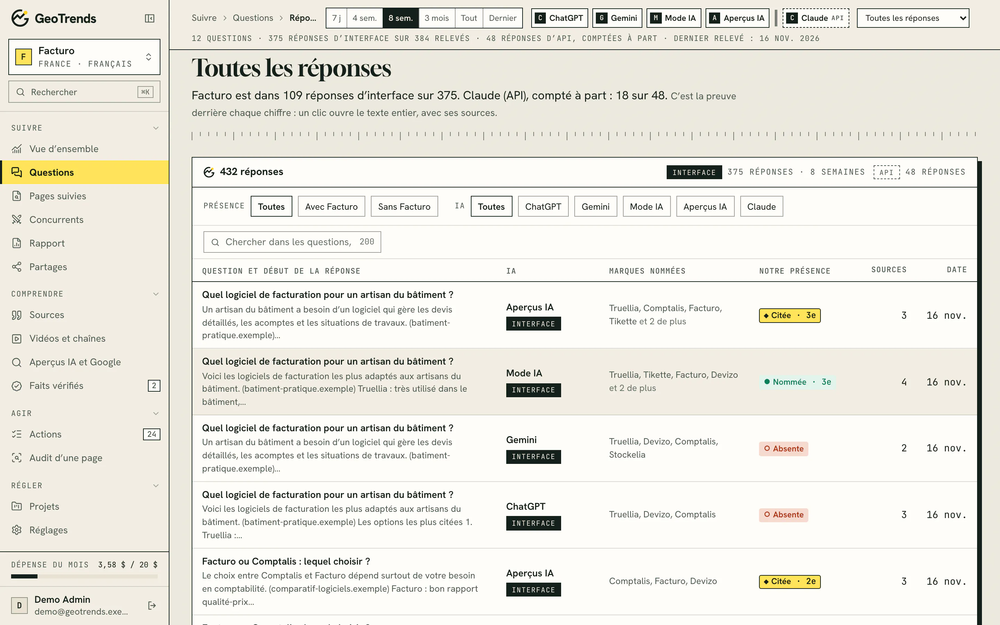

<!-- Page générée depuis la documentation du site (src/site/docs) par scripts/exporter-docs.ts : ne pas la modifier ici. -->

# Toutes les réponses

> La preuve derrière chaque chiffre : les réponses relevées, filtrées par IA, par présence de la marque, par marque nommée ou site cité, chacune lisible en entier.

[← Sommaire de la documentation](../README.md) · [Read this page in English](../../en/measure/answers.md)

Un chiffre n’est utile que si l’on peut voir ce qu’il compte. L’écran Réponses liste les réponses relevées qui se cachent derrière un chiffre : celles de ChatGPT, celles qui nomment Comptalis, celles qui citent un site, celles où Facturo est absente. Un clic ouvre la réponse entière, sans quitter la liste.

L’écran n’a pas d’entrée propre dans le menu : on y arrive depuis un chiffre. Le nombre souligné de la phrase du haut, sur la vue d’ensemble, ouvre les réponses avec la marque ; **Toutes les réponses**, sous les dernières réponses, ouvre la liste complète. Un clic sur une marque dans un classement, sur une IA dans un tableau ou sur un site dans l’écran Sources ouvre la liste déjà filtrée. La recherche rapide (⌘K ou Ctrl K) y mène aussi, par le nom d’une marque.

*L’écran Réponses du projet Facturo : une ligne par réponse, avec l’IA, les marques nommées et la présence de la marque ; à droite, une réponse ouverte en entier.*

## Ce que la liste montre

Le titre dit la sélection : « Toutes les réponses », ou par exemple « Réponses ChatGPT, avec Facturo ». La phrase dessous compte les réponses reçues où la marque apparaît. Au-dessus de la liste, deux choix se combinent avec le filtre venu de l’écran d’origine :

- **Présence** : Toutes, **Avec Facturo**, **Sans Facturo**. « Sans » ne garde que les réponses reçues : une question sans Aperçu IA n’est pas une absence.
- **IA** : Toutes, ou une IA. Claude, mesuré par son API, est une IA parmi les autres dans ce choix, avec son tampon API dans la liste.

D’autres filtres n’arrivent que par un lien d’un autre écran, et s’ajoutent au titre : les réponses **qui nomment** une marque, **qui citent** un site ou une page, **mesurées par l’interface** ou **par l’API**, ou les réponses **à la question** choisie. **Tout afficher** les retire tous. La période et les IA de la barre du haut s’appliquent aussi.

| Colonne | Ce qu’elle montre |
| --- | --- |
| **Question et début de la réponse** | Le texte de la question, puis les premiers mots de la réponse, tels que l’IA les a écrits. Pour une réponse vide, en attente ou en échec, la raison. |
| **IA** | Le nom de l’IA et sa méthode, interface ou API. |
| **Marques nommées** | Les quatre premières marques nommées, dans l’ordre, puis « et n de plus ». « pas encore lues » tant que la lecture n’est pas faite. |
| **Notre présence** | L’état de la marque dans cette réponse : Citée, Nommée (avec son rang), Lue, Absente, Pas d’aperçu, En attente, Échec. |
| **Sources** | Le nombre de sources citées. |
| **Date** | Le jour du relevé. |

Les colonnes se trient d’un clic. Au-delà de huit réponses, un champ cherche dans les questions, le texte des réponses et les marques. Les 200 réponses les plus récentes sont affichées ; au-delà, une ligne le dit, et un filtre réduit la liste.

## Lire une réponse

Un clic sur une ligne ouvre un panneau à droite : la question, l’IA et le jour, la méthode, l’état, l’heure du relevé et le modèle. Puis le texte entier, avec la marque surlignée, les concurrents suivis soulignés et les sources numérotées, et dessous les **Marques nommées, dans l’ordre** et les **Sources citées**. **Ouvrir la question** mène à la page de la question, sur cette IA et ce jour, pour tout le reste : les pages lues, les recherches de l’IA, l’historique.

> [!NOTE]
> **Les mesures approfondies**
>
> Comme les chiffres d’ensemble, la liste ne compte pas les relevés d’une mesure approfondie : une question posée vingt-cinq fois la noierait. Ils y apparaissent quand la liste est filtrée sur leur question.

## Vérifier ce que dit un chiffre

1. **Partir du chiffre.** Sur la vue d’ensemble, la ligne Gemini du tableau **Présence, IA par IA** affiche une visibilité basse : cliquez sur Gemini.

2. **Garder les absences.** Choisissez **Présence › Sans Facturo** : il ne reste que les réponses de Gemini où la marque manque.

3. **Lire les marques nommées.** La colonne **Marques nommées** montre qui revient à sa place. Triez par question pour voir les sujets.

4. **Ouvrir une réponse.** Un clic affiche le texte entier et ses sources. **Ouvrir la question** pour aller plus loin.

## Limites

> [!WARNING]
> Sans filtre de méthode, la phrase du haut compte ensemble les réponses d’interface et celles de Claude par son API ; pour un compte d’une seule méthode, choisissez une IA ou partez d’un chiffre de la vue d’ensemble, qui filtre sur la méthode. Les réponses sont montrées telles que relevées, jamais traduites. Les marques nommées viennent de la lecture par un petit modèle, sauf pour ChatGPT.

**Voir aussi**

- [La page d’une question](./fiche-question.md)
- [Vue d’ensemble](./vue-d-ensemble.md)
- [Qui est cité à ma place ?](../cas-usage/qui-est-cite-a-ma-place.md)
- [ChatGPT cite-t-il ma marque, et sur quelles questions ?](../cas-usage/chatgpt-cite-t-il-ma-marque.md)

---

Mise à jour : 2026-11-18 · [Lire cette page sur le site](https://geotrends.io/documentation/mesurer/reponses)
