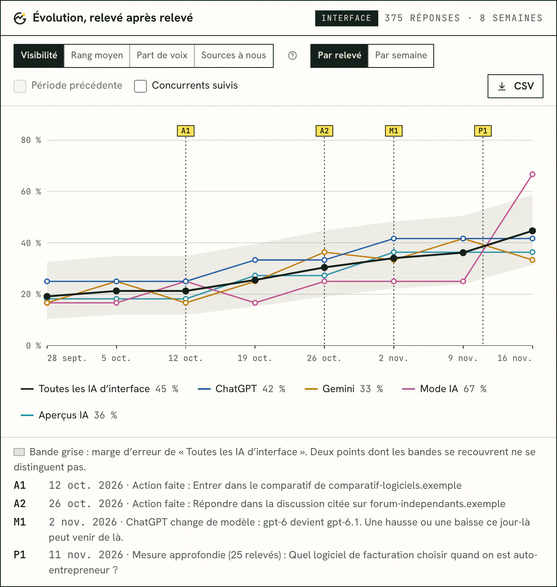
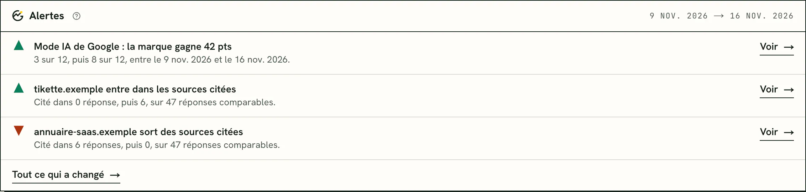

<!-- Page générée depuis la documentation du site (src/site/docs) par scripts/exporter-docs.ts : ne pas la modifier ici. -->

# Vue d’ensemble

> L’écran d’accueil de l’outil : visibilité, part de voix, rang moyen, alertes et présence IA par IA, puis les trois actions de la semaine. Chaque chiffre dit sa méthode.

[← Sommaire de la documentation](../README.md) · [Read this page in English](../../en/measure/overview.md)

La vue d’ensemble s’ouvre après la connexion. Elle répond à deux questions : où en est la marque dans les réponses des IA, et qu’est-ce qui a changé depuis la dernière fois ? Tout vient des relevés déjà en base : ouvrir cet écran ne coûte rien.

Pour y aller : menu **Suivre › Vue d’ensemble**, ou un clic sur le logo en haut du menu. L’écran montre le projet choisi en haut du menu, sur la période et les IA réglées dans la barre du haut.

*La vue d’ensemble du projet Facturo : la phrase du haut, les chiffres clés, puis le grand graphique et les marques les plus nommées.*

## La barre du haut

Elle est la même sur tous les écrans de mesure et reste visible quand on fait défiler la page. À gauche, le fil d’Ariane et le projet. Au milieu, les filtres. À droite, les boutons de l’écran : **Exporter** (le CSV de l’écran), **Lancer un relevé** et la recherche rapide.

| Filtre | Ce qu’il change |
| --- | --- |
| **Période** | 7 jours, 4 semaines, 8 semaines (le réglage par défaut), 3 mois, **Tout l’historique** ou **Dernier relevé seul** (la réponse la plus récente de chaque IA pour chaque question). Les écarts comparent à la période de même durée juste avant. |
| **IA** | Une pastille par IA déjà relevée dans le projet. Un clic la masque ou l’affiche. La pastille de Claude porte la mention API : il n’est jamais additionné aux relevés d’interface. |
| **Face à** | Ne garde que les réponses qui nomment un concurrent suivi, pour voir où vous en êtes face à lui. Les réponses dont les marques ne sont pas encore lues sont écartées, et un bandeau le rappelle. |
| **Réinitialiser** | Revient à 8 semaines, toutes les IA, toutes les réponses. |

Ces réglages valent pour tous les écrans de mesure et sont retenus d’une page à l’autre. Sous la barre, une ligne rappelle ce que vous regardez : le nombre de questions, de réponses d’interface, de réponses d’API (comptées à part), de réponses en attente, et la date du dernier relevé.

> [!NOTE]
> **Lancer un relevé ne part pas d’ici**
>
> Le bouton **Lancer un relevé** ouvre l’onglet Relevés de la fiche du projet. C’est là que le prix de chaque IA s’affiche, avant tout envoi. Voir [Lancer un relevé](../projet/lancer-un-releve.md).

## La phrase du haut

En tête, une phrase donne le compte brut : la marque apparaît dans tant de réponses sur tant, relevées par l’interface. Un clic sur le nombre ouvre ces réponses. Dessous : le nombre d’IA, les dates couvertes, puis le compte de Claude, à part. S’il n’y a qu’un seul jour de relevé, l’écran le dit : c’est un échantillon, pas encore une tendance.

Un projet sans question affiche **Écrire mes questions** ; un projet sans relevé affiche **Préparer le premier relevé**, avec le prix d’un relevé d’interface pour toutes ses questions. Si les réponses ne sont pas encore revenues, la phrase le dit : elles arrivent en quelques minutes.

## Les chiffres clés

Chaque tuile porte sa méthode et sa base (« 12 sur 40 réponses », par exemple). La bulle d’aide dit comment le chiffre est calculé, et un clic sur la tuile ouvre l’écran qui en donne le détail.

| Tuile | Ce qu’elle compte | Méthode |
| --- | --- | --- |
| **Visibilité** | Part des réponses d’interface où la marque est nommée ou citée. Affichée à partir de 5 réponses ; en dessous, la tuile dit « À partir de 5 relevés ». La bulle donne la marge d’erreur. | interface |
| **Part de voix** | Mentions de la marque rapportées à celles de la marque et des concurrents suivis. « n.c. » tant qu’aucun concurrent n’est suivi. | interface |
| **Rang moyen** | Place moyenne de la marque parmi les marques nommées, dans les réponses où elle a un rang. Plus le chiffre est petit, mieux c’est. | interface |
| **Sources à nous** | Nombre de fois où une page du site ou une vidéo de la marque est citée comme source, avec le détail site et YouTube. | interface |
| **Aperçus IA** | Nombre de questions pour lesquelles Google affiche un Aperçu IA, sur les questions relevées. Une question sans aperçu n’est pas une absence de la marque. | interface |
| **Claude (API)** | Visibilité dans les réponses de Claude, interrogé par son API. La tuile n’apparaît que si Claude a été relevé. | API |

> [!NOTE]
> **Un écart coloré est un écart réel**
>
> Sous la valeur, l’écart avec la période d’avant s’affiche en points. Il n’est coloré (▲ en vert, ▼ en rouge) que s’il dépasse la marge d’erreur des deux périodes. Sinon il reste gris, avec la mention « dans la marge », ou « trop peu de relevés » s’il y a moins de 5 réponses d’un côté. Le calcul est détaillé dans [Méthode de mesure](../reference/methode.md).

## Le grand graphique

Le bloc **Évolution, relevé après relevé** trace une courbe par IA d’interface, et une pour toutes ces IA ensemble, avec sa bande grise : la marge d’erreur. Un point vaut un jour de relevé. Les segments sont droits, jamais lissés, et un jour sans relevé laisse un trou, pas un zéro. Les flèches gauche et droite du clavier lisent les points un à un.

- **Mesure affichée** : Visibilité, Rang moyen, Part de voix ou Sources à nous. La part de voix ne se trace qu’avec au moins un concurrent suivi.
- **Par relevé** ou **Par semaine** : un point par jour de relevé, ou un point par semaine.
- **Période précédente** : la même mesure sur la période d’avant, en pointillé.
- **Concurrents suivis** : la courbe de chaque concurrent à côté de la vôtre, sur la visibilité et la part de voix.
- **CSV** : les données du graphique, telles qu’affichées.

Des repères marquent trois événements sur la courbe : le jour où une IA change de modèle (une hausse ou une baisse ce jour-là peut venir de là), le jour où une action passe à « fait », et les mesures approfondies d’une question, qui ne comptent pas dans la courbe.

À droite, **Marques les plus nommées** classe les marques nommées dans les réponses lues, la vôtre surlignée, avec leur écart. **Tout le classement** ouvre l’écran Concurrents. Si Claude a été relevé, sa courbe a son propre bloc, **Claude, mesuré par son API**, en pointillé : elle n’est jamais tracée avec celles de l’interface.

*Le grand graphique : une courbe par IA d’interface, la bande grise de la marge d’erreur, les options au-dessus et les repères dessous.*

## Les alertes

Le bloc **Alertes** montre ce qui a changé entre les deux derniers jours de relevé, seulement quand l’écart dépasse la marge d’erreur : la visibilité qui monte ou baisse, une IA qui gagne ou perd la marque, une marque qui s’installe, une source qui entre ou sort, un Aperçu IA qui apparaît. Quatre au plus ici ; **Tout ce qui a changé** ouvre le rapport. Les alertes ne dépendent pas des filtres de la barre du haut. Quand rien ne dépasse la marge, l’écran écrit « Aucune alerte. »

*Le bloc Alertes : seulement les écarts qui dépassent la marge d’erreur entre les deux derniers jours de relevé, chacun avec son lien.*

## Présence, IA par IA

Une ligne par IA, jamais d’addition entre elles. Claude, mesuré par son API, est séparé des autres par un filet double. Les colonnes se trient d’un clic sur leur titre.

| Colonne | Définition |
| --- | --- |
| **IA** | Le nom de l’IA et, dessous, les modèles relevés. Les mentions « la plus forte » et « la plus faible » départagent les IA d’interface qui ont au moins 5 réponses. |
| **Méthode** | Interface ou API. |
| **Relevés** | Réponses reçues, sur les relevés envoyés. « sans aperçu » : les questions où Google n’a pas affiché d’Aperçu IA, qui ne comptent pas comme une absence. |
| **Visibilité** | Part des réponses où la marque est nommée ou citée, à partir de 5 réponses. En dessous, le compte seul (« 2 sur 4 »). |
| **Écart** | Écart avec la période d’avant, coloré seulement au-delà de la marge d’erreur. |
| **Rang moyen** | Place moyenne de la marque parmi les marques nommées. |
| **Site cité** | Réponses où une page du site (ou d’un profil social déclaré) figure parmi les sources. |
| **Vidéo citée** | Réponses où une vidéo d’une chaîne de la marque est citée, sans page du site. |
| **Nom seul** | La marque est nommée dans le texte, sans qu’une de ses pages soit citée. |
| **Lu, non cité** | Une page de la marque a été lue par l’IA, sans être citée comme source. |
| **Tendance** | La petite courbe de la visibilité de cette IA. |

## D’où vient la visibilité, et à qui vont les citations

**D’où vient la visibilité** répartit les réponses où la marque apparaît en trois parts : **Par le site**, **Par la chaîne YouTube**, **Par le seul nom**. Les trois ne se travaillent pas pareil : écrire, filmer, ou faire parler de la marque ailleurs.

**À qui profitent les citations** répartit toutes les sources citées : la marque, les concurrents suivis, les autres marques, puis les sites tiers rangés par type (comparatifs, médias, blogs…). Un clic sur une part ouvre l’écran Sources, filtré. Tant que des sites ne sont pas classés, une ligne le signale.

Quand le ton des réponses est lu, **Le ton employé pour Facturo** compte les mentions positives (la marque est recommandée), neutres (simplement citée) et négatives (déconseillée).

## Couverture : question par IA

Une ligne par question, une colonne par IA : le carreau montre le dernier relevé de chaque IA. Un clic sur un carreau ouvre la réponse. Quand une question a plusieurs relevés pour une IA, le compte « présente sur relevées » s’affiche à côté. La dernière colonne, **Couverture**, compte les IA d’interface où la marque apparaît, sur celles qui ont répondu.

| Carreau | Ce qu’il veut dire |
| --- | --- |
| **Citée** | Une page ou une vidéo de la marque figure parmi les sources. |
| **Nommée** | Le nom de la marque est dans la réponse. |
| **Absente** | L’IA a répondu sans la marque (y compris quand elle a lu une de ses pages sans la citer). |
| **Pas d’aperçu** | L’IA n’a rien affiché : ce n’est pas une absence. |

## Les marques et les sites cités à votre place

**Nommés à notre place** liste les autres marques nommées, avec leur nombre de réponses, le nombre de fois où elles sont nommées en premier et leur rang moyen. Le bouton **Suivre** en fait un concurrent du projet : c’est gratuit et ne lance aucun relevé. **Les sites que les IA citent** classe les sites le plus souvent cités, avec leur type.

## À faire cette semaine et dernières réponses

**À faire cette semaine** reprend les trois premières lignes de la liste de travail (à faire ou en cours), chacune avec sa preuve : le nombre de réponses et d’IA, et la question qui la justifie. **Dernières réponses** montre les six réponses les plus récentes ; **Toutes les réponses** ouvre la liste complète.

## Lire la vue d’ensemble en cinq minutes

1. **Vérifier ce que vous regardez.** Lisez la ligne sous la barre du haut : combien de questions, combien de réponses d’interface, combien en attente, la date du dernier relevé. Si des réponses sont en attente, attendez qu’elles reviennent.

2. **Lire la visibilité et son écart.** Un écart coloré est réel ; un écart gris est dans la marge d’erreur, il ne faut pas en tirer de conclusion.

3. **Repérer l’IA la plus faible.** Dans **Présence, IA par IA**, regardez la ligne marquée « la plus faible » et ses colonnes **Site cité**, **Nom seul** et **Lu, non cité** : elles disent si le problème vient du site, de la notoriété, ou d’une page trouvée mais pas retenue.

4. **Ouvrir les alertes.** Elles ne montrent que ce qui dépasse la marge d’erreur. Chaque alerte a un lien **Voir** vers la question, l’IA ou la source concernée.

5. **Passer à l’action.** Ouvrez la première ligne de **À faire cette semaine**, ou toute la liste de travail sur l’écran Actions.

## Limites

> [!WARNING]
> Les marques nommées, leur rang et le ton sont lus dans le texte par un petit modèle, sauf pour ChatGPT qui les renvoie lui-même. Tant que la lecture n’est pas faite, un bandeau propose **Lire les réponses**, avec son prix (environ 0,0008 $ par réponse). Avec une réponse par question et par IA à chaque date, peu d’écarts dépassent la marge d’erreur : c’est voulu, et c’est pourquoi l’écran affiche peu d’alertes.

**Voir aussi**

- [L’écran Questions](./questions.md)
- [Concurrents et part de voix](../comprendre/concurrents.md)
- [Rapport et alertes](../piloter/rapport-et-alertes.md)
- [Méthode de mesure](../reference/methode.md)

---

Mise à jour : 2026-11-18 · [Lire cette page sur le site](https://geotrends.io/documentation/mesurer/vue-d-ensemble)
