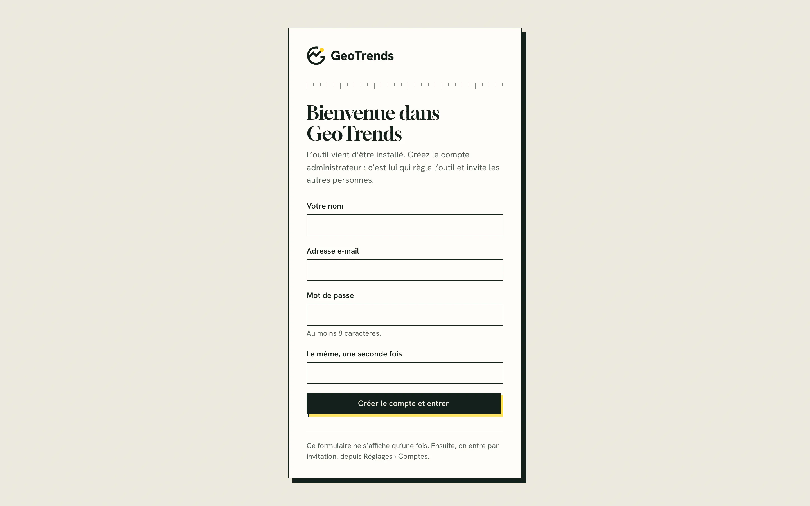
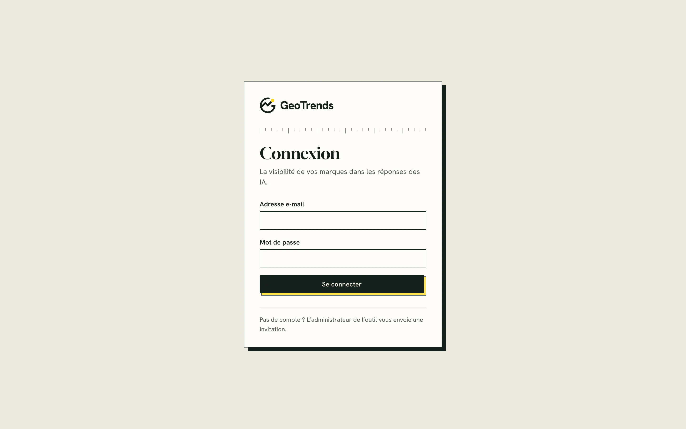
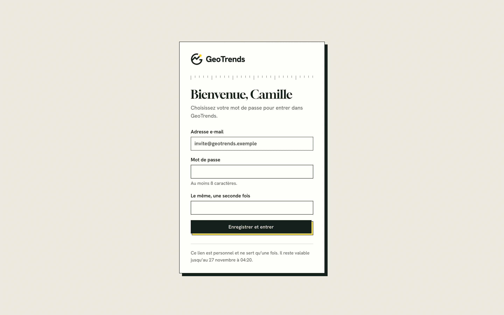

<!-- Page générée depuis la documentation du site (src/site/docs) par scripts/exporter-docs.ts : ne pas la modifier ici. -->

# Comptes et connexion

> Le premier compte se crée au premier lancement ; ensuite chaque personne est invitée et choisit son mot de passe par un lien. Deux rôles, le menu, la recherche.

[← Sommaire de la documentation](../README.md) · [Read this page in English](../../en/steer/accounts.md)

Personne ne s’inscrit seul dans une installation de GeoTrends. Le premier compte, celui de l’administrateur, se crée au premier lancement. Ensuite, l’administrateur invite chaque personne depuis **Réglages › Comptes** ; elle reçoit un lien personnel pour choisir son mot de passe. Aucun mot de passe ne circule par e-mail. Cette page dit comment entrer, ce que chaque rôle peut faire, et comment se repérer une fois connecté.

## Le premier compte

*Au premier lancement, la page de connexion fait créer le compte administrateur.*

Tant qu’aucun compte n’existe, la page de connexion affiche « Bienvenue dans GeoTrends » : **Votre nom**, **Adresse e-mail**, **Mot de passe** (huit caractères au moins, deux fois), puis **Créer le compte et entrer**. Ce compte est administrateur, et l’outil enchaîne sur la création du premier projet. Le formulaire ne s’affiche qu’une fois : dès qu’un compte existe, on n’entre plus que par invitation. Créez-le donc tout de suite après l’installation.

*La page de connexion ordinaire : l’adresse e-mail et le mot de passe.*

## Se connecter

L’adresse de votre installation ouvre la page de connexion : **Adresse e-mail**, **Mot de passe**, puis **Se connecter**. L’outil s’ouvre sur la vue d’ensemble. Tant que personne n’est connecté, la page suit la langue du navigateur ; ensuite, c’est la langue choisie pour votre compte.

| Message | Ce qu’il veut dire |
| --- | --- |
| « Adresse ou mot de passe incorrect. » | L’un des deux ne correspond pas. Vérifiez l’adresse, puis le mot de passe. |
| « Trop de tentatives. Réessayez dans une minute. » | Plus de dix essais en une minute : la connexion est suspendue un instant. |

> [!NOTE]
> **Mot de passe oublié**
>
> Demandez un nouveau lien à l’administrateur : il le crée en un clic dans **Réglages › Comptes** (**Lien de nouveau mot de passe**). Vous l’ouvrez, vous choisissez un nouveau mot de passe, et l’ancien ne marche plus. Pour en changer sans l’avoir oublié : **Réglages › Mon mot de passe**.

## Entrer avec une invitation

*La page ouverte par le lien d’invitation : l’adresse est déjà remplie, il reste à choisir le mot de passe.*

1. **Ouvrir le lien reçu.** L’e-mail de l’administrateur contient un lien personnel. Il vaut **sept jours** et ne sert **qu’une fois**.

2. **Choisir son mot de passe.** Huit caractères au moins, deux fois le même, puis **Enregistrer et entrer**. L’outil s’ouvre directement sur la vue d’ensemble.

3. **Se connecter les fois suivantes.** Avec **Se connecter**, l’adresse e-mail et ce mot de passe.

Un lien déjà utilisé, expiré ou remplacé par un plus récent affiche « Ce lien ne marche plus » : il suffit d’en demander un nouveau à l’administrateur.

## Deux rôles

| Rôle | Ce qu’il permet |
| --- | --- |
| **Membre** | Tous les écrans de l’outil, tous les projets. Un membre peut créer un projet, écrire des questions et lancer un relevé payant, dans la limite du plafond du mois et après la confirmation prévue au-dessus du seuil. |
| **Administrateur** | En plus : la rubrique **Administration › Coûts**, la ligne **Dépense du mois** en bas du menu, l’export du journal des coûts, le lien pour changer le plafond et la gestion des comptes dans Réglages : inviter, refaire un lien, retirer un accès. |

Le rôle se choisit à l’invitation. Il ne se change pas ensuite : pour le modifier, retirez l’accès puis invitez de nouveau la personne avec le bon rôle (rien n’est perdu, les projets n’appartiennent à aucun compte). Tous les comptes voient tous les projets, et tous recevront le rapport du lundi quand l’envoi par e-mail sera possible.

## Se repérer dans l’outil

- **Le menu** range les écrans par verbe : **Suivre**, **Comprendre**, **Agir**, **Régler**, et **Administration** pour un administrateur. Chaque groupe se replie d’un clic sur son titre ; le bouton **Réduire le menu aux icônes** ne garde que les icônes. Ces choix sont retenus. Sur téléphone, le menu s’ouvre en volet par le bouton de la barre du haut.
- **Les compteurs** du menu signalent ce qui attend : les réponses en attente à côté de Questions, les réponses qui contredisent un fait à côté de Faits vérifiés, les actions à faire à côté d’Actions.
- **Le choix du projet**, en haut du menu, montre le projet affiché et son marché. Un clic ouvre la liste des projets, avec la date de leur dernier relevé, une recherche quand il y en a plus de quatre, et les liens **Tous les projets** et **Nouveau projet**. Choisir un projet change tous les écrans.
- **La recherche rapide** s’ouvre avec le bouton **Rechercher** ou le raccourci ⌘ K sur Mac, Ctrl K ailleurs. Elle mène à un écran, à une question, à une marque (ses réponses), à un site ou à une page (sa fiche dans Sources, ou dans Pages suivies si vous la suivez). Flèches pour choisir, Entrée pour y aller, Échap pour fermer.
- **Se déconnecter** : l’icône à côté de votre nom, en bas du menu.

## Donner accès à une nouvelle personne

1. **Inviter.** Dans **Réglages › Comptes** (administrateur), saisissez le nom, l’adresse e-mail et le rôle, puis **Inviter**. Le compte est créé et un lien personnel s’affiche.

2. **Envoyer le lien.** **Écrire l’e-mail** ouvre votre messagerie avec le message tout prêt et le lien dedans ; **Copier le lien** et **Copier le texte de l’e-mail** servent pour une autre messagerie. Le lien ne se réaffiche pas : envoyez-le tout de suite, ou refaites-en un.

3. **Choisir son mot de passe.** La personne ouvre le lien, choisit son mot de passe et entre dans l’outil. Sa ligne dans Réglages passe de « Invitation en cours » à « Dernière connexion ».

4. **Choisir sa langue.** Dans **Réglages**, elle choisit Français ou English : le choix suit son compte.

5. **Choisir le projet.** En haut du menu, elle choisit le projet à afficher. Elle peut alors suivre les écrans sans rien régler d’autre.

## Retirer un accès

Dans **Réglages › Comptes**, **Retirer l’accès** puis **Oui, retirer** : le compte, ses sessions ouvertes et son lien en cours disparaissent tout de suite. On ne peut retirer ni son propre accès, ni celui du dernier administrateur.

## Limites

> [!WARNING]
> Il n’y a pas de droits par projet : chaque compte voit chaque projet et peut lancer un relevé payant. Le plafond du mois et le seuil de confirmation sont les seuls garde-fous de la dépense. L’outil n’envoie pas lui-même l’invitation : c’est vous qui l’envoyez depuis votre messagerie. Il n’y a pas de lien « mot de passe oublié » en libre accès, ni de double authentification.

**Voir aussi**

- [Réglages](./reglages.md)
- [Le tableau des coûts](./couts.md)
- [Prise en main](../demarrer/prise-en-main.md)

---

Mise à jour : 2026-11-25 · [Lire cette page sur le site](https://geotrends.io/documentation/piloter/comptes)
