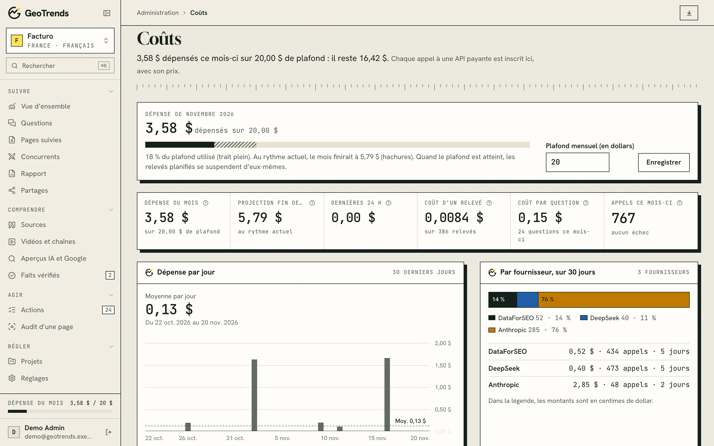

<!-- Page générée depuis la documentation du site (src/site/docs) par scripts/exporter-docs.ts : ne pas la modifier ici. -->

# Le tableau des coûts

> Chaque appel payant est inscrit au journal des coûts. Cet écran en tire la dépense du mois, sa projection, le plafond et le détail par fournisseur et projet.

[← Sommaire de la documentation](../README.md) · [Read this page in English](../../en/steer/costs.md)

Chaque appel à une API payante passe par le journal des coûts, avec son prix : un relevé, la lecture d’une réponse, le classement d’un site, l’étiquetage d’une question, la vérification des faits. Cet écran lit ce journal. Il dit combien a été dépensé ce mois-ci, par quoi, pour quel projet, et où le mois va finir. Il sert à fixer le plafond et à repérer une dépense anormale.

> [!NOTE]
> **Réservé aux administrateurs**
>
> La rubrique **Administration › Coûts** n’apparaît que pour un compte administrateur. Un administrateur voit aussi, en bas du menu, la ligne **Dépense du mois** : la dépense sur le plafond, avec une barre fine ; un clic ouvre cet écran. Un membre qui ouvre l’adresse arrive sur la vue d’ensemble.

*L’écran Coûts : le plafond du mois et sa jauge, les chiffres clés, la dépense par jour et les répartitions par fournisseur, par IA, par projet et par type d’appel.*

## Le plafond du mois

Le mois commence le 1er à minuit, heure de Paris. Le premier bloc donne la dépense du mois sur le plafond (20 $ par défaut), une jauge en trait plein pour ce qui est dépensé et des hachures pour la projection. Le champ **Plafond mensuel (en dollars)** le change, de 0 à 5 000 $, avec **Enregistrer**. Le plafond vaut pour tous les projets ensemble.

| Situation | Ce qui se passe |
| --- | --- |
| Sous le plafond | Les envois partent. Avant un relevé, la fiche du projet montre la dépense du mois après l’envoi et prévient s’il ferait dépasser le plafond. L’envoi reste possible : le plafond se vérifie avant chaque appel. |
| Plafond atteint | Plus aucun appel payant ne part : ni relevé, à la main ou automatique, ni lecture des réponses, ni classement des sites, ni étiquetage, ni vérification des faits. Les relevés planifiés reprennent le mois suivant, ou dès que le plafond est relevé. |
| Projection | La dépense du mois prolongée au rythme des jours écoulés. Elle s’affiche après un jour complet. Si elle dépasse le plafond, le bloc le dit. |

## Les chiffres clés

| Tuile | Ce qu’elle compte |
| --- | --- |
| **Dépense du mois** | Somme des appels payants inscrits au journal depuis le début du mois, sur le plafond. |
| **Projection fin de mois** | La dépense du mois prolongée au rythme actuel. |
| **Dernières 24 h** | Appels payants des vingt-quatre dernières heures. |
| **Coût d’un relevé** | Coût moyen d’une réponse relevée ce mois-ci, tous fournisseurs confondus, sur les relevés réussis. |
| **Coût par question** | Dépense du mois rapportée au nombre de questions suivies, tous projets. |
| **Appels ce mois-ci** | Chaque appel payant inscrit au journal, réussi ou non, avec le nombre d’échecs. |

## Les répartitions

- **Dépense par jour** : les 30 derniers jours, jours sans appel compris, avec la moyenne par jour. Le survol d’une barre donne la dépense du jour.
- **Par fournisseur, sur 30 jours** : DataForSEO (relevés d’interface), Anthropic (Claude), DeepSeek (le petit modèle qui lit les réponses). Dans la légende, les montants sont en centimes de dollar.
- **Par fournisseur**, **Par IA relevée**, **Par projet** et **Par type d’appel, ce mois-ci** : le montant, le nombre d’appels et la part de chacun. Les types d’appel sont les relevés, l’analyse des réponses, le classement des sites, les étiquettes des questions et la vérification des faits.
- **Coût par projet** : pour chaque projet, ses questions, ses appels, sa dépense du mois, son coût par question et sa prévision de fin de mois.

## Le journal des appels

Le bloc **Derniers appels** montre les 40 appels les plus récents ; **Échecs seulement** n’affiche que les appels en échec. Colonnes : **Date** (heure de Paris), **Fournisseur**, **Appel**, **Projet**, **IA**, **Durée**, **État** (Réussi ou Échec) et **Prix**. Le bouton **Exporter** de la barre du haut télécharge le journal entier, avec le modèle et le message d’erreur de chaque appel : voir [Exports CSV](./exports.md).

| Prix | D’où il vient |
| --- | --- |
| Sans astérisque | Le prix renvoyé par le fournisseur pour cet appel. C’est le cas des relevés d’interface (DataForSEO). |
| Avec un astérisque (*) | Le prix calculé depuis la grille de tarifs, faute de montant renvoyé : jetons d’entrée et de sortie, et recherches web pour Claude. C’est le cas d’Anthropic et de DeepSeek. Les heures creuses de DeepSeek sont comptées au prix fort : le journal ne sous-estime jamais une dépense. |

Un envoi refusé par le fournisseur n’est pas facturé : il s’inscrit en échec, à 0 $. Les prix moyens de chaque appel sont détaillés dans [Ce que coûte un relevé](../demarrer/couts.md).

## Contrôler la dépense du mois

1. **Lire la projection.** Si le bloc du plafond dit que le mois finirait au-dessus, décidez maintenant : relever le plafond, ou réduire le rythme des relevés.

2. **Trouver ce qui coûte.** Regardez **Par projet, ce mois-ci** et **Par type d’appel, ce mois-ci**. Les relevés de Claude coûtent bien plus cher qu’un relevé d’interface.

3. **Vérifier les échecs.** Ouvrez **Échecs seulement**. Une série d’échecs sur un fournisseur signale une clé refusée ou un service en panne : voyez l’état des clés dans Réglages.

4. **Ajuster.** Changez le plafond ici, ou les relevés automatiques de chaque projet dans **Réglages › Rythme des relevés**.

## Limites

> [!WARNING]
> Le journal ne connaît que les appels de l’outil : une dépense faite ailleurs avec les mêmes clés n’y figure pas, et la facture du fournisseur fait foi. Les prix de la grille ont été relevés à une date ; si un fournisseur change ses tarifs, la grille doit être mise à jour. Le plafond se vérifie avant chaque envoi : un relevé lancé juste sous le plafond peut le dépasser un peu. Les montants sont en dollars, la devise de facturation des fournisseurs.

**Voir aussi**

- [Ce que coûte un relevé](../demarrer/couts.md)
- [Réglages](./reglages.md)
- [Relevés automatiques](../projet/releves-automatiques.md)
- [Comment suivre une marque sans dépasser son budget ?](../cas-usage/budget-de-suivi.md)

---

Mise à jour : 2026-11-18 · [Lire cette page sur le site](https://geotrends.io/documentation/piloter/couts)
