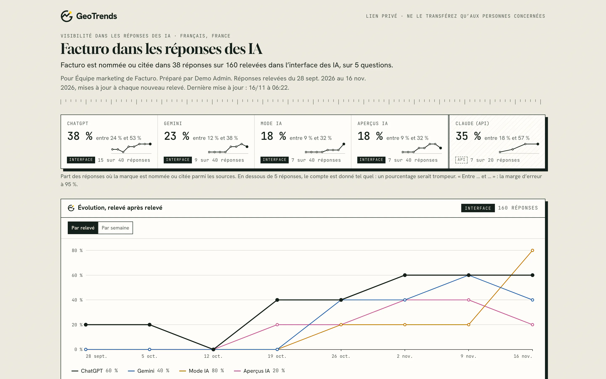
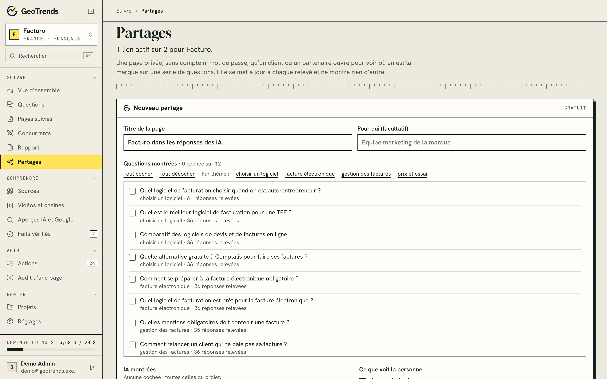

<!-- Page générée depuis la documentation du site (src/site/docs) par scripts/exporter-docs.ts : ne pas la modifier ici. -->

# Partager avec un client

> Un lien privé, sans compte, qu’un client ou un partenaire ouvre pour voir où en est sa marque sur une série de questions. Mis à jour à chaque relevé, coupé en un clic.

[← Sommaire de la documentation](../README.md) · [Read this page in English](../../en/steer/share-with-a-client.md)

Un client veut savoir si les IA citent sa marque, sans entrer dans l’outil. L’écran **Partages** (menu **Suivre**) crée pour lui une page privée sur une série de questions du projet affiché. Il l’ouvre par un simple lien, sans compte ni mot de passe. La page se met à jour d’elle-même à chaque nouveau relevé et ne montre rien d’autre que ces questions. Elle ne coûte rien : elle lit les relevés déjà faits.

*La page que voit le client : la marque IA par IA, l’évolution, puis le détail question par question, avec les pages de la marque surlignées.*

## Créer un lien

1. **Choisir les questions.** Sur **Questions**, cochez la série à montrer puis **Partager** ; ou ouvrez **Partages › Nouveau partage** et cochez-les dans la liste (**Tout cocher**, ou un thème d’un clic).

2. **Régler la page.** Le **titre**, **pour qui** (facultatif), les **IA montrées** (aucune cochée : toutes celles du projet), la **langue de la page**, et ce que voit la personne : un **extrait de chaque réponse**, les **marques nommées** à la place de la marque. Une **date de fin** est possible.

3. **Envoyer le lien.** **Créer le lien de partage**, puis **Copier le lien** et envoyez-le par la messagerie de votre choix. **Ouvrir la page** la montre telle que le client la verra.

*L’écran Partages : le formulaire d’un nouveau partage, puis la liste des liens avec leur état, leurs ouvertures et leurs boutons.*

## Ce que voit le client

- **La marque, IA par IA** : la part des réponses où elle est nommée ou citée, avec le nombre de réponses, la marge d’erreur et une petite tendance. En dessous de cinq réponses, le compte est donné tel quel (« 2 sur 3 ») : un pourcentage serait trompeur.
- **L’évolution**, relevé après relevé, dès qu’il y a deux jours de relevé. Claude, mesuré par son API, a sa propre courbe : il n’est jamais additionné aux IA relevées dans leur interface.
- **Question par question** : pour chaque IA, l’état de sa dernière réponse (citée, nommée, lue, absente), le bilan de toutes ses réponses à la question, les pages qu’elle cite (celles de la marque surlignées), et selon vos choix les marques nommées et un extrait de la réponse.
- **La méthode**, en bas de page, en mots simples : interface ou API, depuis quel pays, pourquoi une réponse est un échantillon.

> [!NOTE]
> **Ce qui n’y est jamais**
>
> Les autres questions du projet, les autres projets, les coûts, les questions archivées depuis, le menu de l’outil. La page n’est pas proposée aux moteurs de recherche, et chaque lien est impossible à deviner.

## Suivre et gérer les liens

| Sur la ligne d’un lien | Ce que cela fait |
| --- | --- |
| « ouvert 3 fois, la dernière le … » | Les ouvertures par quelqu’un qui n’est pas connecté à l’outil. Les vôtres ne comptent pas. |
| **Modifier** | Change les questions, les IA, la langue ou les options. L’adresse reste la même : le client voit les changements à sa prochaine ouverture. |
| **Couper le lien** | La page ne s’ouvre plus, tout de suite. **Rouvrir le lien** la remet en service à la même adresse. |
| **Changer l’adresse** | Fait une nouvelle adresse et rend l’ancienne inutilisable, par exemple si le lien a circulé trop loin. Le compteur d’ouvertures repart de zéro. |
| **Supprimer** | Retire le partage et ses réglages, après confirmation. |

Un lien coupé, expiré ou remplacé affiche « Ce lien n’est plus actif » et invite à demander un nouveau lien. Les partages appartiennent au projet : chaque compte de l’outil les voit et peut les gérer.

## Limites

> [!WARNING]
> La page montre les réponses telles qu’elles ont été relevées : elle ne promet aucune citation et ne commente pas. Il n’y a pas de mot de passe propre à un lien : quiconque a l’adresse peut ouvrir la page tant qu’elle est active. Coupez-la quand le client n’en a plus besoin.

**Voir aussi**

- [L’écran Questions](../mesurer/questions.md)
- [Méthode de mesure](../reference/methode.md)
- [Rapport et alertes](./rapport-et-alertes.md)

---

Mise à jour : 2026-11-19 · [Lire cette page sur le site](https://geotrends.io/documentation/piloter/partager-avec-un-client)
