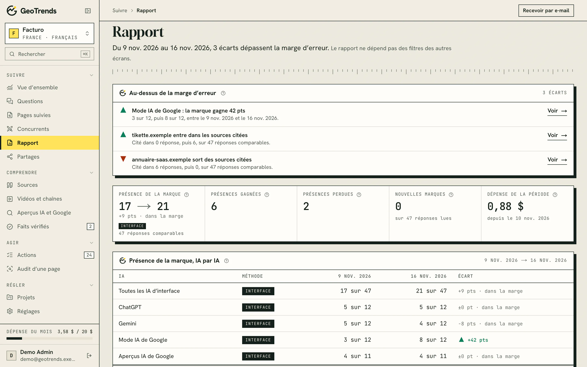

<!-- Page générée depuis la documentation du site (src/site/docs) par scripts/exporter-docs.ts : ne pas la modifier ici. -->

# Rapport et alertes

> Le rapport compare les deux derniers jours de relevé : présences gagnées ou perdues, nouvelles marques, sources, dépense. Les alertes gardent les écarts réels.

[← Sommaire de la documentation](../README.md) · [Read this page in English](../../en/steer/report-and-alerts.md)

Le rapport répond à une question : qu’est-ce qui a changé depuis le relevé précédent, et est-ce que cela compte ? Il compare les deux derniers jours de relevé du projet, sur les mêmes questions et les mêmes IA, et ne signale en alerte que les écarts qui dépassent la marge d’erreur. C’est l’écran du point de la semaine. Il ne coûte rien : tout est lu dans la base.

Le rapport porte sur le projet affiché. Il ne dépend pas des filtres de la barre du haut : il prend toutes les IA et tout l’historique. Les quatre premières alertes s’affichent aussi sur la vue d’ensemble, avec le lien **Tout ce qui a changé**.

*Le rapport du projet Facturo : les écarts au-dessus de la marge d’erreur, les chiffres de la période, puis la présence de la marque IA par IA, entre les deux derniers jours de relevé.*

## Ce qui est comparé

Le rapport prend les deux derniers jours où le projet a été relevé par l’interface. Pour chaque couple question et IA qui a une réponse aux deux dates, il compare la réponse d’avant à celle d’après : c’est une **réponse comparable**. Un couple qui n’a pas été reposé n’entre pas dans la comparaison. Une question non relevée ne passe donc jamais pour une présence perdue.

- Si une question a plusieurs réponses le même jour pour une IA, seule la dernière du jour compte.
- Les mesures approfondies n’entrent pas dans la comparaison : une question posée vingt-cinq fois pèserait vingt-cinq fois plus.
- Claude, mesuré par son API, est comparé à part, sur ses deux derniers jours de relevé à lui. Il n’est jamais ajouté aux relevés d’interface.

> [!NOTE]
> **Il faut deux jours de relevé**
>
> Avec un seul jour, l’écran dit « Un seul jour de relevé pour l’instant. » et propose **Préparer un relevé**. Une seule date est un échantillon, pas une évolution. Le rapport se remplit au deuxième relevé.

## Au-dessus de la marge d’erreur

Premier bloc du rapport : les seuls changements qu’on peut tenir pour réels. Chaque ligne porte ▲ (hausse) ou ▼ (baisse), un titre, les comptes d’avant et d’après, et un lien **Voir** vers la question, l’IA ou la source concernée. Une marque qui s’installe est toujours marquée ▼ : c’est une mauvaise nouvelle pour la vôtre.

| Alerte | Quand elle apparaît |
| --- | --- |
| La visibilité de la marque monte ou baisse | Sur toutes les réponses comparables d’interface, l’écart entre les deux dates dépasse la marge d’erreur. |
| Une IA gagne ou perd la marque | La même règle, IA par IA. |
| Claude (API) gagne ou perd la marque | La même règle, sur les réponses de Claude, comptées à part. |
| Une marque s’installe dans les réponses | Une marque nommée au dernier relevé, et dans aucune réponse du précédent, avec un écart au-delà de la marge. Le détail dit si c’est déjà un concurrent suivi. |
| Un site entre ou sort des sources citées, ou y revient plus ou moins souvent | Compté en réponses comparables qui citent ce site, aux deux dates. |
| Google affiche plus ou moins d’Aperçus IA | Sur les questions relevées aux deux dates, le nombre de questions avec un Aperçu IA change au-delà de la marge. |
| La présence monte ou baisse sur une question | Calculé sur tous les relevés d’interface de la question, avant et depuis le dernier jour de relevé. En pratique, cela n’arrive qu’après une mesure approfondie : sans elle, une question n’a pas assez de réponses. |

Quand rien ne dépasse la marge, le bloc dit : « Aucun écart ne dépasse la marge d’erreur entre ces deux relevés. » Avec une réponse par question et par IA à chaque date, c’est le cas le plus courant, et c’est voulu.

## Les chiffres de la période

| Tuile | Ce qu’elle compte |
| --- | --- |
| **Présence de la marque** | Réponses où la marque est nommée ou citée, à la date d’avant puis à la date d’après, sur les réponses comparables, avec l’écart. Méthode interface. |
| **Présences gagnées** | Couples question et IA où la marque est entrée entre les deux relevés. |
| **Présences perdues** | Couples question et IA où la marque est sortie entre les deux relevés. |
| **Nouvelles marques** | Marques nommées au dernier relevé et dans aucune réponse du précédent, sur les réponses dont les marques sont lues. |
| **Dépense de la période** | Appels payants du projet depuis le relevé précédent, tels qu’ils sont inscrits au journal des coûts. |

Le bloc **Présence de la marque, IA par IA** donne une ligne **Toutes les IA d’interface**, une ligne par IA, puis Claude, à part, avec ses propres dates. Pour chacune : la méthode, le compte à chaque date (« 3 sur 8 », par exemple) et l’écart, coloré seulement au-delà de la marge. Si Claude n’a été relevé qu’une fois, une ligne le dit : rien à comparer.

## Présence gagnée ou perdue, question par question

Deux listes côte à côte : **Présence gagnée** et **Présence perdue**. Chaque ligne donne la question et l’IA ; un clic ouvre la réponse du dernier relevé. Douze lignes au plus par liste. Dessous, une ligne signale les questions où Google affiche un Aperçu IA pour la première fois, ou ne l’affiche plus. Un Aperçu qui ne s’affiche pas n’est pas une absence de la marque.

> [!TIP]
> Une présence gagnée ou perdue repose sur une réponse à chaque date : c’est un indice, pas une tendance. Si la question compte pour vous, lancez une [mesure approfondie](../mesurer/mesure-approfondie.md) depuis sa page avant d’y passer du temps.

## Nouvelles marques, sources gagnées et perdues

**Marques nommées pour la première fois** liste les marques nommées le jour d’après et dans aucune réponse du jour d’avant, avec leur nombre de réponses. Le bouton **Suivre** en fait un concurrent du projet : c’est gratuit et ne lance aucun relevé. Une marque déjà suivie porte la mention **Suivie**.

**Sources gagnées et perdues** donne les **Nouveaux sites** (cités le jour d’après, pas le jour d’avant) et les **Sites perdus** (l’inverse). Le nombre est celui des réponses comparables qui citent le site, avant puis après ; il est coloré quand l’écart dépasse la marge. Le lien **Sources en hausse et en baisse, pages comprises** ouvre le même calcul sur l’écran Sources.

## Les trois actions et la dépense

**Les trois actions les plus utiles** reprend les trois premières lignes de la liste de travail, à faire ou en cours, chacune avec sa preuve. **Dépense de la période** détaille les appels payants du projet depuis le relevé précédent, par type d’appel, avec le total, puis rappelle la dépense du mois, tous projets, sur le plafond.

## Le rapport par e-mail

Le bloc **Recevoir ce rapport par e-mail** (bouton **Recevoir par e-mail** en haut de l’écran) prévoit d’envoyer chaque lundi le même rapport, en version courte, avec un lien vers cet écran. **Aujourd’hui, aucun e-mail ne part** : il manque la clé du service d’envoi (Resend), et l’écran le dit. Le lien **Voir l’e-mail tel qu’il sera envoyé** ouvre l’e-mail, construit par la même fonction que l’envoi ; rien n’est envoyé.

- Une fois la clé installée, deux boutons apparaissent : **Activer l’envoi du lundi** (puis **Couper l’envoi du lundi**) et **Me l’envoyer maintenant**, qui l’envoie à votre seule adresse pour voir le résultat.
- L’envoi est coupé par défaut et se règle projet par projet. Il part le lundi à partir de 8 h, heure de Paris, à tous les comptes de l’outil. Si un lundi est manqué, il part au passage suivant.
- L’envoi est gratuit et n’entre pas au journal des coûts. L’e-mail est rédigé en français.

## Faire le point du lundi

1. **Vérifier les dates comparées.** La phrase du haut dit « Du … au … » et le nombre d’écarts qui dépassent la marge. Si l’écran dit qu’il n’y a qu’un jour de relevé, lancez-en un deuxième depuis la fiche du projet.

2. **Lire les écarts au-dessus de la marge.** C’est la seule partie du rapport à tenir pour réelle. Ouvrez chaque ligne avec **Voir**.

3. **Parcourir les présences perdues.** Ouvrez la réponse : qui est nommé à la place de Facturo, quelle page est citée ? Si la question compte, lancez une mesure approfondie.

4. **Suivre les nouvelles marques qui comptent.** Une marque qui revient d’un relevé à l’autre mérite d’être suivie : elle entre alors dans la part de voix et le face-à-face.

5. **Choisir une action.** Prenez l’une des trois actions proposées, ou ouvrez toute la liste de travail sur l’écran Actions.

## Limites

> [!WARNING]
> Le rapport compare deux dates : ce n’est pas une tendance longue, qui se lit sur le graphique de la vue d’ensemble. Avec une réponse par question et par IA à chaque date, peu d’écarts dépassent la marge d’erreur. Une alerte dit qu’un écart est réel, pas d’où il vient : un changement de modèle, un concurrent ou votre propre correction peuvent l’expliquer. Enfin, l’e-mail du lundi n’est pas envoyé tant que la clé du service d’envoi n’est pas installée.

**Voir aussi**

- [Vue d’ensemble](../mesurer/vue-d-ensemble.md)
- [Mesure approfondie](../mesurer/mesure-approfondie.md)
- [Méthode de mesure](../reference/methode.md)
- [Comment préparer le point du lundi avec l’équipe ?](../cas-usage/point-du-lundi.md)

---

Mise à jour : 2026-11-18 · [Lire cette page sur le site](https://geotrends.io/documentation/piloter/rapport-et-alertes)
