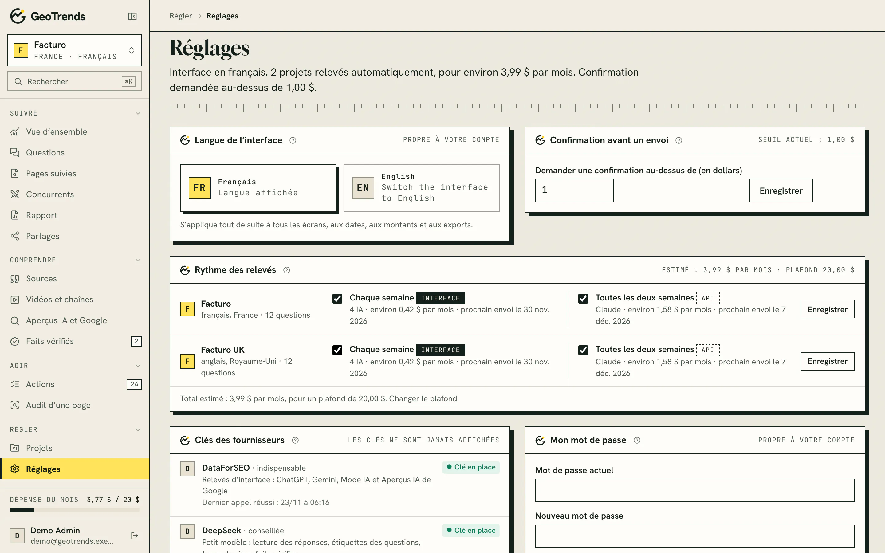
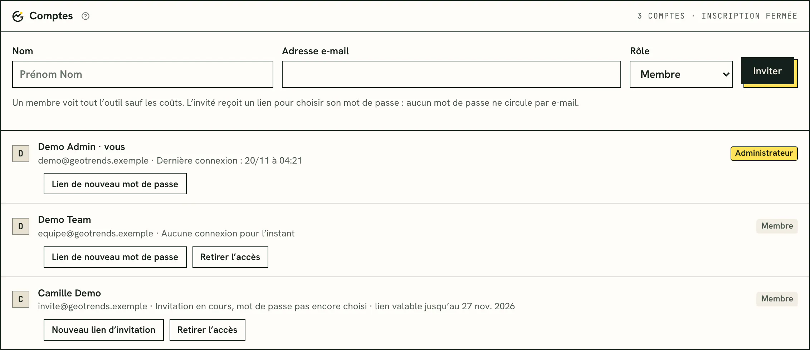

<!-- Page générée depuis la documentation du site (src/site/docs) par scripts/exporter-docs.ts : ne pas la modifier ici. -->

# Réglages

> Les réglages de tout l’outil : langue de l’interface, seuil de confirmation, rythme des relevés de chaque projet, état des connexions, votre mot de passe et les comptes de l’équipe.

[← Sommaire de la documentation](../README.md) · [Read this page in English](../../en/steer/settings.md)

L’écran Réglages réunit ce qui vaut pour tout l’outil. Il sert à trois décisions : dans quelle langue travailler, à partir de quel montant un envoi demande une confirmation, et à quel rythme chaque projet est relevé tout seul. Il dit aussi si chaque fournisseur est bien branché. Les réglages propres à un écran se font sur cet écran.

La phrase du haut résume l’état : la langue de l’interface, le nombre de projets relevés automatiquement et leur coût estimé par mois, et le seuil de confirmation.

*L’écran Réglages : la langue de l’interface, la confirmation avant un envoi, le rythme des relevés de chaque projet, puis les connexions aux fournisseurs.*

## Langue de l’interface

Deux choix, **Français** ou **English**. Le choix est propre à votre compte et retenu d’une session à l’autre, d’un appareil à l’autre. Il s’applique tout de suite à tous les écrans, aux dates, aux montants (`0,05 $` ou `$0.05`) et aux exports. Il ne change pas la langue des questions d’un projet, et le texte des réponses des IA n’est jamais traduit.

## Confirmation avant un envoi

Le prix d’un relevé est toujours écrit sur son bouton. Au-dessus du seuil, une fenêtre demande en plus de confirmer : « Envoyer pour … ? », avec **Annuler** et **Confirmer l’envoi**. Le seuil vaut 1 $ par défaut ; le champ **Demander une confirmation au-dessus de (en dollars)** le change, de 0 à 1 000 $. Il vaut pour tous les comptes et pour tous les envois payants lancés à la main : le relevé d’un projet, le relevé d’une sélection de questions, la mesure approfondie.

## Rythme des relevés

Une ligne par projet, avec deux cases, puis **Enregistrer**. Ce sont les mêmes cases que dans l’onglet Relevés de la fiche du projet : les changer ici ou là revient au même. Rien n’est activé par défaut.

| Case | Ce qu’elle fait | Coût estimé par mois |
| --- | --- | --- |
| **Chaque semaine** (interface) | Pose chaque semaine toutes les questions du projet à ChatGPT, Gemini, au Mode IA et aux Aperçus IA de Google. | Questions × 4 IA × (prix d’un relevé d’interface + lecture de la réponse) × 4,33 semaines. |
| **Toutes les deux semaines** (API) | Pose les questions à Claude, par son API, une semaine sur deux. | Questions × (prix moyen d’une question à Claude + lecture) × 2,17 passages. |

Quand une case est cochée, la ligne dit quand part le prochain envoi : « dans la demi-heure », ou à une date. Sous la liste, le total estimé de tous les projets est comparé au plafond du mois ; un administrateur a le lien **Changer le plafond**. Les relevés automatiques se suspendent d’eux-mêmes quand le plafond est atteint. Le détail est dans [Relevés automatiques](../projet/releves-automatiques.md).

## Clés des fournisseurs

| Fournisseur | À quoi il sert |
| --- | --- |
| DataForSEO | Relevés d’interface : ChatGPT, Gemini, Mode IA et Aperçus IA de Google. Payant. La seule clé indispensable. |
| DeepSeek | Le petit modèle : lecture des réponses, étiquettes des questions, types de sites, faits vérifiés. Payant, conseillé. |
| Anthropic | Relevés de Claude par son API, et petit modèle quand il n’y a pas de clé DeepSeek. Payant. |
| YouTube | Fiche des vidéos citées et reconnaissance des chaînes. Gratuit. |
| Resend | Envoi du rapport du lundi par e-mail. Gratuit, à activer sur l’écran Rapport. |

Chaque ligne dit **Clé en place** ou **Clé absente** ; les clés elles-mêmes ne sont jamais affichées. Elles s’écrivent dans le fichier `.env` de l’installation, pas dans cet écran : une ligne sans clé rappelle le nom à y mettre, et il faut relancer l’outil après un changement. Pour un fournisseur payant, la ligne donne aussi la date du dernier appel réussi : c’est elle qui prouve que la clé fonctionne. Les appels gratuits ne sont pas inscrits au journal des coûts. Où trouver chaque clé : [Installer GeoTrends](../demarrer/installer.md#cles).

## Comptes

## Mon mot de passe

Chaque compte peut changer son mot de passe : **Mot de passe actuel**, **Nouveau mot de passe** (huit caractères au moins), **Le même, une seconde fois**, puis **Changer le mot de passe**. Vos autres sessions ouvertes (un autre navigateur, un téléphone) sont fermées. En cas d’oubli, demandez un nouveau lien à l’administrateur.

*Le bloc Comptes, pour un administrateur : inviter une personne, puis une ligne par compte avec son état, son rôle et ses boutons.*

Pour un administrateur, le dernier bloc gère les comptes de l’outil. En haut, **Inviter** : le nom, l’adresse e-mail et le rôle (**Membre** ou **Administrateur**). Le compte est créé et un lien personnel s’affiche, avec **Écrire l’e-mail** (votre messagerie s’ouvre avec le message prêt), **Copier le lien** et **Copier le texte de l’e-mail**. Le lien vaut sept jours, une seule fois, et ne se réaffiche pas.

| État affiché | Ce qu’il veut dire |
| --- | --- |
| « Invitation en cours, mot de passe pas encore choisi » | Le lien a été créé, la personne ne l’a pas encore ouvert. La date dit jusqu’à quand il vaut. |
| « Mot de passe pas encore choisi, lien expiré » | Sept jours ont passé : **Nouveau lien d’invitation** en refait un. |
| « Lien de nouveau mot de passe en cours » | Un lien a été refait pour quelqu’un qui avait déjà un mot de passe (oubli). |
| « Dernière connexion : … » | La personne est entrée ; la date est celle de sa dernière connexion. |

Sur chaque ligne, **Lien de nouveau mot de passe** (ou **Nouveau lien d’invitation**) refait un lien et rend le précédent inutilisable ; **Retirer l’accès**, confirmé par **Oui, retirer**, supprime le compte et ferme ses sessions. Voir [Comptes et connexion](./comptes.md).

## Où sont les autres réglages

| Réglage | Où il se trouve |
| --- | --- |
| Plafond de dépense du mois | Administration › Coûts (administrateurs). |
| Nom du projet, pays et langue, archivage | Fiche du projet, onglet **Réglages du projet**. |
| Classement automatique des nouveaux sites | Écran Sources. |
| Étiquetage automatique des questions ajoutées | Écran Questions. |
| Faits vérifiés | Écran Faits vérifiés. |
| Envoi du rapport du lundi | Écran Rapport. |

## Mettre un projet en relevés automatiques

1. **Vérifier les connexions.** DataForSEO doit avoir sa clé en place, et Anthropic aussi si Claude doit être relevé.

2. **Cocher le rythme.** Sur la ligne du projet, cochez **Chaque semaine**, et **Toutes les deux semaines** pour Claude si besoin, puis **Enregistrer**. Le premier envoi part dans la demi-heure.

3. **Comparer au plafond.** Lisez le total estimé sous la liste. S’il dépasse le plafond du mois, les derniers relevés du mois ne partiront pas.

4. **Régler le seuil de confirmation.** Il ne concerne que les envois lancés à la main ; les relevés automatiques partent sans fenêtre de confirmation.

## Limites

> [!WARNING]
> Les coûts mensuels sont des estimations : le prix de Claude est la moyenne de ses trente derniers relevés, et la lecture des réponses est comptée au prix moyen. Une clé « en place » n’est pas forcément valable : seule la date du dernier appel réussi le montre. Les clés se changent sur le serveur, pas depuis cet écran.

**Voir aussi**

- [Relevés automatiques](../projet/releves-automatiques.md)
- [Le tableau des coûts](./couts.md)
- [Comptes et connexion](./comptes.md)
- [Pays et langues](../reference/pays-et-langues.md)

---

Mise à jour : 2026-11-25 · [Lire cette page sur le site](https://geotrends.io/documentation/piloter/reglages)
