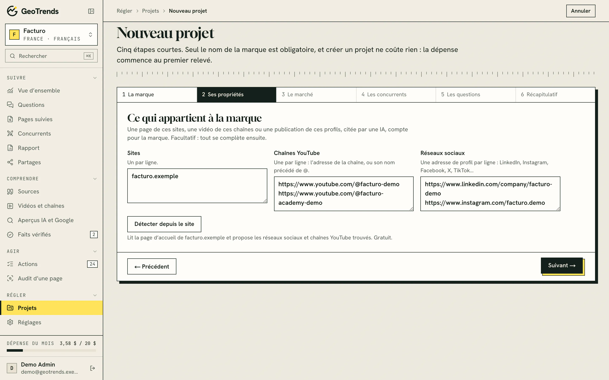
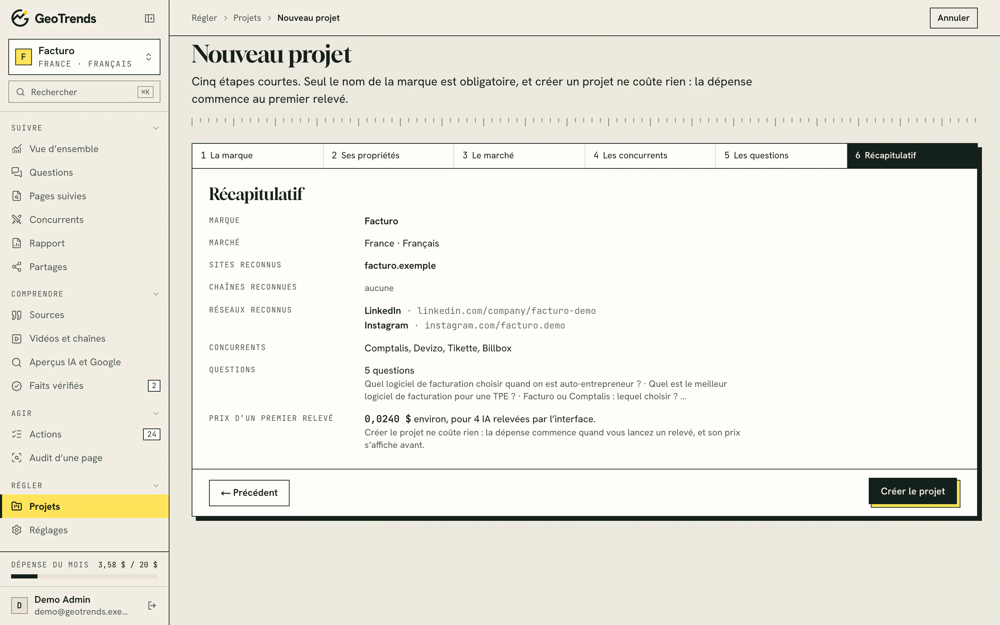

<!-- Page générée depuis la documentation du site (src/site/docs) par scripts/exporter-docs.ts : ne pas la modifier ici. -->

# Créer un projet

> Un projet suit une marque : ce qui lui appartient, ses concurrents, ses questions, son pays et sa langue. Le créer est gratuit : la dépense vient avec le relevé.

[← Sommaire de la documentation](../README.md) · [Read this page in English](../../en/project/create-a-project.md)

Tout, dans l’outil, se lit projet par projet. Un projet suit une marque sur un marché : un pays et une langue. Pour suivre la même marque dans un autre pays, ou une autre marque, on crée un autre projet. Créer un projet est gratuit : la dépense ne commence qu’au premier relevé, et son prix s’affiche avant l’envoi.

Pour créer un projet : le bouton **Nouveau projet** en haut de l’écran Projets, ou le lien **Nouveau projet** au bas de la liste des projets, dans le menu. Le premier projet se crée depuis l’écran vide, avec le même bouton.

*La création d’un projet : cinq étapes courtes et un récapitulatif. Ici, l’étape de la marque pour Facturo.*

## Les étapes de la création

Le formulaire tient en six onglets. Rien n’est enregistré avant le dernier bouton : on peut revenir en arrière, sauter une étape ou cliquer directement sur un onglet dès que le nom de la marque est saisi. La touche Entrée passe à l’étape suivante, elle ne crée pas le projet.

| Étape | Ce qu’on y saisit |
| --- | --- |
| **La marque** | Le **Nom de la marque**, le seul champ obligatoire. C’est ce nom qui est cherché dans le texte des réponses. Ses autres écritures (sigle, nom sans espace) s’ajoutent ensuite, dans la fiche du projet. |
| **Ses propriétés** | Les **Sites**, les **Chaînes YouTube** et les **Réseaux sociaux** de la marque, un par ligne. Une page de ces sites, une vidéo de ces chaînes ou une publication de ces profils, citée par une IA, compte pour la marque. Le bouton **Détecter depuis le site** lit la page d’accueil et propose les profils trouvés. |
| **Le marché** | Le **Pays** d’où les questions sont posées et leur **Langue**. Par défaut : France, français. |
| **Les concurrents** | Un nom de marque par ligne. Facultatif : après le premier relevé, l’outil propose les marques que les IA nomment le plus. |
| **Les questions** | Une question par ligne, comme un client la poserait à une IA. Dix suffisent pour commencer. Sous le champ, le prix d’un relevé d’interface pour ces questions se met à jour à chaque ligne. |
| **Récapitulatif** | Ce que l’outil a compris : la marque, le marché, les **Sites reconnus**, les **Chaînes reconnues** et les **Réseaux reconnus**, les concurrents, les questions et le **Prix d’un premier relevé**. Puis le bouton **Créer le projet**. |

> [!NOTE]
> **Le pays et la langue se choisissent une fois**
>
> Ils ne se changent plus après le premier relevé : les courbes doivent rester comparables d’une semaine à l’autre. Pour suivre Facturo en Belgique, créez un second projet. Tant qu’aucun relevé n’est parti, ils se corrigent dans l’onglet **Réglages du projet**. Voir [Pays et langues](../reference/pays-et-langues.md).

Le récapitulatif vérifie les saisies sans rien enregistrer : une adresse complète est ramenée à son domaine, une chaîne saisie par son nom (« @Facturo ») est retrouvée sur YouTube avec son vrai nom, un lien de partage ou de publication n’est pas pris pour un profil. Ce qui n’est pas reconnu est signalé avant la création.

*Le récapitulatif avant de créer le projet : ce que l’outil a reconnu (sites, chaînes, réseaux) et le prix d’un premier relevé.*

## L’écran Projets

Une carte par projet, avec son marché, son nombre de questions, de sites, de chaînes, de réseaux et de concurrents. Le projet affiché dans tout l’outil porte la mention « affiché dans l’outil » ; les autres ont un bouton **Afficher ce projet**. Le même choix se fait dans le menu, en haut à gauche, avec une recherche quand il y a plus de quatre projets.

| Case de la carte | Ce qu’elle montre |
| --- | --- |
| **Dernier relevé** | La date du dernier envoi, et le nombre de réponses encore en attente. |
| **Visibilité** | La part des réponses d’interface où la marque est nommée ou citée, sur la période réglée dans la barre du haut. En pourcentage à partir de 5 réponses, sinon le compte seul (« 2 sur 4 »). |
| **Dépense du mois** | Les appels payants du projet depuis le début du mois, et leur nombre. |
| **Prochain relevé conseillé** | Sept jours après le dernier relevé d’interface, ou « dès maintenant ». Dessous : « Relevé hebdomadaire automatique » ou « Relevés lancés à la main ». |

Au pied de chaque carte, trois liens ouvrent la fiche du projet sur l’onglet voulu : **Lancer un relevé**, **Questions**, **Marque et propriétés**.

## Renommer ou archiver un projet

L’onglet **Réglages du projet** de la fiche réunit trois blocs. **Nom du projet** change le **Nom affiché dans l’outil** ; le nom cherché dans les réponses reste celui de la marque, et le journal des coûts suit le changement. **Pays et langue** ne se modifie que tant qu’aucun relevé n’est parti ; ensuite le bloc passe en lecture seule. **Archiver le projet** le retire de l’outil et arrête ses relevés automatiques ; rien n’est effacé, son historique reste en base.

## Créer le projet Facturo, pas à pas

1. **Nommer la marque.** Écrivez « Facturo », tel que les IA l’écrivent. Un nom trop court ou trop courant fera des faux positifs : préférez la forme exacte de la marque.

2. **Déclarer ce qui lui appartient.** Saisissez facturo.exemple, puis cliquez sur **Détecter depuis le site** : les chaînes YouTube et les profils trouvés sur la page d’accueil s’ajoutent aux champs. Relisez-les et retirez les comptes personnels.

3. **Choisir le marché.** France et français pour Facturo. C’est le pays d’où les questions seront posées.

4. **Nommer deux ou trois concurrents.** Comptalis, Devizo. Les autres viendront des relevés : l’outil propose les marques que les IA nomment.

5. **Écrire une dizaine de questions.** Celles de vos clients, avec et sans le nom de la marque. Voir [Écrire les questions à suivre](./questions.md).

6. **Relire le récapitulatif et créer.** Vérifiez ce qui a été reconnu, puis **Créer le projet**. Le projet devient celui affiché dans l’outil et sa fiche s’ouvre sur l’onglet Relevés, prête pour un premier relevé. Il porte le nom de la marque : renommez-le dans **Réglages du projet** si un autre marché doit suivre.

## Limites

> [!WARNING]
> Le nouveau projet prend le nom de la marque, et deux projets ne peuvent pas porter le même nom. Pour suivre Facturo sur un second marché, renommez d’abord le premier projet (« Facturo France ») dans **Réglages du projet**, puis créez le second. La marque est reconnue dans le texte par son nom et ses autres écritures, mot entier, sans tenir compte des majuscules : un nom qui est aussi un mot courant sera repéré à tort dans certaines réponses. Une propriété oubliée se rattrape ensuite, y compris pour l’historique.

**Voir aussi**

- [Sites, chaînes YouTube et réseaux sociaux](./sites-chaines-reseaux.md)
- [Écrire les questions à suivre](./questions.md)
- [Lancer un relevé](./lancer-un-releve.md)
- [Suis-je en train de suivre les bonnes questions ?](../cas-usage/suivre-les-bonnes-questions.md)

---

Mise à jour : 2026-11-18 · [Lire cette page sur le site](https://geotrends.io/documentation/projet/creer-un-projet)
