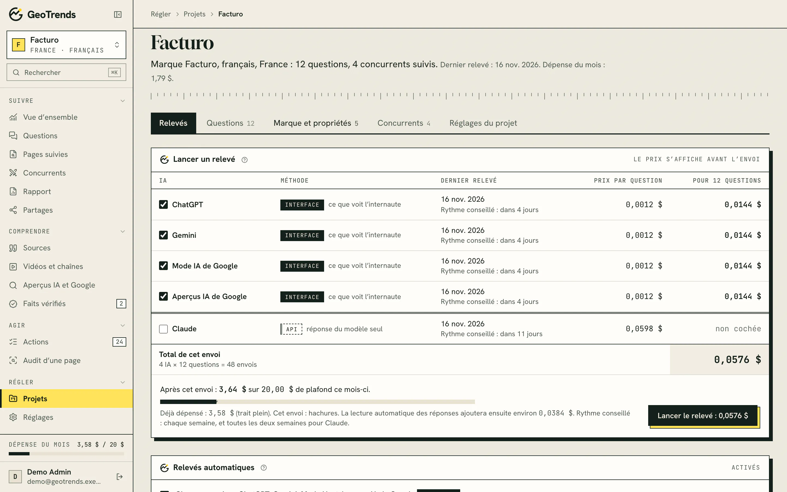
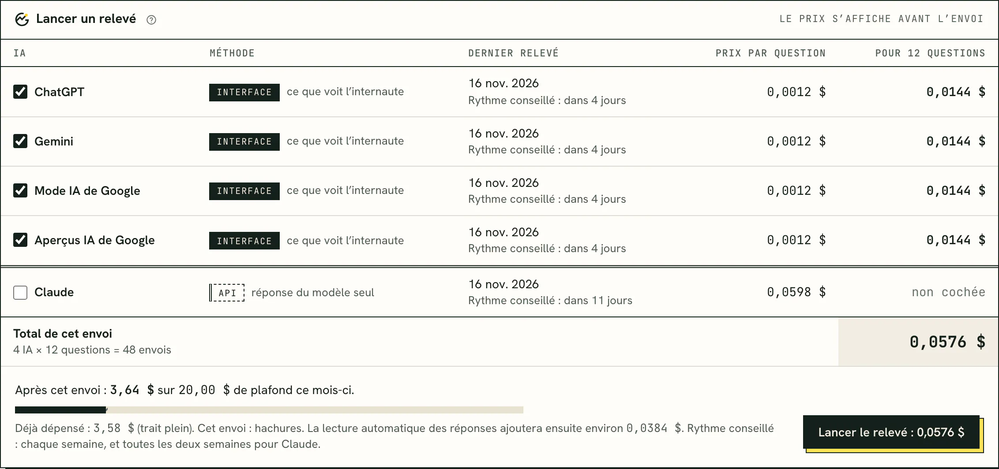

<!-- Page générée depuis la documentation du site (src/site/docs) par scripts/exporter-docs.ts : ne pas la modifier ici. -->

# Lancer un relevé

> Un relevé pose les questions du projet aux IA cochées. Le prix de chaque IA s’affiche avant l’envoi, le plafond du mois est vérifié : rien ne part sans votre clic.

[← Sommaire de la documentation](../README.md) · [Read this page in English](../../en/project/start-a-run.md)

Un relevé est l’envoi de toutes les questions actives du projet aux IA que vous choisissez. Chaque couple question et IA donne un relevé : une réponse, avec ses sources, gardée en base. C’est la seule étape payante de la mesure. L’écran sert à décider d’un envoi en voyant son prix, IA par IA, avant de payer.

Pour y aller : l’onglet **Relevés** de la fiche du projet, celui qui s’ouvre par défaut. Le bouton **Lancer un relevé** de la barre du haut, sur les écrans de mesure, y mène, comme les boutons **Préparer un relevé** des écrans vides. Pour quelques questions seulement, cochez-les sur l’écran Questions ; pour poser une question plusieurs fois, voir [Mesure approfondie](../mesurer/mesure-approfondie.md).

*L’onglet Relevés du projet Facturo : une ligne par IA avec sa méthode et son prix, le total de l’envoi, puis la dépense du mois après l’envoi.*

## Le tableau des prix

Une ligne par IA, avec une case à cocher. Les quatre IA relevées par l’interface sont cochées d’office ; Claude, interrogé par son API et bien plus cher, ne l’est pas. Le total se recalcule à chaque case cochée.

| Colonne | Ce qu’elle dit |
| --- | --- |
| **IA** | ChatGPT, Gemini, Mode IA de Google, Aperçus IA de Google, puis Claude, séparé par un filet. |
| **Méthode** | « interface », ce que voit l’internaute, ou « API », la réponse du modèle seul. |
| **Dernier relevé** | La date du dernier envoi à cette IA, ou « jamais relevée ». Si le dernier envoi date de moins de 7 jours (14 pour Claude), une ligne rouge donne le rythme conseillé : « dans 3 jours », par exemple. |
| **Prix par question** | 0,0012 $ pour une IA d’interface, le prix renvoyé par le fournisseur. Pour Claude, la moyenne de ce qu’ont réellement coûté ses 30 derniers relevés ; avant le premier, une estimation de 0,06 $. |
| **Pour n questions** | Le prix pour toutes les questions du projet, ou « non cochée ». |
| **Total de cet envoi** | Le nombre d’IA × le nombre de questions = le nombre d’envois, et leur prix. |

Sous le tableau, une phrase et une jauge disent ce que deviendra la dépense du mois : ce qui est déjà dépensé en trait plein, cet envoi en hachures, sur le plafond du mois. La même ligne estime ce qu’ajoutera la lecture automatique des réponses, environ 0,0008 $ par réponse. Si l’envoi doit dépasser le plafond, l’écran l’écrit en rouge.

*Le tableau des prix avant l’envoi : une ligne par IA, sa méthode, son prix par question et le total, puis la dépense du mois après l’envoi.*

## Envoyer

Le bouton porte le prix : **Lancer le relevé : 0,0480 $**, par exemple. Au-dessus du seuil de confirmation (1 $ par défaut, réglable dans Réglages), une fenêtre demande de confirmer, avec le nombre d’envois et les IA concernées : **Confirmer l’envoi**. Chaque envoi est inscrit au journal des coûts, avec le prix renvoyé par le fournisseur, qu’il réussisse ou non.

> [!NOTE]
> **Le plafond du mois**
>
> Si la dépense du mois a déjà atteint le plafond (20 $ par défaut, réglé par un administrateur dans Administration › Coûts), rien ne part et un bandeau le dit. Un envoi qui ferait seulement dépasser le plafond part quand même, après l’avertissement en rouge : c’est à vous de décocher une IA si vous ne voulez pas le dépasser.

## Le retour des réponses

Après l’envoi, l’onglet affiche « Relevé envoyé. », le nombre de réponses revenues sur le nombre d’envois et une barre d’avancement. Les IA d’interface répondent en quelques minutes, 45 au plus ; Claude répond en une à deux minutes par lot, et ses réponses s’ajoutent ensuite. Tant que des réponses sont attendues, l’écran se met à jour tout seul pendant dix minutes. Au-delà, le bouton **Récupérer les réponses** va les lire, gratuitement, et la tâche de fond du serveur le fait de toute façon toutes les demi-heures.

| État d’un relevé | Ce qu’il veut dire | Dans les chiffres |
| --- | --- | --- |
| **Réponse revenue** | La réponse est là, avec ses sources. | Compte, que la marque y soit ou non. |
| **Sans réponse d’IA** | L’IA n’a rien affiché. Pour les Aperçus IA : Google n’a pas montré d’aperçu sur cette question. | Écarté : ce n’est pas une absence de la marque. |
| **En attente** | La question est partie, la réponse n’est pas encore revenue. | Pas encore. |
| **En échec** | Le fournisseur n’a pas pu relever la réponse, ou elle n’est jamais arrivée après six heures d’attente. | Ne compte pas. La question est posée de nouveau au relevé suivant. |

## Le journal des envois

En bas de l’onglet, **Journal des envois** garde une ligne par jour et par IA : la **Date**, l’**IA** (un clic ouvre ses réponses), la **Méthode**, le nombre de **Questions**, puis les **Réponses revenues**, **Sans réponse d’IA**, **En attente** et **En échec**, et le **Coût**. Quand une question a été posée plusieurs fois le même jour, la colonne Questions le précise (« 30 envois »). En tête du bloc : le nombre total d’envois du projet et leur prix.

## Le premier relevé de Facturo

1. **Ouvrir l’onglet Relevés.** Depuis la fiche du projet, ou par **Lancer un relevé** dans la barre du haut.

2. **Choisir les IA.** Gardez les quatre IA d’interface. Cochez Claude si vous voulez aussi la réponse du modèle seul : son prix s’ajoute au total.

3. **Lire le total et la jauge.** Pour dix questions et quatre IA d’interface : 40 envois à 0,0012 $, soit 0,0480 $, plus environ 0,0320 $ de lecture automatique.

4. **Lancer.** Cliquez sur le bouton qui porte le prix. Confirmez si la fenêtre s’ouvre.

5. **Attendre le retour.** Restez sur l’onglet ou revenez plus tard : la barre d’avancement se remplit. Quand tout est revenu, **Voir les réponses** ouvre l’écran Questions.

## Limites

> [!WARNING]
> Un relevé donne une réponse par question et par IA : un échantillon, pas une vérité. La même question donne des réponses différentes d’un jour à l’autre, d’où l’intérêt de relever chaque semaine. Le prix de Claude est une moyenne : un relevé précis peut coûter un peu plus ou un peu moins, et le journal des coûts garde le prix réel. Un relevé lancé ne s’annule pas.

**Voir aussi**

- [Relevés automatiques](./releves-automatiques.md)
- [Ce que coûte un relevé](../demarrer/couts.md)
- [Le tableau des coûts](../piloter/couts.md)
- [Comment suivre une marque sans dépasser son budget ?](../cas-usage/budget-de-suivi.md)

---

Mise à jour : 2026-11-18 · [Lire cette page sur le site](https://geotrends.io/documentation/projet/lancer-un-releve)
