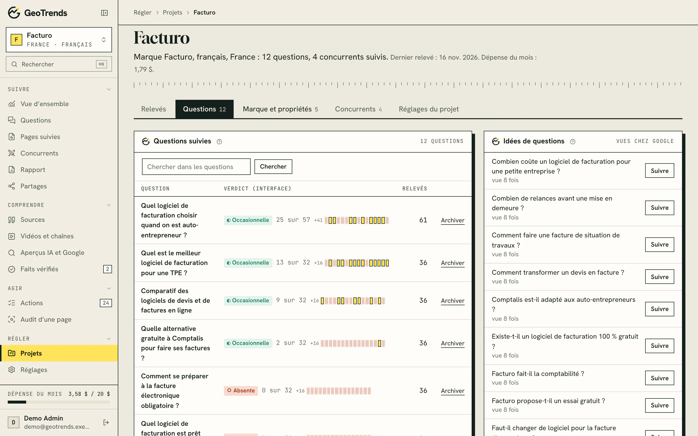

<!-- Page générée depuis la documentation du site (src/site/docs) par scripts/exporter-docs.ts : ne pas la modifier ici. -->

# Écrire les questions à suivre

> Les questions sont ce que vos clients demandent aux IA, et tout ce que mesure l’outil en dépend. Comment les écrire, les ajouter, les archiver, trouver des idées.

[← Sommaire de la documentation](../README.md) · [Read this page in English](../../en/project/prompts.md)

Une question est ce qu’un client potentiel demande à une IA, avec ses mots. Chaque relevé pose toutes les questions du projet à chaque IA choisie : ce sont elles qui décident de ce que vous mesurez, et de ce que coûte un relevé. Mieux vaut dix questions bien choisies que cinquante écrites à la hâte.

Pour y aller : l’onglet **Questions** de la fiche du projet. Le bouton **Ajouter des questions** de l’écran Questions et le bouton **Écrire mes questions** des écrans vides y mènent aussi. Une question se suit encore depuis l’écran Aperçus IA et Google, avec **Ajouter au projet**.

*L’onglet Questions du projet Facturo : les questions suivies avec leur verdict, le champ d’ajout, et les idées vues chez Google.*

## Écrire de bonnes questions

- **Comme un client la poserait**, en phrase complète, dans la langue du projet : « Quel logiciel de facturation choisir pour un auto-entrepreneur ? » plutôt que « logiciel facturation auto-entrepreneur ».
- **Surtout sans le nom de la marque.** Ces questions-là disent si l’IA pense à Facturo quand on ne lui parle pas de Facturo : ce sont elles qui amènent de nouveaux clients.
- **Quelques-unes avec le nom**, pour savoir ce que l’IA dit de la marque : « Facturo convient-il à une TPE ? ». L’outil les repère tout seul, dès que le texte contient le nom de la marque.
- **Une idée par question.** Deux sujets dans la même phrase donnent une réponse qui ne mesure ni l’un ni l’autre.
- **Les trois intentions** : s’informer (« comment faire une facture conforme ? »), comparer (« Comptalis ou Devizo pour un freelance ? »), acheter (« logiciel de facturation pas cher avec relances automatiques »).
- **Des questions stables.** Une question reformulée est une nouvelle question : sa courbe repart de zéro.

| Question | Ce qu’elle mesure |
| --- | --- |
| « Quel logiciel de facturation choisir pour un indépendant ? » | Sans le nom de la marque, intention comparer : l’IA pense-t-elle à Facturo, et qui cite-t-elle à sa place ? |
| « Comment relancer un client qui ne paie pas ? » | Sans le nom, intention s’informer : vos pages d’aide servent-elles de source ? |
| « Facturo est-il gratuit ? » | Avec le nom : ce que l’IA affirme sur la marque, à comparer aux faits vérifiés. |

## Les questions suivies

Le bloc **Questions suivies** liste les questions du projet. Pour chacune : son texte (un clic ouvre sa page), son **Verdict (interface)** avec le compte des réponses où la marque apparaît et un trait par relevé, puis le nombre de **Relevés**. Au-delà de six questions, un champ permet de chercher dans la liste.

Le verdict suit la règle de l’écran Questions : « solide » à partir de 6 réponses d’interface sur 10, « occasionnelle » en dessous, « absente » à zéro, « trop tôt pour dire » avec moins de 3 réponses. Voir [L’écran Questions](../mesurer/questions.md).

## Ajouter, retirer, archiver

- **Ajouter** : une question par ligne dans **Ajouter des questions**. Le bouton dit combien seront ajoutées, et la ligne voisine ce que chaque relevé d’interface coûtera de plus (4 IA × 0,0012 $ par question). Ajouter ne coûte rien : la dépense commence au prochain relevé. Une question déjà présente n’est pas ajoutée deux fois.
- **Retirer** : une question jamais relevée se retire tout simplement, elle n’a pas d’historique.
- **Archiver** : une question déjà relevée ne se modifie plus et ne s’efface pas. Archivée, elle n’est plus relevée et ne compte plus dans les chiffres ; son historique reste. Une fenêtre demande de confirmer.
- **Reprendre** : le bloc **Questions archivées** liste les questions archivées, avec un bouton pour les remettre dans le suivi.

> [!NOTE]
> **Étiquettes des nouvelles questions**
>
> Si l’étiquetage automatique est en place sur l’écran Questions, une question ajoutée reçoit toute seule un thème et une intention, pour environ 0,00008 $. La ligne sous le champ d’ajout le rappelle. Cela se coupe sur l’écran Questions. Voir [Thèmes et carte des thèmes](../comprendre/themes.md).

## Les idées de questions

Le bloc **Idées de questions** (vues chez Google) reprend les « autres questions posées » que Google affiche sous vos questions, relevées avec les Aperçus IA. Ce sont de vraies questions d’internautes. Chaque idée dit combien de fois elle a été vue ; **Suivre** l’ajoute au projet, gratuitement, et chaque relevé d’interface coûtera ensuite 0,0048 $ de plus. Les questions déjà suivies ne sont pas reproposées. **Toutes les idées, et les recherches des IA** ouvre la liste complète sur l’écran Aperçus IA et Google, avec les recherches que ChatGPT et Claude lancent avant de répondre.

## Constituer la liste de Facturo

1. **Écrire dix questions.** Sept sans le nom de la marque, trois avec. Partez des questions que les clients posent au support ou en rendez-vous.

2. **Les ajouter.** Collez-les dans **Ajouter des questions**, une par ligne, puis cliquez sur **Ajouter 10 questions**.

3. **Lancer un premier relevé.** Onglet **Relevés** : le prix s’affiche avant l’envoi. Voir [Lancer un relevé](./lancer-un-releve.md).

4. **Compléter avec les idées.** Après le relevé, lisez **Idées de questions** et suivez celles qui ressemblent à vos clients.

5. **Archiver ce qui ne sert pas.** Une question qui ne dit rien d’utile au bout de quelques relevés s’archive : elle coûte à chaque relevé.

## Limites

> [!WARNING]
> L’outil ne dit pas combien de personnes posent une question : aucune IA ne publie ce qu’on lui demande. Le texte d’une question ne se corrige pas une fois relevé : on archive et on en écrit une autre. « Avec ou sans le nom de la marque » se déduit du seul texte de la question, par une recherche du nom. Les idées de Google n’apparaissent qu’après un relevé des Aperçus IA.

**Voir aussi**

- [Suis-je en train de suivre les bonnes questions ?](../cas-usage/suivre-les-bonnes-questions.md)
- [Avec ou sans nom de marque : comment répartir mes questions ?](../cas-usage/questions-avec-ou-sans-marque.md)
- [L’écran Questions](../mesurer/questions.md)
- [Aperçus IA et résultats de Google](../comprendre/google.md)

---

Mise à jour : 2026-11-18 · [Lire cette page sur le site](https://geotrends.io/documentation/projet/questions)
