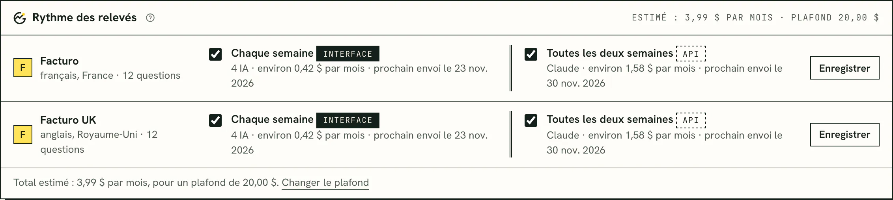

<!-- Page générée depuis la documentation du site (src/site/docs) par scripts/exporter-docs.ts : ne pas la modifier ici. -->

# Relevés automatiques

> Chaque semaine pour ChatGPT, Gemini et Google, toutes les deux semaines pour Claude : les relevés partent seuls et s’arrêtent si le plafond du mois est atteint.

[← Sommaire de la documentation](../README.md) · [Read this page in English](../../en/project/scheduled-runs.md)

Une réponse d’IA est un échantillon : c’est la répétition, semaine après semaine, qui fait une tendance. Les relevés automatiques donnent des séries régulières sans que personne n’ait à y penser. Le rythme est fixé : chaque semaine pour les quatre IA relevées par l’interface, toutes les deux semaines pour Claude, plus cher à interroger. Rien n’est activé par défaut : vous décidez, projet par projet.

Pour y aller : le bloc **Relevés automatiques** de l’onglet Relevés, sur la fiche du projet. Le bloc **Rythme des relevés** de l’écran Réglages règle les mêmes cases pour tous les projets à la fois.

## Les deux cases

| Case | Ce qui part | Estimation affichée |
| --- | --- | --- |
| **Chaque semaine : ChatGPT, Gemini, Mode IA et Aperçus IA de Google** | Toutes les questions actives du projet, aux quatre IA d’interface, sept jours après l’envoi automatique précédent. | Questions × 4 IA × (0,0012 $ de relevé + 0,0008 $ de lecture) × 4,33 semaines. Pour 10 questions : environ 0,35 $ par mois. |
| **Toutes les deux semaines : Claude** | Toutes les questions actives, à Claude par son API, quatorze jours après l’envoi précédent. | Questions × (prix moyen d’une question à Claude + lecture) × 2,17. Pour 10 questions, avec l’estimation de 0,06 $ : environ 1,32 $ par mois. |

Cochez, puis **Enregistrer**. Le bloc affiche « activés » ou « aucun pour l’instant », et sous chaque case la date du dernier envoi automatique. Le premier part dans la demi-heure qui suit l’activation.

*L’écran Réglages : le bloc Rythme des relevés réunit les relevés automatiques de tous les projets, avec l’estimation du mois face au plafond.*

## Tous les projets dans Réglages

Dans **Rythme des relevés**, une ligne par projet : son marché, son nombre de questions, puis les cases **Chaque semaine** (4 IA, interface) et **Toutes les deux semaines** (Claude, API), chacune avec son estimation par mois et, si elle est cochée, la date du prochain envoi (« dans la demi-heure », ou une date). En tête du bloc, le total estimé de tous les projets face au plafond du mois ; un administrateur peut **Changer le plafond** d’un clic.

## Ce que fait le serveur toutes les demi-heures

1. **Lire les réponses prêtes** des relevés en attente. Gratuit.
2. **Lancer les relevés dus** : ceux des projets dont la case est cochée et dont le dernier envoi automatique date de sept jours (quatorze pour Claude).
3. **Lire les réponses récentes** avec le petit modèle : marques nommées, rang, ton. Environ 0,0008 $ par réponse. Seules les réponses de moins de trois jours sont lues ainsi ; les plus anciennes se lisent à la demande, avec le bouton **Lire les réponses** de la vue d’ensemble.
4. **Classer les nouveaux sites cités**, pour les projets où le classement a été lancé une première fois à la main sur l’écran Sources.
5. **Envoyer le rapport du lundi** aux projets qui l’ont demandé, gratuitement. Cet envoi ne peut pas être activé tant que la clé du service d’envoi (Resend) n’est pas installée : aujourd’hui, aucun e-mail ne part.

> [!NOTE]
> **Le plafond arrête tout ce qui est payant**
>
> Avant chaque étape payante, la tâche vérifie la dépense du mois. Si le plafond est atteint, les relevés automatiques, la lecture et le classement sont suspendus, et reprennent seuls au mois suivant, ou dès que le plafond est relevé. La lecture des réponses prêtes, gratuite, continue.

## Mettre Facturo en relevé automatique

1. **Faire un premier relevé à la main.** Il permet de vérifier les questions et les propriétés avant de payer chaque semaine. Voir [Lancer un relevé](./lancer-un-releve.md).

2. **Cocher la case hebdomadaire.** Dans **Relevés automatiques**, cochez **Chaque semaine** et lisez l’estimation par mois.

3. **Décider pour Claude.** Cochez **Toutes les deux semaines : Claude** si la réponse du modèle seul vous sert. C’est l’essentiel de la dépense.

4. **Enregistrer et vérifier dans Réglages.** Le bloc **Rythme des relevés** montre le prochain envoi et le total de tous les projets face au plafond.

## Limites

> [!WARNING]
> Le rythme n’est pas réglable : sept et quatorze jours, avec une heure de marge pour que l’envoi ne glisse pas d’une semaine à l’autre. Un relevé lancé à la main ne décale pas le relevé automatique : la même semaine peut en compter deux. L’estimation par mois suppose le même nombre de questions toute la période. Archiver le projet arrête ses relevés automatiques.

**Voir aussi**

- [Lancer un relevé](./lancer-un-releve.md)
- [Réglages](../piloter/reglages.md)
- [Le tableau des coûts](../piloter/couts.md)
- [Un chiffre a bougé : vraie évolution ou bruit ?](../cas-usage/evolution-ou-bruit.md)

---

Mise à jour : 2026-11-18 · [Lire cette page sur le site](https://geotrends.io/documentation/projet/releves-automatiques)
