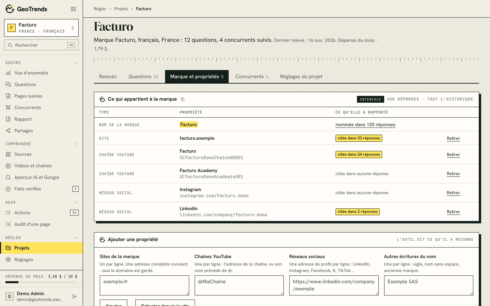

<!-- Page générée depuis la documentation du site (src/site/docs) par scripts/exporter-docs.ts : ne pas la modifier ici. -->

# Sites, chaînes YouTube et réseaux sociaux

> Déclarer ce qui appartient à la marque : sites, chaînes YouTube, profils sociaux, autres écritures du nom. Une citation de l’un d’eux compte alors pour elle.

[← Sommaire de la documentation](../README.md) · [Read this page in English](../../en/project/sites-channels-profiles.md)

Une marque ne se limite pas à son site. Quand une IA cite une vidéo de la chaîne Facturo Academy, ou la page LinkedIn de Facturo, c’est une citation de la marque. Encore faut-il que l’outil sache que cette chaîne et ce profil sont les siens : sinon la vidéo compte pour youtube.com, donc pour quelqu’un d’autre. Cet onglet sert à le lui dire.

Pour y aller : l’onglet **Marque et propriétés** de la fiche du projet, ou le lien du même nom sur la carte du projet, dans l’écran Projets. Les boutons **Déclarer une chaîne** et **Gérer les chaînes** de l’écran Vidéos et chaînes y mènent aussi. Les mêmes champs existent à la création du projet.

*La fiche du projet Facturo, avec ses onglets : Relevés, Questions, Marque et propriétés, Concurrents, Réglages du projet.*

## Ce qui appartient à la marque

Le tableau liste tout ce qui est déclaré, avec ce que chaque propriété a rapporté sur tout l’historique des relevés d’interface. La première ligne est toujours le **Nom de la marque**, avec le nombre de réponses qui le nomment.

| Type | Ce qu’il faut saisir | Ce qui compte pour la marque |
| --- | --- | --- |
| **Site** | Un domaine par ligne. Une adresse complète convient : seul le domaine est gardé (« https://www.facturo.exemple/tarifs » devient facturo.exemple). | Toute page du domaine et de ses sous-domaines (blog.facturo.exemple) citée comme source. |
| **Chaîne YouTube** | L’adresse de la chaîne, ou son nom précédé de @ (« @FacturoAcademy »). L’outil la retrouve sur YouTube et garde son vrai nom. | Toute vidéo publiée par la chaîne et citée comme source. Chaque vidéo citée est rattachée à sa chaîne par l’API publique de YouTube, gratuite. |
| **Réseau social** | L’adresse du profil : LinkedIn (page d’entreprise ou profil), Instagram, Facebook, X, TikTok, Pinterest, Threads, Bluesky ou GitHub. | Le profil et les pages placées sous son adresse. Ils comptent comme une page du site, dans la colonne **Site cité**. |
| **Écriture du nom** | Un sigle, le nom sans espace, une ancienne marque. Une par ligne. | Le texte des réponses, comme le nom de la marque. |

La colonne **Ce qu’elle a rapporté** dit, pour un site, une chaîne ou un profil, dans combien de réponses il est cité ; pour une écriture du nom, dans combien de réponses elle est écrite. Une propriété qui n’a rien rapporté le dit aussi : « citée dans aucune réponse ». Sans rien de déclaré, l’onglet le rappelle : seule la mention du nom est repérée.

> [!NOTE]
> **Tout se recalcule, y compris le passé**
>
> Les chiffres sont tirés des réponses gardées en base. Une propriété ajoutée compte aussitôt pour tous les relevés déjà faits, et une propriété retirée cesse de compter partout, historique compris : la fenêtre de confirmation de **Retirer** le dit. Rien n’est repayé.

## Ajouter une propriété

Le bloc **Ajouter une propriété** a quatre champs : **Sites de la marque**, **Chaînes YouTube**, **Réseaux sociaux** et **Autres écritures du nom**, une saisie par ligne. Après **Ajouter**, l’outil dit ce qu’il a compris : **Reconnu et ajouté**, avec le domaine nettoyé et le vrai nom de chaque chaîne ; **Déjà déclaré, écarté** ; **Non reconnu**, avec la saisie à vérifier. Un bouton de partage ou l’adresse d’une publication n’est pas pris pour un profil.

### Détecter depuis le site

Le bouton **Détecter depuis le site** lit la page d’accueil des sites saisis, ou des sites déjà déclarés si le champ est vide. Il y cherche les liens vers des profils sociaux et vers des chaînes YouTube, ainsi que le balisage « sameAs », la liste officielle des profils d’un site, dont les profils passent en tête. Ce qui est trouvé s’ajoute aux champs, sans être enregistré : vous relisez, vous retirez ce qui ne va pas, puis vous cliquez sur **Ajouter**. Ce qui est déjà déclaré n’est pas reproposé. La lecture est gratuite.

> [!TIP]
> **Relire avant d’ajouter**
>
> Une page d’accueil contient souvent des comptes personnels à côté de ceux de la marque : le profil X du fondateur, la page LinkedIn d’un salarié. Déclarés, ils compteraient comme des citations de la marque. Ne gardez que les comptes de Facturo.

## Comment la marque est reconnue dans une réponse

- **Citée** : une page d’un site déclaré, une page sous un profil déclaré ou une vidéo d’une chaîne déclarée figure parmi les sources citées.
- **Nommée** : le nom de la marque, une de ses autres écritures ou un de ses domaines apparaît dans le texte. Le nom est cherché comme un mot entier, sans tenir compte des majuscules.
- **Lue** : une de ses pages a été ouverte par l’IA sans être citée. Seuls ChatGPT et Claude donnent ces pages lues.

## Déclarer les propriétés de Facturo

1. **Ouvrir l’onglet Marque et propriétés.** Depuis la fiche du projet Facturo.

2. **Saisir les sites.** facturo.exemple, et tout autre domaine de la marque (un site d’aide séparé, par exemple). Un sous-domaine est déjà couvert par son domaine.

3. **Lancer la détection.** **Détecter depuis le site** remplit les champs des chaînes et des réseaux. Gardez la chaîne Facturo, la chaîne Facturo Academy, les profils LinkedIn et Instagram de la marque ; retirez le reste.

4. **Ajouter les autres écritures.** Par exemple « Facturo.app » ou un ancien nom, si les IA l’emploient encore.

5. **Cliquer sur Ajouter et lire le bilan.** Vérifiez la ligne **Non reconnu** : une adresse mal copiée ou une chaîne introuvable s’y retrouve.

## Limites

> [!WARNING]
> La détection ne lit que la page d’accueil, sans exécuter son JavaScript : un lien affiché après coup lui échappe. Une publication dont l’adresse ne contient pas le nom du profil (instagram.com/p/…, linkedin.com/posts/…) n’est pas reconnue comme une page de la marque. La reconnaissance des chaînes et le rattachement des vidéos passent par l’API publique de YouTube : sans sa clé, une chaîne saisie reste « non reconnue » (l’état de la clé se lit dans Réglages). Les pages lues sans être citées ne sont connues que pour ChatGPT et Claude.

**Voir aussi**

- [Vidéos et chaînes](../comprendre/videos.md)
- [Sources citées](../comprendre/sources.md)
- [Ma marque est-elle citée, nommée ou absente ?](../cas-usage/citee-nommee-ou-absente.md)
- [Choisir ses concurrents](./concurrents.md)

---

Mise à jour : 2026-11-18 · [Lire cette page sur le site](https://geotrends.io/documentation/projet/sites-chaines-reseaux)
